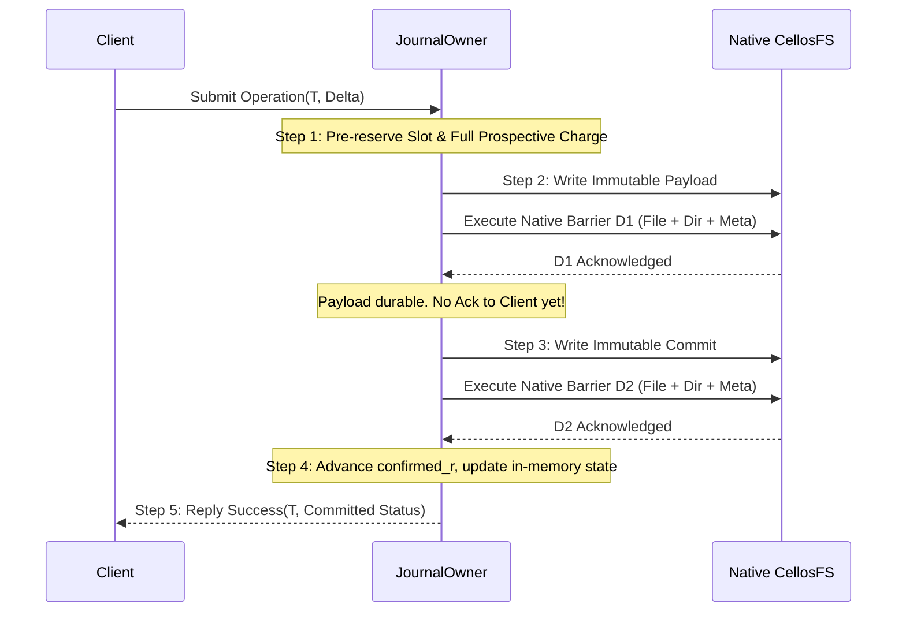

# OGJ1 Codec and Unknown/Lifecycle Protocol Specification

**Status:** Unapproved standalone model/design proposal; G2/OGJ1 lifecycle qualification and G3 admission remain BLOCKED. Corrected model-only [regression execution](../../build/ogj1-corrected-model-verification.json) and [direct smoke](../../build/ogj1-corrected-model-smoke.json) are separate evidence, not authority, native durability, durable charge reconstruction or checkpoint implementation.
**Governing contracts:** [Spec 25 v1.3](../../docs/specs/25-cell-kernel-authority-contract.md), [Spec 26 v1.1](../../docs/specs/26-workload-placement-scaling-contract.md), [G2 persistence candidate](g2-ordinary-persistence-candidate.md#5-bounded-journal-and-filesystem-prerequisites--proposed), [G2-J preservation design](g2-j-preservation-design.md), [Issuer & persistence candidate](issuer-persistence-candidate.md#2-concrete-issuer-roles-and-authority-chain--proposed).  
**Phase and lock posture:** Ten phases remain pending; 38 legacy locks and all 23 downstream CP1/CP2 pairs remain unchanged. No public wire opcode, VFS runtime promotion, kernel authority, KMS root or production key is granted or activated by this document.

---

## 1. Scope and Boundary Definition

This document proposes binary encoding, codec rules, and lifecycle obligations for the Ordinary Generic Journal v1 (`OGJ1`) and the associated `Unknown` prospective-charge protocol. Concrete model bytes are not an approved persistent format. The [independent G3 audit §9](g3-lifecycle-authority-gates.md#9-independent-upstream-audit--2026-10-15) supersedes the earlier author-written approval and identifies unmet prerequisites.

### 1.1 In-Scope for Standalone Review
1. Proposed little-endian binary envelope (112-byte fixed header, domain-separated 32-byte digest trailer); governing reference-digest ambiguity remains blocked for exact-byte approval.
2. Proposed body structures for four record kinds: `Payload` (Kind 1), `Commit` (Kind 2), `Checkpoint` (Kind 3), `Switch` (Kind 4). Checkpoint/Switch codec roundtrip is not implemented checkpoint recovery or retirement.
3. Codec validation invariants: bounds checking, overflow guards, canonical encoding, domain separation, and rejection of non-conforming byte sequences.
4. Finite filesystem layout on CellosFS: bounded slot hierarchy (`/srv/cellos/journal/tx/{0..3}`, `/srv/cellos/journal/cp/{0..1}`) respecting `MAX_NAME_LEN=46` and directory entry constraints.
5. `Unknown` state-machine obligations: prospective-charge reservation, D1 and D2 ordering, retention under ambiguity, no-refund invariant, required durable owner-death handoff, and fail-closed recovery. Durable charge codec/adoption remain unmet prerequisites, not model features.
6. Standalone executable model and historical receipt. The model provides no real issuer, genesis, floor, storage, execution-proof or lifecycle trust evidence.

### 1.2 Explicit Non-Goals / Excluded Scope
- **NO public ABI or wire changes:** No new VFS syscall opcodes, no wire error-code additions, no changes to `libs/api/src/abi/`.
- **NO VFS integration or runtime activation:** `cells/services/vfs/src/**` remains strictly unedited.
- **NO KMS or protected persistence changes:** `StoreIo`, 186-byte KMS records, two-slot storage, CAS, signed time, and TLS relay remain strictly unchanged.
- **NO issuer minting or key generation:** No synthetic cryptographic signers, production pins, or fake Genesis blocks.
- **NO CP1 or CP2 promotion:** This preparation does not satisfy all design-review prerequisites or grant approval. All locks and checkpoint decisions remain unchanged.

---

## 2. OGJ1 Binary Format and Codec Specification

### 2.1 Fixed Header Layout (112 Bytes)

All multi-byte numeric fields are encoded in **little-endian** byte order.

| Offset | Field | Type | Size | Valid Range / Constraints |
|---|---|---|---|---|
| `0x00` | `magic` | `[u8; 4]` | 4 | Verbatim ASCII `b"OGJ1"` (`[0x4F, 0x47, 0x4A, 0x31]`). Any other bytes reject. |
| `0x04` | `version` | `u16` | 2 | Must equal `1` (`0x0001`). All other versions reject as `UnsupportedVersion`. |
| `0x06` | `kind` | `u8` | 1 | `1` = Payload, `2` = Commit, `3` = Checkpoint, `4` = Switch. All other values reject as `UnknownKind`. |
| `0x07` | `reserved` | `u8` | 1 | Must equal `0` (`0x00`). Non-zero values reject as `NonzeroReserved`. |
| `0x08` | `total_encoded_bytes` | `u32` | 4 | Total byte count of the entire record. Must equal `112 + body_bytes + 32`. Rejects on mismatch. |
| `0x0C` | `ledger_id` | `[u8; 32]` | 32 | Admitted 32-byte identifier of the ledger/home instance. Must match admitted configuration. |
| `0x2C` | `transaction_id` | `[u8; 16]` | 16 | Non-reusable identity allocated under the single writer lock from an admitted incarnation/sequence namespace. The model supplies fixtures, not an admitted identity producer. |
| `0x3C` | `revision` | `u64` | 8 | Strictly monotonic 64-bit sequence number ($r \ge 1$). Rejects on zero, regression, or wrap. |
| `0x44` | `enforcement_fence` | `u64` | 8 | Non-regressing 64-bit authority fence. Must satisfy $\text{fence} \ge \text{floor}$. |
| `0x4C` | `prev_commit_digest` | `[u8; 32]` | 32 | Proposed reference convention: trailer digest of the immediately preceding committed record, or an explicitly supplied initialized base digest. All-zero is never implicit genesis. |
| `0x6C` | `body_bytes` | `u32` | 4 | Byte length of the record body immediately following the header. Must match body payload length. |

**Header Invariant:** $\text{Size}(\text{Header}) = 4 + 2 + 1 + 1 + 4 + 32 + 16 + 8 + 8 + 32 + 4 = 112\text{ bytes}$ exactly.

### 2.2 Digest Trailer Layout (32 Bytes)

The record immediately terminates with a 32-byte cryptographic digest trailer:

| Offset | Field | Type | Size | Constraint |
|---|---|---|---|---|
| `112 + body_bytes` | `record_digest` | `[u8; 32]` | 32 | SHA-256 over: Domain Separator + Header (112 B) + Body (`body_bytes` B). |

**Domain Separator Prefix:**  
$$\text{Preimage} = \text{ASCII}(b"\text{cellos/ordinary-journal/v1}\backslash0") \mathbin{\Vert} \text{Header}[0..112] \mathbin{\Vert} \text{Body}[0..\text{body\_bytes}]$$
Where $\text{Domain Separator} = [0x63, 0x65, 0x6c, 0x6c, 0x6f, 0x73, 0x2f, 0x6f, 0x72, 0x64, 0x69, 0x6e, 0x61, 0x72, 0x79, 0x2d, 0x6a, 0x6f, 0x75, 0x72, 0x6e, 0x61, 0x6c, 0x2f, 0x76, 0x31, 0x00]$ (27 bytes).

**Proposed reference clarification, not an approved byte cutover:** The existing model computes the trailer exactly as above, excluding the trailer itself from its preimage. This proposal would use that validated trailer value for `prev_commit_digest` and Commit/Switch `referenced_digest`, with `referenced_len` binding the complete encoded length. This is not `SHA-256(header || body || trailer)`. The governing [G2 candidate §5.1](g2-ordinary-persistence-candidate.md#51-selected-envelope-namespace-and-finite-development-input) instead says “referenced entire-record SHA-256”; that ambiguity remains unresolved for owner/maintainer exact-byte review. Model convention does not amend the upstream candidate or authorize persistent bytes.

A matching digest establishes integrity/chain linkage only. Anyone able to construct a record can recompute it; neither the domain prefix nor the trailer authenticates an issuer, authorizes genesis, proves execution, supplies a floor or prevents rollback. Real operation-specific verified proofs and admitted identity/floor bindings require their actual authoritative producers.

### 2.3 Record Body Formats by Kind

#### Kind 1: Payload (`kind = 1`)
Encodes the immutable proposed state modification, prospective charge debit, or operation arguments.

| Field | Type | Size | Constraints |
|---|---|---|---|
| `schema_id` | `[u8; 32]` | 32 | Unique 32-byte hash identifying the application payload schema. |
| `canonical_len` | `u32` | 4 | Length $N$ of canonical body bytes. Envelope model range is $0 \le N \le 256$; actual semantic schema validity remains an owner gate, so empty envelope content is not an authorized lifecycle operation. |
| `canonical_bytes` | `[u8; N]` | $N$ | Exact deterministic canonical serialization of application state/arguments. |

Total body length: $32 + 4 + N$ bytes.  
Total encoded record length: $112 + 36 + N + 32 = 180 + N$ bytes (maximum 436 bytes for $N = 256$).

#### Kind 2: Commit (`kind = 2`)
Binds a referenced Payload into the proposed linear committed ledger chain. The digest does not establish successful external execution; that requires operation-specific authoritative evidence.

| Field | Type | Size | Constraints |
|---|---|---|---|
| `referenced_slot` | `u32` | 4 | Physical transaction slot index ($0..3$) containing the referenced Payload. |
| `referenced_len` | `u32` | 4 | Total encoded byte length of the referenced Payload record. |
| `referenced_digest` | `[u8; 32]` | 32 | Proposed model convention: exact trailer digest of the referenced Payload; upstream entire-record wording remains blocked for exact-byte approval (§2.2). |

Total body length: $4 + 4 + 32 = 40$ bytes exactly.  
Total encoded record length: $112 + 40 + 32 = 184$ bytes exactly.

#### Kind 3: Checkpoint (`kind = 3`)
Required semantics: bind the complete live state, active obligations, outstanding Unknown transactions, outcomes, closed-key fences and replay-retirement/floor binding at revision $r$. No complete canonical lifecycle snapshot codec or checkpoint recovery/compaction implementation is supplied by the model.

| Field | Type | Size | Constraints |
|---|---|---|---|
| `schema_id` | `[u8; 32]` | 32 | Schema identifier for checkpoint snapshot format. |
| `canonical_len` | `u32` | 4 | Length $M$ of canonical checkpoint bytes. |
| `canonical_bytes` | `[u8; M]` | $M$ | Complete deterministic snapshot of live obligations, charges, and fences. |

Total body length: $32 + 4 + M$ bytes. The experiment envelope codec limit is $0 \le M \le 256$, giving a maximum encoded record of 436 bytes. This limit does **not** prove a complete authoritative snapshot fits in 256 bytes, or that an empty body is a valid snapshot. Without an approved complete schema and independently finite capacity proof, checkpoint/runtime admission remains blocked; obligations must not be omitted to fit the experiment.

#### Kind 4: Switch (`kind = 4`)
Proposed durable switch record referencing a complete Checkpoint as the recovery base. Codec parsing/roundtrip alone does not select a checkpoint, perform compaction or authorize retirement.

| Field | Type | Size | Constraints |
|---|---|---|---|
| `referenced_slot` | `u32` | 4 | Physical checkpoint slot index ($0..1$) containing the referenced Checkpoint. |
| `referenced_len` | `u32` | 4 | Total encoded byte length of the referenced Checkpoint record. |
| `referenced_digest` | `[u8; 32]` | 32 | Proposed model convention: exact trailer digest of the referenced Checkpoint; upstream entire-record wording remains blocked for exact-byte approval (§2.2). |

Total body length: $4 + 4 + 32 = 40$ bytes exactly.  
Total encoded record length: $112 + 40 + 32 = 184$ bytes exactly.

---

## 3. Finite CellosFS Directory and Inode Layout

CellosFS directory payload is 428 bytes with 56-byte entries, hence at most $\lfloor428/56\rfloor = 7$ entries per directory. The indexed inode capacity is $32 \times 8 = 256$; this is **not** eight directory blocks per inode. Long hexadecimal transaction IDs MUST NOT be used as directory filenames (`MAX_NAME_LEN=46`).

### 3.1 Slot Directory Structure

The journal resides exclusively under `/srv/cellos/journal/`:

```
/srv/cellos/journal/
├── tx/
│   ├── 0/
│   │   ├── payload   (Kind 1, ≤ 436 B; extent storage above 428 B)
│   │   └── commit    (Kind 2, 184 B, inline inode storage)
│   ├── 1/
│   ├── 2/
│   └── 3/
└── cp/
    ├── 0/
    │   ├── checkpoint (Kind 3, ≤ 436 B; extent storage above 428 B)
    │   └── switch     (Kind 4, 184 B, inline inode storage)
    └── 1/
```

### 3.2 Inode and Allocation Geometry
- **Directory count:** 9 directories (`journal`, `tx`, `cp`, `tx/0..3`, `cp/0..1`).
- **Record files:** Maximum 12 files (4 payloads, 4 commits, 2 checkpoints, 2 switches).
- **Journal subtree inodes:** $9 + 12 = 21$ inodes, excluding surrounding `/srv/cellos/...` parents and all other volume users.
- **Record storage:** Inline file capacity is 428 bytes. Payload/Checkpoint size is $180 + N$; canonical bytes $N \le 248$ fit inline, while $249..256$ require extent storage because $436 > 428$. Commit/Switch records are 184 bytes and fit inline. Data/metadata extents and scratch/replacement/retained-history capacity require a complete filesystem manifest; inode count alone is no allocation or durability certificate.
- **Slot Invariant:** Each slot is **write-once** per generation. Reopening an existing slot file for modification is rejected as `SlotAlreadyOccupied`.

---

## 4. Unknown State Machine and Lifecycle Protocol

### 4.1 State Definitions

The diagram below is the proposed **real owning-service** lifecycle, not a claim that the model can recover mutation authority. Successful model replay must instead return `RECOVERED_MUTATION_CLOSED`; valid orphan replay returns `UNKNOWN`, and malformed/torn or uninitialized input returns `RECOVERY_FAILED`. Every recovery result retains `mutation_admission=False`, `charge_recovery=UNIMPLEMENTED` and `accounting_recovered=False` while durable charge reconstruction remains unavailable.

```
                     ┌──────────────────┐
                     │    Recovering    │
                     └────────┬─────────┘
                              │ Explicit initialized context & valid chain/floor
                              ▼
    ┌───────────────────────────────────────────────────┐
    │     Writable(confirmed_r, confirmed_digest)       │
    └─────────┬───────────────────────────────▲─────────┘
              │                               │
              │ Any ambiguous failure         │ Qualified authoritative reconciliation
              │ (short write, lost barrier D1/D2)
              ▼                               │
    ┌─────────────────────────────────────────┴─────────┐
    │       Unknown(T, prior_confirmed, charge)         │
    └───────────────────────────────────────────────────┘
```

1. **`Recovering`**: Initial state upon startup or crash recovery. Real recovery must validate admitted volume/ledger identity, unique initialized genesis or complete checkpoint, chain and floor. The standalone model requires an **explicit model-only initialized recovery context** identifying its supplied base and expected bindings. No omitted context, empty directory, zero predecessor, caller-supplied floor integer or valid digest is implicit genesis. The context is a fixture, not authentic admission evidence.
2. **`Writable(r, digest, fence)` — real owning-service target only:** Actual mutation requires qualified charged-history reconstruction and admitted authority/storage/floor inputs in addition to valid initialized-chain replay. The model must not report Writable after recovery: a valid chain or explicitly initialized empty fixture yields `RECOVERED_MUTATION_CLOSED`, not mutation permission.
3. **`Unknown(T, prior_confirmed, reservation)`**: Entered on possible acceptance with uncertain result (network disconnect, short write, unobserved barrier return), or a valid orphan Payload. Conflicting mutations are rejected and full prospective charge remains retained. A process-local dictionary is not durable retention.
4. **`RecoveryFailed`**: Fail-closed state for absent/unverifiable initialized context, missing required initialized records, present corrupt/torn/foreign records, mismatched bindings, fork/gap or fence/floor regression. Mutation remains disabled; recovery never formats or manufactures genesis.

### 4.2 The Double-Barrier Execution Sequence (D1 / D2)

The proposed real owning-service sequence requires an admitted native persistence backend and single mutation lock. The model simulates ordering only; its barriers are not native durability witnesses.



#### Step 1: Prospective Charge Reservation
Before issuing any I/O:
- Verify $r$ and $\text{fence}$.
- Reserve target physical slot index $S$.
- Reserve the **full prospective resource vector**, result/Unknown/tombstone entries, filesystem metadata and scratch capacity before external dispatch. Actual dimensions/units and canonical durable charge ownership must be owner-approved; no complete runtime vector codec is supplied here.
- Record immutable transaction binding and prospective mapping $T \mapsto S$. Process-local model maps do not satisfy durable retention or ownership transfer.

#### Step 2: Payload Write & Barrier D1
- Construct canonical Kind 1 Payload record with `prev_commit_digest`.
- Write Payload file to `/srv/cellos/journal/tx/{S}/payload`.
- Issue **Barrier D1**: Flush file data, parent directory entry, and inode/bitmap allocation metadata.
- *Invariant:* In an admitted backend, observed D1 success establishes payload/namespace/allocation durability under that backend's qualified failure model; D1 alone acknowledges no transaction. A simulated model barrier is not that evidence.

#### Step 3: Commit Write & Barrier D2
- Construct canonical Kind 2 Commit record binding slot $S$, Payload length, and Payload digest.
- Write Commit file to `/srv/cellos/journal/tx/{S}/commit`.
- Issue **Barrier D2**: Flush commit file data, parent directory entry, and allocation metadata.
- *Invariant:* **Observed successful D2 is required before advancing confirmed state or replying success.** A complete durable Commit may physically exist even if the D2 acknowledgement fails or is lost. That uncertainty enters `Unknown(same T)`; authoritative recovery/lookup may later report the already committed result. Observed D2 is an acknowledgement rule, not the definition of physical commit.

#### Step 4: State Advancement
- Update in-memory confirmed state: $\text{confirmed\_revision} \leftarrow r$, $\text{confirmed\_digest} \leftarrow \text{digest}(\text{Commit})$.
- Release temporary writer scratch buffers.

#### Step 5: Acknowledgment
- Reply with same-$T$ committed status only after observed successful D2. A digest/status fixture is **not** a cryptographic execution proof. Any real operation-specific proof requires an admitted authoritative producer and verifier contract, which this model does not supply.

### 4.3 The Inviolable Unknown Invariants

1. **Full Prospective Charge Retained:** After possible acceptance, pre-D1 crash, D1 timeout, pre-D2 crash, D2 failure/unobserved acknowledgement, or post-D2 reply loss require `Unknown(same T)` with full charge/slots retained. No refund or credit follows uncertainty. A definite rejection before proven engine entry may release its provisional reservation; generic ERR_IO or missing reply is not that proof.
2. **Single Transaction Identity Binding:** `Unknown(T)` cannot be re-executed under a fresh $T'$. The caller and qualified recovery owner MUST reconcile the same $T$ and complete immutable binding.
3. **No Speculative Re-issuance:** While `Unknown` is set, conflicting mutations are rejected; successful reconciliation must establish the exact existing result, not repeat the effect.
4. **Owner Death / Lifecycle Handoff — unmet prerequisite:** The existing authoritative ledger/recovery owner must durably recover the same-$T$ obligation or receive an authenticated, fenced, durable transfer before old ownership ends. Until proven, charge remains retained and mutation closed. A supervisor does **not** automatically assume ownership by name, restart or process exit. Canonical charge-vector/ownership codec, transfer acknowledgement, fencing, owner assignments and failure receipts remain blocked and unimplemented; model dictionaries cannot discharge them.

---

## 5. Recovery, Chain Reconstitution & Reconciliation

### 5.1 Reopen Protocol (Non-Formatting)
1. Reopen the admitted existing filesystem without formatting; keep owning-service mutation closed.
2. Require admitted initialized genesis/checkpoint identity and floor/nonregression evidence. Missing state is not fresh initialization. In the model, require explicit model-only initialized recovery context; absent context yields `RecoveryFailed`, including empty storage.
   The model correction contract requires keyword-only `model_initialized_context` with exactly `ledger_id`, `checkpoint_revision`, `checkpoint_digest` and `checkpoint_fence`. These are explicitly supplied fixture-base bindings, not a checkpoint implementation or trust evidence. Transaction slots are integer keys `0..3` with only optional `payload`/`commit` records; unsupported checkpoint/runtime input must not be accepted as implemented recovery.
3. Validate every present retained record before replay: exact kind/slot, canonical length/digest, ledger, same transaction/revision/fence/predecessor and reference binding. Never silently omit a malformed Payload.
4. Real checkpoint selection must validate the durable Switch and complete Checkpoint plus retained obligations. The model does not implement that selection, charged-history reconstruction, compaction or retirement. Filesystem superblock choice and boot-local numbers are not admitted floors.

### 5.2 Chain Reconstitution Rules
- **Valid Successor Commit:** Require admitted/model-context ledger/base, exact slot/kinds, same Payload/Commit transaction, revision, fence and predecessor; exact referenced length/digest; contiguous revision $r+1$ without wrap; and nonregressing fence across the chain as well as floor validation.
  $\implies$ Advance confirmed revision/digest and report the existing same-$T$ committed result, including when its earlier D2 acknowledgement/reply was lost. This does not authorize another execution or refund.
- **Valid Orphan Payload:** A fully validated Payload exists with no Commit record present.
  $\implies$ Retain it under `Unknown(T)` without deletion/refund. Authoritative effect/charge reconciliation remains required; absence of Commit alone does not prove no external effect.
- **Present Torn/Corrupt Record:** Any retained Payload/Commit/Checkpoint/Switch has a corrupt or truncated header/body/trailer, digest mismatch, wrong kind/ledger/slot or incompatible binding.
  $\implies$ `RecoveryFailed`, with scope mutation-closed and obligations retained. Never treat a corrupt present Commit as absent, downgrade it to a valid orphan, skip a corrupt Payload or select an older plausible balance.
- **Missing Initialized State / Revision Gap / Fork:** Required base/history is absent, two distinct commits claim one revision, or replay skips a revision.
  $\implies$ `RecoveryFailed`; no default genesis or implicit reset.
- **Fence/Floor Regression:** Any record is below the required floor or regresses from its validated predecessor.
  $\implies$ `RecoveryFailed`. A model context/floor integer is not protected nonregression evidence.

### 5.3 Checkpoint and Retirement Gate
Real checkpoint switching must preserve every live/reserved/Unknown/outcome/closed-key obligation and prior acknowledged root: write a complete fresh Checkpoint, D1, fresh Switch, D2; preserve the old recoverable chain until the new base is durable and replay-safe retirement is authoritatively fenced. Without complete schema/capacity/floor/retirement qualification, refuse admission rather than truncate obligations, evict Unknown, reuse slots or assume 256 snapshot bytes suffice. These are unmet runtime prerequisites, not implemented model behavior.

---

## 6. EARS Acceptance Criteria

These are proposed requirements, not discharged acceptance gates or independent approval. Model-only checks cannot establish the actual durable lifecycle, issuer, backend or floor obligations.

| ID | EARS Criterion |
|---|---|
| **OGJ-01** | WHEN an encoded record is deserialized, the codec SHALL verify magic `OGJ1`, version `1`, reserved `0`, total length equality, and domain-separated SHA-256 trailer, rejecting any non-conforming record before exposing body fields. |
| **OGJ-02** | WHEN a Payload or Checkpoint is encoded, the codec SHALL reject canonical bodies exceeding 256 bytes (in development model) or with inconsistent length declarations. |
| **OGJ-03** | WHEN a Commit or Switch is encoded, the codec SHALL enforce exactly 40 bytes body length containing 4-byte slot, 4-byte referenced length, and 32-byte referenced digest. |
| **OGJ-04** | WHEN a transaction is submitted, the journal owner SHALL reserve the slot and the full prospective charge before issuing native barrier D1 for the Payload. |
| **OGJ-05** | WHEN barrier D1 succeeds but barrier D2 fails or is unobserved, the journal SHALL transition to `Unknown(same T)` and retain the full prospective charge without refund. |
| **OGJ-06** | WHEN an operation is in `Unknown` state, the journal SHALL reject conflicting mutations until qualified authoritative same-identity reconciliation occurs. |
| **OGJ-07** | WHEN recovery executes, it SHALL require explicit initialized context and validate complete bindings, nonregressing fences and the contiguous Commit chain before reporting existing committed results; absent context SHALL fail closed without genesis. |
| **OGJ-08** | WHEN recovery encounters a valid Payload with no Commit record present, it SHALL retain that valid orphan and its prospective charge under `Unknown`; corrupt present records SHALL NOT be treated as orphans. |
| **OGJ-09** | WHEN recovery encounters any present torn/corrupt/foreign record, missing required initialized state, revision gap, conflicting fork, binding mismatch or fence/floor regression, it SHALL enter `RecoveryFailed` with mutation closed. |
| **OGJ-10** | WHEN a slot has received an immutable record in the active generation, the filesystem layout SHALL refuse any overwrite or re-creation in that slot. |
| **OGJ-11** | WHEN D2 acknowledgement is lost after possible acceptance, the journal SHALL retain `Unknown(same T)` without assuming physical noncommit; only observed successful D2 SHALL permit the original success reply. |
| **OGJ-12** | WHEN an owner exits with pending/Unknown obligations, the authoritative owner SHALL recover them or complete authenticated durable fenced transfer before ownership ends; process-local retention or automatic supervisor assumption SHALL NOT suffice. |
| **OGJ-13** | WHEN a checkpoint is proposed, its approved complete schema and capacity SHALL preserve all live/reserved/Unknown/outcome/closed-key obligations and the prior acknowledged recovery root until durable switch and authoritative replay-safe retirement; the 256-byte codec cap SHALL NOT establish snapshot completeness. |
