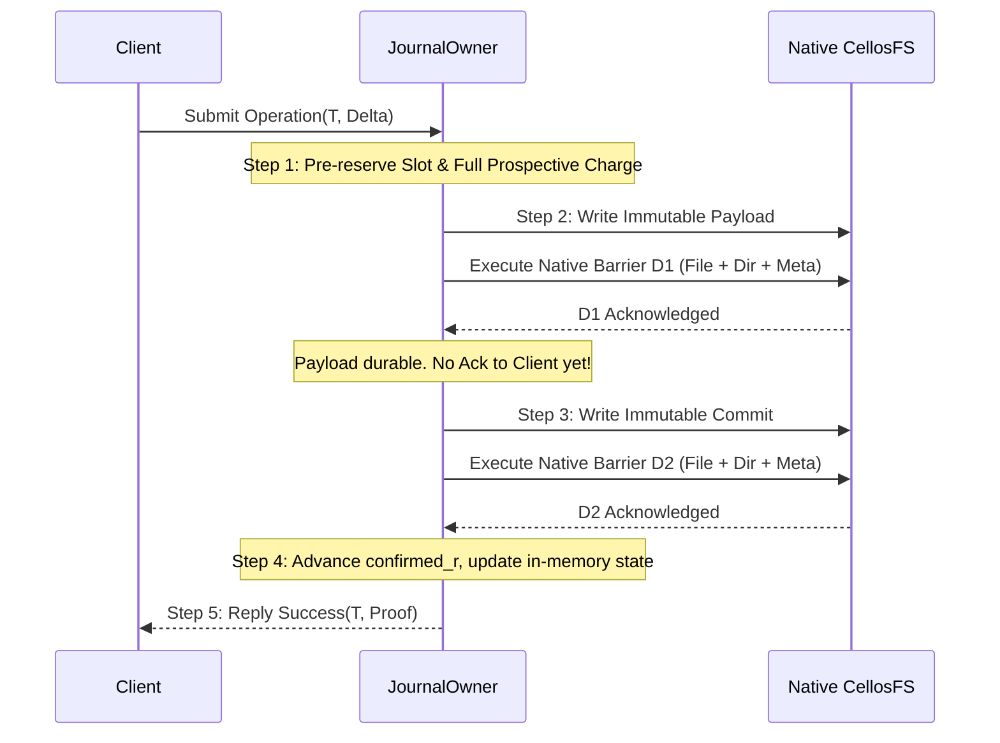

# OGJ1 Codec and Unknown/Lifecycle Protocol Specification

**Status:** Unapproved standalone design proposal for review.  
**Governing contracts:** [Spec 25 v1.3](../../docs/specs/25-cell-kernel-authority-contract.md), [Spec 26 v1.1](../../docs/specs/26-workload-placement-scaling-contract.md), [G2 persistence candidate](g2-ordinary-persistence-candidate.md#5-bounded-journal-and-filesystem-prerequisites--proposed), [G2-J preservation design](g2-j-preservation-design.md), [Issuer & persistence candidate](issuer-persistence-candidate.md#2-concrete-issuer-roles-and-authority-chain--proposed).  
**Phase and lock posture:** Ten phases remain pending; 38 legacy locks and all 23 downstream CP1/CP2 pairs remain unchanged. No public wire opcode, VFS runtime promotion, kernel authority, KMS root or production key is granted or activated by this document.

---

## 1. Scope and Boundary Definition

This document specifies the exact binary encoding, codec rules, and lifecycle state-machine invariants for the Ordinary Generic Journal v1 (`OGJ1`) and the associated `Unknown` prospective-charge lifecycle protocol.

### 1.1 In-Scope for Standalone Review
1. Exact little-endian binary envelope (112-byte fixed header, domain-separated 32-byte digest trailer).
2. Exact body structures for all four record kinds: `Payload` (Kind 1), `Commit` (Kind 2), `Checkpoint` (Kind 3), `Switch` (Kind 4).
3. Codec validation invariants: bounds checking, overflow guards, canonical encoding, domain separation, and rejection of non-conforming byte sequences.
4. Finite filesystem layout on CellosFS: bounded slot hierarchy (`/srv/cellos/journal/tx/{0..3}`, `/srv/cellos/journal/cp/{0..1}`) respecting `MAX_NAME_LEN=46` and directory entry constraints.
5. `Unknown` state machine and lifecycle protocol: prospective-charge reservation, D1 and D2 barriers, retention under ambiguity, no-refund invariant, owner-death handoff, and fail-closed recovery.
6. Standalone executable verification harness exercising codec edge cases and negative controls.

### 1.2 Explicit Non-Goals / Excluded Scope
- **NO public ABI or wire changes:** No new VFS syscall opcodes, no wire error-code additions, no changes to `libs/api/src/abi/`.
- **NO VFS integration or runtime activation:** `cells/services/vfs/src/**` remains strictly unedited.
- **NO KMS or protected persistence changes:** `StoreIo`, 186-byte KMS records, two-slot storage, CAS, signed time, and TLS relay remain strictly unchanged.
- **NO issuer minting or key generation:** No synthetic cryptographic signers, production pins, or fake Genesis blocks.
- **NO CP1 or CP2 promotion:** This preparation satisfies design review prerequisites; formal CP1 promotion remains gated on maintainer approval.

---

## 2. OGJ1 Binary Format and Codec Specification

### 2.1 Fixed Header Layout (112 Bytes)

All multi-byte numeric fields are encoded in **little-endian** byte order.

| Offset | Field | Type | Size | Valid Range / Constraints |
|---|---|---|---|---|
| `0x00` | `magic` | `[u8; 4]` | 4 | Verbatim ASCII `b"OGJ1"` (`[0x4F, 0x47, 0x4A, 0x31]`). Any other bytes reject. |
| `0x04` | `version` | `u16` | 2 | Must equal `1` (`0x0001`). All other versions reject as `UnsupportedVersion`. |
| `0x06` | `kind` | `u8` | 1 | `1` = Payload, `2` = Commit, `3` = Checkpoint, `4` = Switch. All other values reject as `UnknownKind`. |
| `0x07` | `reserved` | `u8` | 1 | Must equal `0` (`0x00`). Non-zero values reject as `NonzeroReserved`. |
| `0x08` | `total_encoded_bytes` | `u32` | 4 | Total byte count of the entire record. Must equal `112 + body_bytes + 32`. Rejects on mismatch. |
| `0x0C` | `ledger_id` | `[u8; 32]` | 32 | Admitted 32-byte identifier of the ledger/home instance. Must match admitted configuration. |
| `0x2C` | `transaction_id` | `[u8; 16]` | 16 | Non-reusable 16-byte transaction UUID/token assigned under the single writer lock. |
| `0x3C` | `revision` | `u64` | 8 | Strictly monotonic 64-bit sequence number ($r \ge 1$). Rejects on zero, regression, or wrap. |
| `0x44` | `enforcement_fence` | `u64` | 8 | Non-regressing 64-bit authority fence. Must satisfy $\text{fence} \ge \text{floor}$. |
| `0x4C` | `prev_commit_digest` | `[u8; 32]` | 32 | SHA-256 digest of the immediately preceding committed record (or all-zero for Genesis). |
| `0x6C` | `body_bytes` | `u32` | 4 | Byte length of the record body immediately following the header. Must match body payload length. |

**Header Invariant:** $\text{Size}(\text{Header}) = 4 + 2 + 1 + 1 + 4 + 32 + 16 + 8 + 8 + 32 + 4 = 112\text{ bytes}$ exactly.

### 2.2 Digest Trailer Layout (32 Bytes)

The record immediately terminates with a 32-byte cryptographic digest trailer:

| Offset | Field | Type | Size | Constraint |
|---|---|---|---|---|
| `112 + body_bytes` | `record_digest` | `[u8; 32]` | 32 | SHA-256 over: Domain Separator + Header (112 B) + Body (`body_bytes` B). |

**Domain Separator Prefix:**  
$$\text{Preimage} = \text{ASCII}(b"\text{cellos/ordinary-journal/v1}\backslash0") \mathbin{\Vert} \text{Header}[0..112] \mathbin{\Vert} \text{Body}[0..\text{body\_bytes}]$$
Where $\text{Domain Separator} = [0x63, 0x65, 0x6c, 0x6c, 0x6f, 0x73, 0x2f, 0x6f, 0x72, 0x64, 0x69, 0x6e, 0x61, 0x72, 0x79, 0x2d, 0x6a, 0x6f, 0x75, 0x72, 0x6e, 0x61, 0x6c, 0x2f, 0x76, 0x31, 0x00]$ (27 bytes).

### 2.3 Record Body Formats by Kind

#### Kind 1: Payload (`kind = 1`)
Encodes the immutable proposed state modification, prospective charge debit, or operation arguments.

| Field | Type | Size | Constraints |
|---|---|---|---|
| `schema_id` | `[u8; 32]` | 32 | Unique 32-byte hash identifying the application payload schema. |
| `canonical_len` | `u32` | 4 | Length $N$ of canonical body bytes. In development model, $1 \le N \le 256$. |
| `canonical_bytes` | `[u8; N]` | $N$ | Exact deterministic canonical serialization of application state/arguments. |

Total body length: $32 + 4 + N$ bytes.  
Total encoded record length: $112 + 36 + N + 32 = 180 + N$ bytes (maximum 436 bytes for $N = 256$).

#### Kind 2: Commit (`kind = 2`)
Binds a durable, successful Payload into the linear committed ledger chain.

| Field | Type | Size | Constraints |
|---|---|---|---|
| `referenced_slot` | `u32` | 4 | Physical transaction slot index ($0..3$) containing the referenced Payload. |
| `referenced_len` | `u32` | 4 | Total encoded byte length of the referenced Payload record. |
| `referenced_digest` | `[u8; 32]` | 32 | Exact 32-byte digest trailer of the referenced Payload record. |

Total body length: $4 + 4 + 32 = 40$ bytes exactly.  
Total encoded record length: $112 + 40 + 32 = 184$ bytes exactly.

#### Kind 3: Checkpoint (`kind = 3`)
Binds the complete live state, active obligations, outstanding Unknown transactions, and closed key fences at revision $r$.

| Field | Type | Size | Constraints |
|---|---|---|---|
| `schema_id` | `[u8; 32]` | 32 | Schema identifier for checkpoint snapshot format. |
| `canonical_len` | `u32` | 4 | Length $M$ of canonical checkpoint bytes. |
| `canonical_bytes` | `[u8; M]` | $M$ | Complete deterministic snapshot of live obligations, charges, and fences. |

Total body length: $32 + 4 + M$ bytes. Total encoded record length $\le 436$ bytes in experiment model.

#### Kind 4: Switch (`kind = 4`)
Atomically commits an active Checkpoint as the authoritative recovery base.

| Field | Type | Size | Constraints |
|---|---|---|---|
| `referenced_slot` | `u32` | 4 | Physical checkpoint slot index ($0..1$) containing the referenced Checkpoint. |
| `referenced_len` | `u32` | 4 | Total encoded byte length of the referenced Checkpoint record. |
| `referenced_digest` | `[u8; 32]` | 32 | Exact 32-byte digest trailer of the referenced Checkpoint record. |

Total body length: $4 + 4 + 32 = 40$ bytes exactly.  
Total encoded record length: $112 + 40 + 32 = 184$ bytes exactly.

---

## 3. Finite CellosFS Directory and Inode Layout

To avoid exhausting directory inode block capacity (CellosFS directory payload is 428 bytes per 512-byte block, max 7 entries per block, max 8 blocks per inode), long hexadecimal transaction IDs MUST NOT be used as directory filenames.

### 3.1 Slot Directory Structure

The journal resides exclusively under `/srv/cellos/journal/`:

```
/srv/cellos/journal/
├── tx/
│   ├── 0/
│   │   ├── payload   (Kind 1, ≤ 436 B, inline inode storage)
│   │   └── commit    (Kind 2, 184 B, inline inode storage)
│   ├── 1/
│   ├── 2/
│   └── 3/
└── cp/
    ├── 0/
    │   ├── checkpoint (Kind 3, ≤ 436 B, inline inode storage)
    │   └── switch     (Kind 4, 184 B, inline inode storage)
    └── 1/
```

### 3.2 Inode and Allocation Geometry
- **Directory count:** 9 directories (`journal`, `tx`, `cp`, `tx/0..3`, `cp/0..1`).
- **Record files:** Maximum 12 files (4 payloads, 4 commits, 2 checkpoints, 2 switches).
- **Total inodes:** $9 + 12 = 21$ inodes.
- **Payload storage:** All record sizes are $\le 436$ bytes, fitting entirely within the 428-byte inline inode payload (or exactly 1 data block if extent-allocated).
- **Slot Invariant:** Each slot is **write-once** per generation. Reopening an existing slot file for modification is rejected as `SlotAlreadyOccupied`.

---

## 4. Unknown State Machine and Lifecycle Protocol

### 4.1 State Definitions

```
                     ┌──────────────────┐
                     │    Recovering    │
                     └────────┬─────────┘
                              │ Valid contiguous chain & floor
                              ▼
    ┌───────────────────────────────────────────────────┐
    │     Writable(confirmed_r, confirmed_digest)       │
    └─────────┬───────────────────────────────▲─────────┘
              │                               │
              │ Any ambiguous failure         │ Authoritative reconciliation
              │ (short write, lost barrier D1/D2)
              ▼                               │
    ┌─────────────────────────────────────────┴─────────┐
    │       Unknown(T, prior_confirmed, charge)         │
    └───────────────────────────────────────────────────┘
```

1. **`Recovering`**: Initial state upon startup or crash recovery. Validates superblock, loads latest valid checkpoint, replays contiguous commit chain up to latest verified commit.
2. **`Writable(r, digest, fence)`**: Operational state where mutations may be submitted.
3. **`Unknown(T, prior_confirmed, reservation)`**: Entered whenever an in-flight operation encounters ambiguity (network disconnect, short write, unobserved barrier return). Conflicting mutations are rejected. The full prospective charge is retained.
4. **`RecoveryFailed`**: Terminal fail-closed state. Entered on corrupt digests, torn commits, missing genesis, or floor regression. Mutation is permanently disabled.

### 4.2 The Double-Barrier Execution Sequence (D1 / D2)

Every state-changing transaction follows an inviolable 5-step sequence under the journal's single mutation lock:



#### Step 1: Prospective Charge Reservation
Before issuing any I/O:
- Verify $r$ and $\text{fence}$.
- Reserve target physical slot index $S$.
- Debit the **full prospective resource vector** (CPU budget, memory allocation, storage quota, completion ticket).
- Record prospective transaction mapping $T \mapsto S$.

#### Step 2: Payload Write & Barrier D1
- Construct canonical Kind 1 Payload record with `prev_commit_digest`.
- Write Payload file to `/srv/cellos/journal/tx/{S}/payload`.
- Issue **Barrier D1**: Flush file data, parent directory entry, and inode/bitmap allocation metadata.
- *Invariant:* D1 completion proves durability of the payload, but does NOT constitute a committed transaction.

#### Step 3: Commit Write & Barrier D2
- Construct canonical Kind 2 Commit record binding slot $S$, Payload length, and Payload digest.
- Write Commit file to `/srv/cellos/journal/tx/{S}/commit`.
- Issue **Barrier D2**: Flush commit file data, parent directory entry, and allocation metadata.
- *Invariant:* A transaction commits **if and only if** D2 is observed to succeed.

#### Step 4: State Advancement
- Update in-memory confirmed state: $\text{confirmed\_revision} \leftarrow r$, $\text{confirmed\_digest} \leftarrow \text{digest}(\text{Commit})$.
- Release temporary writer scratch buffers.

#### Step 5: Acknowledgment
- Reply to caller with cryptographic execution proof binding $T$, $r$, and the new commit digest.

### 4.3 The Inviolable Unknown Invariants

1. **Full Prospective Charge Retained:** If any failure occurs after Step 1 begins (pre-D1 crash, D1 timeout, pre-D2 crash, D2 failure, or post-D2 reply loss), state transitions to `Unknown(same T)`. The full prospective charge is **retained**. It MUST NOT be dropped, refunded, or credited back.
2. **Single Transaction Identity Binding:** A transaction in `Unknown(T)` cannot be re-executed or retried under a fresh transaction ID $T'$. The caller and supervisor MUST query/reconcile using the **same** $T$.
3. **No Speculative Re-issuance:** While `Unknown` is set, subsequent mutations are rejected with `MutationClosedUnknownInFlight`.
4. **Owner Death / Lifecycle Handoff:** If the journal owner process crashes or exits while an operation is pending or `Unknown`, the enclosing supervisor (P05/P06/P08-C) assumes responsibility for the retained charge token. Reclaiming or retiring the charge requires an authoritative supervisor lifecycle record.

---

## 5. Recovery, Chain Reconstitution & Reconciliation

### 5.1 Reopen Protocol (Non-Formatting)
1. Mount filesystem read-only.
2. Read latest authoritative Checkpoint from `/srv/cellos/journal/cp/` referenced by valid Switch.
3. Validate Checkpoint digest against domain prefix. Ensure Checkpoint fence $\ge$ local boot floor.
4. Scan transaction slots `/srv/cellos/journal/tx/{0..3}` in sequential revision order.

### 5.2 Chain Reconstitution Rules
- **Valid Successor Commit:** A Commit whose `prev_commit_digest` equals current confirmed digest, whose referenced Payload exists in the indicated slot, whose referenced length and digest match the actual on-disk Payload, and whose revision equals $r + 1$.  
  $\implies$ Advance confirmed revision and digest. Mark $T$ as **Committed**.
- **Orphan Payload:** A Payload exists in slot $S$, but no corresponding valid Commit exists (or Commit is torn/invalid).  
  $\implies$ The Payload is **Uncommitted**. However, because external physical effects may have been staged or observed before the crash, the Payload and its prospective charge are **retained** in `Unknown(T)` until authoritative supervisor reconciliation. It is NEVER discarded as a mere temporary scratch file.
- **Torn Commit / Broken Digest:** Commit header or trailer is corrupt, truncated, or digest mismatch.  
  $\implies$ Treat as absent commit. Do NOT advance chain. Transition to `Unknown(T)`.
- **Revision Gap or Fork:** Two distinct commits claim the same revision, or a revision skips a number.  
  $\implies$ Immediate transition to `RecoveryFailed`. Refuse operation.
- **Fence Regression:** Any record claims $\text{fence} < \text{enforcement\_fence}$.  
  $\implies$ Immediate transition to `RecoveryFailed`.

---

## 6. EARS Acceptance Criteria

| ID | EARS Criterion |
|---|---|
| **OGJ-01** | WHEN an encoded record is deserialized, the codec SHALL verify magic `OGJ1`, version `1`, reserved `0`, total length equality, and domain-separated SHA-256 trailer, rejecting any non-conforming record before exposing body fields. |
| **OGJ-02** | WHEN a Payload or Checkpoint is encoded, the codec SHALL reject canonical bodies exceeding 256 bytes (in development model) or with inconsistent length declarations. |
| **OGJ-03** | WHEN a Commit or Switch is encoded, the codec SHALL enforce exactly 40 bytes body length containing 4-byte slot, 4-byte referenced length, and 32-byte referenced digest. |
| **OGJ-04** | WHEN a transaction is submitted, the journal owner SHALL reserve the slot and the full prospective charge before issuing native barrier D1 for the Payload. |
| **OGJ-05** | WHEN barrier D1 succeeds but barrier D2 fails or is unobserved, the journal SHALL transition to `Unknown(same T)` and retain the full prospective charge without refund. |
| **OGJ-06** | WHEN an operation is in `Unknown` state, the journal SHALL reject subsequent conflicting mutations until authoritative supervisor reconciliation occurs. |
| **OGJ-07** | WHEN recovery executes, the journal SHALL traverse the contiguous valid Commit chain and mark contiguous completed commits as committed. |
| **OGJ-08** | WHEN recovery encounters an orphan Payload without a valid Commit, it SHALL retain the Payload and its prospective charge in `Unknown` state without deleting the file. |
| **OGJ-09** | WHEN recovery encounters a torn commit, revision gap, conflicting fork, or fence regression, it SHALL fail closed into `RecoveryFailed` state. |
| **OGJ-10** | WHEN a slot has received an immutable record in the active generation, the filesystem layout SHALL refuse any overwrite or re-creation in that slot. |
