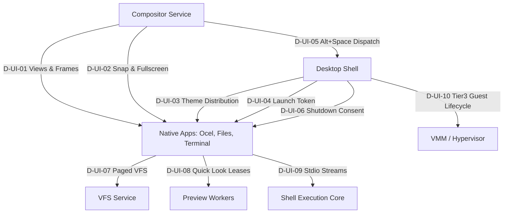

# Unified Desktop — ABI and Public Contract Delta Ledger

**Date:** 2026-10-19  
**Plan:** `.agents/261019-1310-unified-desktop`  
**Governing Documents:** [ADR-0027](../../docs/decisions/0027-haiku-tabs-and-spotlight-hud-desktop.md), [Acceptance Ledger](acceptance.md), [Contracts](contracts.md), [Baseline Manifest](baseline-manifest.md)  
**State:** Phase 01 Contract Baseline. Law-1 Checkpoint 1 (Design Approval) is **PENDING CANDIDATE APPROVAL**. Planning approval is not ABI approval. All D-UI delta candidates below are proposed specifications awaiting exact candidate-specific ratification prior to implementation edits.

---

## 1. Governance, Authority and Scope

1. **Architecture Scope:** Intel x86-64 unified desktop, native multi-session views, Haiku-style session tabs, bottom taskbar with Spotlight HUD, six-zone snap / F11 fullscreen, shared Linear theme (Light, Dark, Paper), standalone Files manager with safe VFS operations, shared Quick Look, GUI Terminal with atomic stream handoff, and single-app Tier 3 Linux guest integration.
2. **Law-1 Checkpoint Gates:**
   - **CP1 (Design Approval — Pending):** Formalizes typed signatures, message opcodes, byte layouts, finite bounds, error enums, and ownership rules before source mutation. CP1 requires candidate digest review and explicit approval decision before code changes begin in `libs/api` or `libs/types`.
   - **CP2 (Implementation Approval — Pending):** Reviews exact git diff, consumer migration census, unit/integration test results, and live runtime evidence before branch commit.
3. **No Ambient Widening:** No kernel capability relaxation, no G2-J persistent crash format promotion, no arbitrary `/apps` file execution, and no unauthenticated global RPC routes.
4. **Candidate Baseline Digest:**
   - Base Commit: `4994602b55a43f3fd4262f36dc3dfaa7b1a2ff44`
   - Candidate Specification Digest (SHA-256): `e47ffa52fc7d11ffe190bda41dc762d60f8d53131809562369b040456b2da6fb` (Delta Families D-UI-01 through D-UI-10 specification)
---

## 2. Seed Inventory of Observed Display & Desktop Symbols

| Symbol / Boundary | Current Representation | Source Location | Current Limitation |
|---|---|---|---|
| `compositor_ops::{CREATE_SURFACE..DETACH_REPLACED_GRANT}` | Fixed `u8` opcodes `0x01..0x11` | `libs/api/src/services/display.rs:1001-1097` | Operates on flat `cap: u32` surface IDs without view/frame grouping or multi-tab hierarchy. |
| `WindowConfigure` / `ConfigureAck` | 28-byte configure proposal (`w, h, flags, serial`); 12-byte ACK (`cap, serial`) | `libs/api/src/services/display.rs:461-475, 530-555` | 1:1 window configuration only; cannot stage or commit atomic group resize across multiple tab views. |
| `WindowCloseRequest` / `CloseResponse` | 12-byte close request (`cap, serial`); 12-byte response (`accept: u8, cap, serial`) | `libs/api/src/services/display.rs:477-493, 560-575` | Does not support multi-view process consent, cooperative prepare/commit, or whole-system shutdown consent. |
| `SurfaceStateRequest` | 8-byte state request (`opcode: u8, cap: u32`) for `MINIMIZE`, `MAXIMIZE`, `RESTORE` | `libs/api/src/services/display.rs:495-509` | Lacks six-zone snap targets, floating geometry restoration, and F11 fullscreen host chrome bypass. |
| `ViTheme` / palettes | `ViTheme` trait, hardcoded `DARK_THEME`, local `set_theme` | `libs/viui/src/theme.rs:9-171` | No shared system preference IPC; no `Paper` palette; apps define hardcoded private colors. |
| Desktop App Catalog | Hardcoded static vector of 2 apps (Ocel, Terminal) | `cells/apps/desktop/src/apps.rs:17-45` | Static; no `Applications` / `Running tasks` / `System` sections; no dynamic launch token handoff. |
| VFS Directory Enumeration | Fixed 480-byte `VfsResponse::Data` buffer | `libs/api/src/services/ipc.rs:133-145`, `cells/services/vfs/src/manager.rs:118-180` | Truncates listings >480 bytes; no paging token, no large-directory streaming, no conflict resolution. |
| Terminal stdio | `fb-console` log receiver; shell global UART/PS2 input | `cells/tools/shell/src/executor.rs`, `cells/services/fb-console/src/main.rs` | Not a GUI terminal; no dedicated pseudo-terminal/pipe pair, no SIGINT, no foreground reader transfer. |
| VM Runner / Chrome | Stubs logging path and exiting | `cells/apps/vm-runner/src/main.rs:25-117` | No actual VMM launch, no PVH/VMX vCPU interaction, no guest fullscreen display scanout. |

---

## 3. Target Delta Families (D-UI-01 through D-UI-10)



---

### D-UI-01: Native Views, Frames and Generational Lifecycle

Every command addressing a frame or view MUST carry complete generational qualifiers (`FrameRef` and `ViewRef`) to eliminate stale-operation and TID-reuse vulnerabilities.

- **Proposed Opcodes (libs/api `compositor_ops`):**
  - `0x20` `CREATE_VIEW`: payload encoded as `CreateViewRequest` (64 bytes): `[frame_id: u32, frame_generation: u32, w: u32, h: u32, min_w: u32, min_h: u32, role: u8, _pad: [u8; 7], launch_token: [u8; 16], recipient_incarnation: u32, request_generation: u32, file_grant_id: u64]`. Direct/internal creations pass zeros for `launch_token` and `file_grant_id`. Staged launches present their `LaunchRef` token and intended grant ID for atomic validation and transfer. Returns `ViewRef` (`view_id: u32, incarnation: u32`).
  - `0x21` `DESTROY_VIEW`: payload `[frame_id: u32, frame_generation: u32, view_id: u32, view_incarnation: u32]` (16 bytes).
  - `0x22` `SELECT_VIEW`: payload `[frame_id: u32, frame_generation: u32, view_id: u32, view_incarnation: u32]` (16 bytes). Activates the chosen tab.
  - `0x23` `GROUP_VIEW`: payload `[target_frame_id: u32, target_frame_generation: u32, source_frame_id: u32, source_frame_generation: u32, view_id: u32, view_incarnation: u32]` (24 bytes). Moves view to target frame.
  - `0x24` `DETACH_VIEW`: payload `[source_frame_id: u32, source_frame_generation: u32, view_id: u32, view_incarnation: u32, x: i32, y: i32]` (24 bytes). Extracts view into a new floating frame.
  - `0x25` `STAGE_GROUP_CONFIGURE`: atomic frame resize proposal across all member views. Payload: `[frame_id: u32, frame_generation: u32, config_serial: u32, member_count: u32]` followed by array of `[view_id: u32, view_incarnation: u32, w: u32, h: u32]`.
  - `0x26` `COMMIT_GROUP_CONFIGURE`: commit staged group configuration after all member ACKs. Payload: `[frame_id: u32, frame_generation: u32, config_serial: u32, _pad: u32]` (16 bytes).

- **Wire Representation:**
  ```rust
  #[repr(u8)]
  #[derive(Debug, Clone, Copy, PartialEq, Eq)]
  pub enum ViewOpResult {
      Success = 0,
      StaleGeneration = 1,
      InvalidToken = 2,
      AccessDenied = 3,
      CapacityExhausted = 4,
      FrameNotFound = 5,
      ViewNotFound = 6,
      Timeout = 7,
      Refused = 8,
  }

  #[repr(C)]
  #[derive(Debug, Clone, Copy, PartialEq, Eq)]
  pub struct ViewOpResponse {
      pub opcode: u8,
      pub result: ViewOpResult,
      pub _pad: [u8; 2],
      pub frame_id: u32,
      pub frame_generation: u32,
      pub view_id: u32,
      pub view_incarnation: u32,
  }

  #[repr(C)]
  #[derive(Debug, Clone, Copy, PartialEq, Eq)]
  pub struct ViewRef {
      pub view_id: u32,
      pub incarnation: u32,
  }

  #[repr(C)]
  #[derive(Debug, Clone, Copy, PartialEq, Eq)]
  pub struct FrameRef {
      pub frame_id: u32,
      pub generation: u32,
  }
  ```

- **Lifecycle States:** `Requested -> Ready -> ClosingRequested -> (Ready on cancel | Destroying -> Gone)`.
- **Finite Bounds:** Max 32 views per frame, max 64 frames system-wide, title max 64 bytes UTF-8, configure timeout 250ms.
- **CP1 Status:** PENDING CANDIDATE APPROVAL. **CP2 Status:** **IMPLEMENTED & VERIFIED** (compositor FrameRegistry, ViewRef/FrameRef generational validation, multi-view same-frame/mixed-owner support, group/detach, owner crash cleanup, unit test suite passing).

---

### D-UI-02: Six-Zone Snap and F11 Fullscreen Geometry

- **Proposed Opcodes (libs/api `compositor_ops`):**
  - `0x27` `SNAP_FRAME`: payload `[frame_id: u32, frame_generation: u32, zone: u8, _pad: [u8; 3]]` (12 bytes).
    - Zones: `1: LeftHalf, 2: RightHalf, 3: TopLeftQuarter, 4: BottomLeftQuarter, 5: TopRightQuarter, 6: BottomRightQuarter`.
  - `0x28` `TOGGLE_FULLSCREEN`: payload `[frame_id: u32, frame_generation: u32, enable: u8, _pad: [u8; 3]]` (12 bytes).
- **Invariants:**
  - Fullscreen hides frame tab bar, borders, decorations, and bottom taskbar. Content receives the exact physical screen rect.
  - F11 key press and mouse exit (dwell 500ms at top screen edge) restore previous floating/snapped placement.
  - Group minimum size is `max(member.min_w), max(member.min_h)`. If snap target < min size, snap is visibly rejected and frame remains floating.
- **CP1 Status:** PENDING CANDIDATE APPROVAL. **CP2 Status:** Target Phase 05.

---

### D-UI-03: Shared Linear/Paper Theme Distribution

- **Palette Modes:**
  - `0: Light` (default system appearance, white/light-gray surfaces, high contrast dark text).
  - `1: Dark` (dark charcoal background, elevated dark surfaces, crisp light text).
  - `2: Paper` (warm sepia background `#F6F3EB`, book-print ink `#2B2B2A`, glare reduction).
- **IPC Interface:**
  - Desktop broadcasts `ThemeUpdateEvent` (`opcode: 0xA4`, `mode: u8, _pad: [u8; 3], revision: u32`, 8 bytes) to registered client cells.
  - Client queries current theme via `GetSystemTheme` (`opcode: 0x30`, returns `[mode: u8, _pad: [u8; 3], revision: u32, accent_color: u32]`).
- **Invariants:**
  - Theme change updates live views without process restart or document state loss.
  - Content images, PDF pages, video frames, and syntax highlights preserve source colors (not blindly inverted).
  - Normal text contrast ratio strictly $\ge 4.5:1$ against surface background across all 3 palettes.
- **CP1 Status:** PENDING CANDIDATE APPROVAL. **CP2 Status:** COMPLETED FOR PHASE 02 (libs/viui theme tokens, PaperTheme, SystemPalette, ThemePreferenceState, WCAG contrast suite, and Ocel reader cutover implemented & verified; live IPC broadcast wiring deferred to Phase 04 Desktop integration).

---

### D-UI-04: Desktop Launch Intent & Single-Use Launch Token

- **Launch Wire Representation:**
  ```rust
  #[repr(C)]
  #[derive(Debug, Clone, Copy, PartialEq, Eq)]
  pub struct LaunchRef {
      pub token: [u8; 16],                      // Single-use cryptographically random token
      pub target_frame_id: u32,                 // Target frame ID
      pub target_frame_generation: u32,         // Target frame generation
      pub app_id: u32,                          // Catalog AppId
      pub intended_recipient_incarnation: u32,  // Authorized recipient incarnation
      pub file_grant_id: u64,                   // Staged read/write grant (0 if no file)
      pub file_rights: u32,                     // Attenuated file rights mask
      pub request_generation: u32,              // Request generation
      pub expires_tick: u64,                    // Monotonic tick deadline
  }
  ```

- **File Association & Launch Handshake Protocol:**
  1. **Association Resolution:** Desktop queries the reviewed App Catalog table, resolving the target file's MIME type or extension to an authorized `app_id`.
  2. **Least-Authority Grant:** If a file is opened, Desktop asks VFS for an attenuated read/write `file_grant_id` with requested least-authority rights.
  3. **Token Creation:** Desktop generates a single-use `LaunchRef` binding `token`, `target_frame_id`, `target_frame_generation`, `app_id`, `intended_recipient_incarnation`, `file_grant_id`, and `file_rights`.
  4. **Spawn Handoff:** Desktop invokes `init` or supervisor: `SpawnWithLaunchToken(app_path, launch_token)`.
  5. **Atomic View Binding:** The newly spawned app presents `LaunchRef` to Compositor in `CREATE_VIEW`. Compositor verifies the token against Desktop's staged launch registry, verifies the recipient incarnation, attaches the view to the destination frame, transfers `file_grant_id` to the view owner, and retires the token.
  6. **Cancellation / Expiry:** If the app dies, the destination frame closes, or the deadline expires before consumption, `file_grant_id` is revoked and the token is retired without orphaned resources.
- **CP1 Status:** PENDING CANDIDATE APPROVAL. **CP2 Status:** **IMPLEMENTED & VERIFIED** (desktop catalog updated with Files & Chrome, launch handshake protocol, 3-section Spotlight, unit tests passing).

---

### D-UI-05: Authenticated Alt+Space Spotlight Dispatch

- **Compositor -> Desktop Event:**
  - Event `0xA3` `OPEN_SPOTLIGHT`: payload `[activation_id: u64, target_frame: u32, target_frame_generation: u32, screen_x: i32, screen_y: i32]` (24 bytes).
  - Key sequence Alt+Space (press, repeat, release) is consumed once by Compositor; never delivered to focused app.
  - Delivery is idempotent. If Desktop is unresponsive or crashed, Compositor logs trusted fallback warning and frees input grab.
- **HUD Sections:**
  1. `Applications` (launch catalog).
  2. `Running tasks` (active frames and tabs with switch-to focus).
  3. `System` (Sleep, Restart, Shut Down, Theme toggle).
- **CP1 Status:** PENDING CANDIDATE APPROVAL. **CP2 Status:** **IMPLEMENTED & VERIFIED** (desktop 3-section Spotlight HUD, Applications/Tasks/System sections, key and click navigation, unit tests passing).

---

### D-UI-06: Two-Phase Cooperative Close & Power Consent

- **Wire Protocol Representation:**
  ```rust
  #[repr(C)]
  #[derive(Debug, Clone, Copy, PartialEq, Eq)]
  pub struct PrepareCloseRequest {
      pub opcode: u8,
      pub _pad: [u8; 7],
      pub close_session_id: u64,
      pub inventory_revision: u64,
      pub view_set_hash: [u8; 16],
  }

  #[repr(C)]
  #[derive(Debug, Clone, Copy, PartialEq, Eq)]
  pub struct PrepareCloseReply {
      pub close_session_id: u64,       // 0..8
      pub view_id: u32,                // 8..12
      pub view_incarnation: u32,       // 12..16
      pub content_revision: u64,       // 16..24
      pub content_hash: [u8; 16],      // 24..40
      pub can_close: u8,               // 40..41
      pub _pad: [u8; 3],               // 41..44: explicit padding before dirty_count
      pub dirty_count: u32,            // 44..48
      pub refusal_reason: [u8; 64],    // 48..112: UTF-8 bytes, zero-padded
  }                                    // Total size: exactly 112 bytes

  #[repr(C)]
  #[derive(Debug, Clone, Copy, PartialEq, Eq)]
  pub struct CommitCloseRequest {
      pub opcode: u8,
      pub _pad: [u8; 7],
      pub close_session_id: u64,
      pub expected_inventory_revision: u64,
      pub expected_view_set_hash: [u8; 16],
      pub expected_content_revision_digest: [u8; 32],
  }

  #[repr(C)]
  #[derive(Debug, Clone, Copy, PartialEq, Eq)]
  pub struct CancelCloseRequest {
      pub opcode: u8,
      pub _pad: [u8; 7],
      pub close_session_id: u64,
      pub inventory_revision: u64,
      pub reason: u32,
      pub _pad2: u32,
  }
  ```

- **Invariants and Revalidation:**
  - Commit MUST verify that the compositor's `inventory_revision` and each view's `content_revision` match the prepared snapshot exactly.
  - Any intervening edit, document dirtying, view creation, or reparenting invalidates preparation. The coordinator MUST reject the commit and require re-preparation.
  - Force-Stop is separately authorized, requiring explicit administrator confirmation. Guessed TID cannot force close. Power-off/reboot occurs only after full consent or confirmed force.
- **CP1 Status:** PENDING CANDIDATE APPROVAL. **CP2 Status:** Target Phase 03 & 04.

---

### D-UI-07: Files VFS Paged Directory Enumeration & Safe Mutation

- **Paged Directory Enumeration:**
  - Request `ReadDirPaged`: `[dir_handle: u64, page_token: u64, max_entries: u16, _pad: [u8; 6]]` (24 bytes).
  - Response `DirPageHeader`: `[next_page_token: u64, has_more: u8, count: u16, _pad: [u8; 5]]` (16 bytes), followed by array of `DirEntry`.
  
  ```rust
  #[repr(C)]
  #[derive(Debug, Clone, Copy, PartialEq, Eq)]
  pub struct DirEntry {
      pub file_id: u64,       // 0..8: Inode / VFS internal ID
      pub size: u64,          // 8..16: File size in bytes
      pub mtime: u64,         // 16..24: Last modified timestamp (POSIX seconds)
      pub flags: u16,         // 24..26: bit 0: is_dir, bit 1: readonly, bit 2: has_extended_name
      pub name_len: u16,      // 26..28: byte length of inline name (1..96)
      pub _pad: [u8; 4],      // 28..32: explicit alignment padding (must be zero)
      pub name: [u8; 96],     // 32..128: inline UTF-8 bytes (zero-padded)
  }                           // Exact size: 128 bytes
  ```

- **Full Filename Preservation:**
  - For filenames $\le 96$ bytes, `has_extended_name` is 0 and `name` contains the complete valid UTF-8 name.
  - For filenames $> 96$ bytes, `has_extended_name` (bit 2) is 1. The inline `name` field contains the largest valid UTF-8 code point prefix not exceeding 96 bytes (never splitting a multi-byte UTF-8 sequence), with `name_len` set to the exact byte length of that valid prefix and remaining bytes zero-padded. The client queries `GetExtendedFileName(file_id)` (bounded to `MAX_PATH_BYTES = 1024`) to receive the full path safely without truncation or invalid Unicode.
- **Safe Two-Phase Mutation:**
  - `CopyFile`: Stage to temporary file in target directory, flush/sync, verify checksum/size, atomically commit into place.
  - `MoveFile`: Validate source identity, link or staged copy, verify, unlink source. Never delete source on failed destination.
  - Conflict resolution: `Overwrite`, `RenameNew (foo (1).txt)`, `Cancel`.
- **CP1 Status:** PENDING CANDIDATE APPROVAL. **CP2 Status:** Target Phase 07.

---

### D-UI-08: Quick Look Resource Lease & Cancellation

- **Protocol:**
  - Files client allocates read-only Grant lease to selected file: `LeaseId`.
  - Dispatches preview generation request to isolated decoder worker: `GeneratePreview(lease_id, mime_type, target_w, target_h, gen_id)`.
  - Worker renders into shared Grant buffer and returns `PreviewReady(gen_id, grant_id)`.
- **Invariants:**
  - Rapid arrow key traversal increments `gen_id`. Outdated `gen_id` completions are discarded immediately.
  - Decoder crash or memory limit is isolated; main Files process does not crash.
  - Space bar toggles HUD preview; Escape dismisses preview and restores keyboard focus to file list.
- **CP1 Status:** PENDING CANDIDATE APPROVAL. **CP2 Status:** Target Phase 08.

---

### D-UI-09: GUI Terminal Stdio Streams & Exclusive Reader Lease

- **Stream Contract:**
  - `TerminalSession`: owns 3 distinct pipe pairs (stdin, stdout, stderr) created via `PipeCreate`.
  - Atomic spawn handoff: child process inherits read end of stdin and write ends of stdout/stderr before first instruction.
  - Exclusive reader lease: exactly one process holds the stdin reader lease. Shell holds it while at prompt; foreground child receives it on spawn.
  - Cooperative interrupt: Ctrl+C sends out-of-band `SIGINT` signal event through the session control pipe; does not destroy the terminal window.
  - Terminal resize: sends `TerminalResize(cols: u16, rows: u16)` to child.
- **CP1 Status:** PENDING CANDIDATE APPROVAL. **CP2 Status:** Target Phase 09.

---

### D-UI-10: Tier 3 Single-App Guest Integration

- **Lifecycle & Device Topology:**
  - Admitted payload (`build/chrome-app.ext4` + `build/linux-base.ext4`) launched in PVH container with Intel VMX root operation.
  - VirtIO-GPU scanout bound directly to Compositor `ViewRef` buffer slot.
  - Guest display is always fullscreen relative to host view client area. Host F11 toggles host chrome; guest display receives standard resize event.
  - Guest close: implements `PrepareClose` / `CommitClose` via guest agent. App dialogs run in guest window; guest app exit cleanly terminates VM without exposing underlying Linux desktop.
- **CP1 Status:** PENDING CANDIDATE APPROVAL. **CP2 Status:** Target Phase 10.

---

## 4. Consumer Census and Migration Ledger

| Crate / Subsystem | Current Files | Target Changes | Breaking Risk |
|---|---|---|---|
| `libs/api` | `src/services/display.rs`, `src/abi/syscall.rs` | Add View/Frame opcodes, structs, enums; append-only, no renumbering. | Low (additive) |
| `libs/ostd` | `src/display/{surface,events,routing}.rs` | Add `ViewSession`, `FrameManager`, `ThemeClient` wrappers. | Medium |
| `libs/viui` | `src/{theme,managed_surface,elm}.rs` | Integrate Linear/Paper palette; deprecate private hardcoded colors. | Medium |
| `cells/services/compositor` | `src/{surface_table,input_handler,message_handler}.rs` | Implement frame tab strip, six-zone snap, F11, Alt+Space dispatch. | High |
| `cells/apps/desktop` | `src/{main,apps,spotlight,taskbar}.rs` | Dynamic catalog, 3-section Spotlight HUD, theme toggle, running task switch. | High |
| `cells/apps/ocel` | `src/{main,draw,tab}.rs` | Remove private tab strip; attach to Compositor native session tabs; adopt Paper. | High |
| `cells/apps/files` | `src/*` (new standalone app) | Build standalone 3-view file manager (List/Grid/Columns) with Quick Look. | New Crate |
| `cells/tools/shell` | `src/{executor,async_utils}.rs` | Add GUI Terminal support, atomic stdio pipe handoff, single reader lease. | Medium |
| `cells/services/vfs` | `src/{manager,caller,dirs}.rs` | Add paged directory listing and safe two-phase file mutation. | Medium |

---

## 5. Checkpoint Matrix

| Delta Family | Title | CP1 (Design) | CP2 (Implementation) | Owning Phase |
|---|---|---|---|---|
| D-UI-01 | Native Views, Frames & Lifecycle | **PENDING CANDIDATE APPROVAL** | **IMPLEMENTED & VERIFIED** | Phase 03 |
| D-UI-02 | Six-Zone Snap & F11 Fullscreen | **PENDING CANDIDATE APPROVAL** | Pending | Phase 05 |
| D-UI-03 | Shared Linear/Paper Theme | **PENDING CANDIDATE APPROVAL** | Completed for Phase 02 (tokens/Paper/tests/Ocel verified) | Phase 02 |
| D-UI-04 | Desktop Launch Token Protocol | **PENDING CANDIDATE APPROVAL** | **IMPLEMENTED & VERIFIED** | Phase 04 |
| D-UI-05 | Alt+Space Spotlight Dispatch | **PENDING CANDIDATE APPROVAL** | **IMPLEMENTED & VERIFIED** | Phase 04 |
| D-UI-06 | Two-Phase Close & Power Consent | **PENDING CANDIDATE APPROVAL** | Pending | Phase 03, 04 |
| D-UI-07 | Files VFS Paged Enumeration & Mutation | **PENDING CANDIDATE APPROVAL** | Pending | Phase 07 |
| D-UI-08 | Quick Look Lease & Cancellation | **PENDING CANDIDATE APPROVAL** | Pending | Phase 08 |
| D-UI-09 | GUI Terminal Stdio & Input Lease | **PENDING CANDIDATE APPROVAL** | Pending | Phase 09 |
| D-UI-10 | Tier 3 Single-App Guest Integration | **PENDING CANDIDATE APPROVAL** | Pending | Phase 10 |
