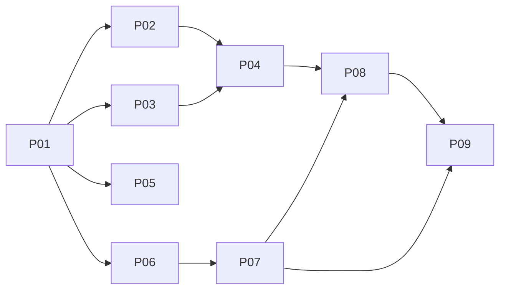

# Ginux lessons adoption

Source analysis: [scout report](scout-report.md). Every phase names its Intel C2C link, contract owner and evidence ceiling (x86 q35 QEMU, TCG or KVM). Physical Intel qualification is out of scope.

## Phases

| # | Phase | Item | Contract owner | Law-1 | Depends |
|---|---|---|---|---|---|
| 01 | [Admission, ownership and CellosFS inputs](phase-01-admission.md) | 7 + governance | portfolio, controlling plan, lock register, 261025 | no | — |
| 02 | [Mutable-global inventory and drift gate](phase-02-mutable-global-inventory.md) | 8 | P02/P03 | no | 01 |
| 03 | [x86 q35 accelerator-bound perf gate](phase-03-x86-perf-gate.md) | 9 | P10 | no | 01 |
| 04 | [x86 privileged-entry hardening](phase-04-x86-entry-hardening.md) | 1 | HAL x86 + P02–P06 for `user_copy` | no | 02, 03 |
| 05 | [Doc claim checker and POSIX ledger](phase-05-doc-claims-posix-ledger.md) | 6 | P07 (ledger) | no | 01 |
| 06 | [ABI record convention and pre-activation refusal](phase-06-abi-record-convention.md) | 5 | P01 ABI census | no (convention binds future changes) | 01 |
| 07 | [Boot authority provenance + test-hooks lifecycle image](phase-07-authority-provenance.md) | 4 | P02/P05 | no; D-07 ADR is proposal only | 06 |
| 08 | [Ordered device quiescence (AHCI/NVMe)](phase-08-device-quiescence.md) | 2 | P05 (+P04) | no (kernel/driver private) | 04, 07 |
| 09 | [Post-fault replacement and stash fencing](phase-09-post-fault-replacement.md) | 3 | P06 | no unless the stash syscall changes | 07, 08 |

Order rationale: the inventory gate (02) and perf baseline (03) come before the entry change (04), so the new per-CPU IST state is classified and its overhead is measured. Phase 07 builds the test-hooks SMP lifecycle image that Phases 08 and 09 reuse. Phase 08 needs IST-safe NMI/#MC before injecting device faults.

**Recommended exception:** Phase 09 steps 1–2 (stash owner/generation fencing) fix a live cross-Cell read/overwrite/clear bug (`kernel/src/task/syscall.rs:7465-7552` uses the unversioned stash). Phase 01 asks the maintainer to admit them as an early independent slice.

## Rules for every slice

- Before editing, record the exact file set, acceptance IDs and evidence ceiling in the controlling plan adoption ledger and the lock-register adopted-slice entry (created in Phase 01). One implementation slice at a time.
- No `libs/api` / `libs/types` edit without the two Law-1 checkpoints. If a slice discovers it needs public bytes, stop and escalate.
- Production behavior never depends on `test-hooks`. Hooks inject faults and emit markers only, and are absent from production images (checked).
- A skipped runner or a TCG-only result never counts as a KVM pass. An unmatched KVM fingerprint never counts as a budget pass.

## Out of scope

Implementing the signed boot authority manifest (only ADR D-07 is drafted); ginux's Linux-ABI-in-kernel model; `.ko` compatibility; ginux's kernel profiler; virtio-pci transport; driver-side prepared/notified tracking for e1000/igb/xhci; physical Intel qualification (P10).

## Maintainer decisions requested in Phase 01

Admission and order; the early stash slice; README vs controlling-plan status truth; D-04a (NMI non-fatal); D-08 (AHCI fail-closed, no re-grant without FLR).

## Risks

1. SMAP vs Tier-1 SAS: the kernel touches U=1 pages outside `user_copy`. SMAP is a hard gate after migrating those sites; it may split into its own phase.
2. The FLR re-grant path depends on NVMe running on q35. If it doesn't, it stays unproven and is reported, not faked.
3. Request-id reconciliation may not exist in P04. If so, Phase 09 F2 has a provider-local ceiling.
4. Governance drift: README vs controlling-plan status (scout report).

## Rollback

Phases 02, 03, 05 and 06 are tooling/docs: revert. Phases 04, 07, 08 and 09 change kernel behavior: revert per slice and cold boot. No persistent format changes.

## Red Team Review

2026-10-30, one reviewer lens: 1 Critical and 11 Major findings, all accepted and applied; 2 Minor accepted.
- Stash fencing moved to the syscall path.
- Lock-register handoff added.
- IDT AC clearing added.
- SMAP made a hard gate.
- AHCI/NVMe replace the virtio-MMIO drivers.
- All interrupt modes are quiesced; capabilities come from a retirement-time ECAM walk.
- Freshness assertions are split by execution class.
- A test-hooks SMP lifecycle image was added.
- The NMI window test is deterministic.
- Explicit resource vector instead of unqualified P01 counters.
- KVM fingerprinting.
- Legacy `CapTable` deleted.
- IST frame decoding.

Full findings: [red-team-2026-10-30.md](red-team-2026-10-30.md).
