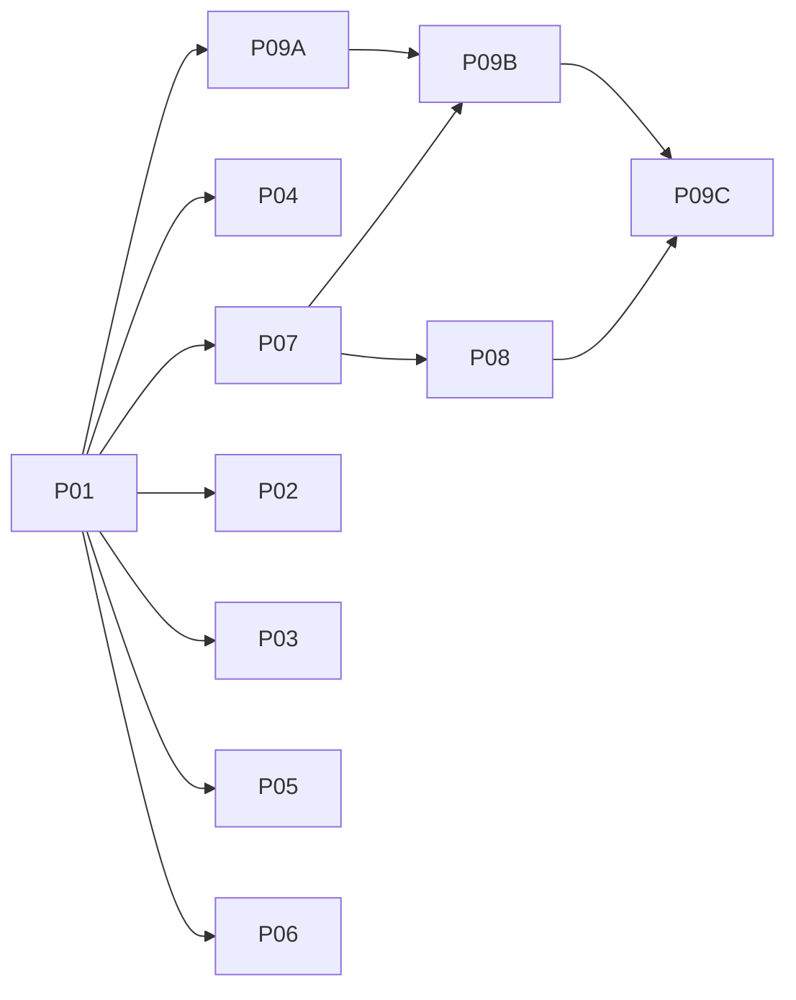

# Ginux lessons adoption

Source analysis: [scout report](scout-report.md). Every phase names its Intel C2C link, contract owner and evidence ceiling (x86 q35 QEMU, TCG or KVM). Physical Intel qualification is out of scope.

## SAS/LBI ground rules (apply to every phase)

Ginux isolates every domain with its own page tables, so it uses copy-at-boundary and process-tree authority. Cellos Tier 1 is a deliberate shared address space for admitted safe Rust plus an audited unsafe substrate (`docs/security-model.md:14-16,97-119`; Spec 25:176). So:

1. **No silent tier conversion.** Do not add CR3 switches, bounce copies, per-call revalidation or kernel proxying to Tier-1 paths in order to adopt a ginux mechanism. If a mechanism needs that, it stays an option disabled for that profile, with a recorded gate.
2. **Hardware ≠ language.** LBI does not make exception delivery, interrupts, DMA or TLB reuse safe. Phases 04 and 08 apply to all tiers.
3. **Authority comes from the issuer, not ancestry or locality.** A pointer, a name, CPL3, a signature or a newer generation grants no resource rights (Spec 25 §3).
4. **Fresh incarnation ≠ fresh address space.** SAS Cells share the root. Identity is checked by incarnation/object generation, never by address inequality.
5. **Tier 1 is not a hostile-code sandbox.** No phase claims protection against malicious native code inside SAS.

## Phases

| # | Phase | Item | Contract owner | Law-1 | Depends |
|---|---|---|---|---|---|
| 01 | [Admission, ownership and CellosFS inputs](phase-01-admission.md) | 7 + governance | portfolio, controlling plan, lock register, 261025 | no | — |
| 02 | [SAS-aware writable-global ownership inventory](phase-02-mutable-global-inventory.md) | 8 | P02/P03 | no | 01 |
| 03 | [Tier-aware x86 performance evidence](phase-03-x86-perf-gate.md) | 9 | P10 | no | 01 |
| 04 | [SAS-compatible x86 entry safety](phase-04-x86-entry-hardening.md) | 1 | HAL x86 (+P02–P06 for `user_copy`) | no | 01 |
| 05 | [Semantic doc consistency and optional POSIX ledger](phase-05-doc-claims-posix-ledger.md) | 6 | P07 (ledger) | no | 01 |
| 06 | [Boundary-specific ABI records](phase-06-abi-record-convention.md) | 5 | P01 ABI census | no (convention binds future changes) | 01 |
| 07 | [Issuer-derived authority provenance + private SMP witness](phase-07-authority-provenance.md) | 4 | P02/P05 | no; signed-manifest ADR is a proposal only | 01 |
| 08 | [Device-specific quiescence](phase-08-device-quiescence.md) | 2 | P05 (+P04) | no (kernel/driver private) | 01, 07 (fixture only) |
| 09A | [State handoff authority](phase-09-post-fault-replacement.md#09a--independent-early-handoff-authority-slice-depends-only-on-01) | 3 | P06 | **review required** (semantic change) | 01 |
| 09B | [Software provider recovery](phase-09-post-fault-replacement.md#09b--software-provider-crashrestore-witness-depends-on-07-fixture-not-device-phase) | 3 | P06 | no | 09A, 07 |
| 09C | [Device-backed replacement](phase-09-post-fault-replacement.md#09c--device-backed-extension-additionally-depends-on-08) | 3 | P06 + P05 | no | 09B, 08 |

Suggested order once admitted: **09A** (live authority gap) → **04** (node-integrity gap on every tier) → 07 → 08 → 09B → 09C. Phases 02, 03, 05 and 06 are tooling/docs and fill gaps between kernel slices. When they land, 02 classifies Phase 04's new IST state, and 03 measures 04/08/09 overhead; neither blocks a security fix.

## Rules for every slice

- Before editing, record the exact file set, acceptance IDs and evidence ceiling in the controlling plan adoption ledger and the lock-register adopted-slice entry (Phase 01). One implementation slice at a time.
- No `libs/api` / `libs/types` edit, and no public semantic change, without the two Law-1 checkpoints. An unchanged opcode or layout is not, by itself, a no-ABI exemption.
- Production behavior never depends on `test-hooks`. Hooks inject faults and emit markers only, and are absent from production images (checked).
- A skipped runner, a TCG-only result or an unmatched KVM fingerprint never counts as a KVM pass. Unavailable evidence is reported as pending, never as PASS.

## Out of scope

Implementing the signed boot authority manifest (ADR proposal only); turning Tier 1 into a private-domain or copy-only model; resumable NMI; ginux's Linux-ABI-in-kernel model; `.ko` compatibility; ginux's kernel profiler; virtio-pci transport; driver-side issue tracking for e1000/igb/xhci; physical Intel qualification (P10).

## Maintainer decisions requested in Phase 01

- Admission and order, including 09A first.
- README vs controlling-plan status truth.
- Whether SMEP/SMAP/UMIP are wanted per profile, once Phase 04's inventory shows their cost to SAS paths.

## Risks

1. SMAP vs SAS: the kernel legitimately reads U=1 memory on authorized SAS paths. SMAP is only enabled where bounded audited access windows preserve those paths without copies.
2. Device reset support differs per controller (FLR vs AHCI/NVMe controller reset). A device without a proven reset stays unavailable, and that is reported as a real result.
3. Request-id reconciliation may not exist in P04. 09B then requires dedup state at the actual state authority, never a volatile per-worker table.
4. Governance drift: README vs controlling-plan status (scout report).

## Rollback

Phases 02, 03, 05 and 06 are tooling/docs: revert. Phases 04, 07, 08 and 09 change kernel behavior: revert per slice and cold boot a known-good image. Already-issued device effects and new fencing epochs are not undone by a binary revert. No persistent format change.

## Review history

- 2026-10-30 red team: 1 Critical + 11 Major + 2 Minor, applied. See [red-team-2026-10-30.md](red-team-2026-10-30.md).
- 2026-10-30 SAS/LBI review: see [sas-lbi-review-2026-10-30.md](sas-lbi-review-2026-10-30.md). The two reviewer subagents failed on quota, so this review was done directly against source and Spec 25.
