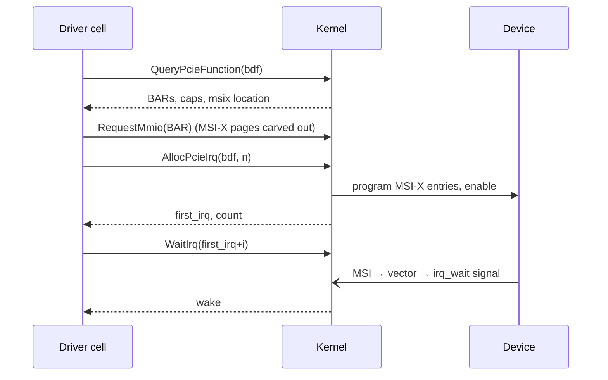

# Phase 04a: PCIe function ABI and MSI/MSI-X

> **Required — deviation-log:** Log every Decision / Deviation / Surprise in § Deviation Log the moment it occurs — not at report time. On an edge case that diverges from this plan, choose the smallest reversible option, log four lines, and continue. Escalate only irreversible or contract-breaking divergence.

## Context Links

- `libs/api/src/abi/syscall.rs:85-95` (`GrantDma`, `WaitIrq`), `:482,539` (`FindPcieDevice*`)
- `libs/ostd/src/syscall.rs:2747-2782` (`PcieDeviceInfo`)
- `kernel/src/task/drivers/pcie_ecam.rs:162-203,547-597,768-776`; `kernel/src/task/drivers/irq_wait.rs`; quiesce in `kernel/src/task.rs:1920-1935`
- Phase 00 CP1 record (required before starting)

## Overview

Two append-only syscalls give driver cells what modern PCIe devices need: every BAR plus read-only capability bytes (virtio, vmxnet3, MSI-X table location), and MSI/MSI-X vectors delivered through the existing `WaitIrq` path. The kernel programs MSI/MSI-X; cells never write config space.

## Key Insights

- `PcieDeviceInfo` exposes only BAR0 and the first memory BAR. Virtio-modern places structures in arbitrary BARs described by vendor capabilities (cap ID 0x09).
- Without interrupt remapping, a cell that can write the MSI-X table can send arbitrary vectors to any CPU. The MSI-X table and PBA pages are therefore carved out of the cell's MMIO grant. Phase 12 adds IR as a second layer.
- FADT IAPC_BOOT_ARCH bit 3 ("MSI not supported") forces a refusal.
- `WaitIrq` takes a `u8 irq_num`, and `MAX_IRQ = 64` today (`kernel/src/task/drivers/irq_wait.rs:26`). MSI vectors map into the same namespace, so `MAX_IRQ` grows to 256 (every u8 value) in this phase.

## Requirements

- Functional:
  - `QueryPcieFunction = 434`: `a0 = bdf`, `a1 = *mut PcieFunctionInfo`.
    - `PcieFunctionInfo` (repr(C), versioned `size` first field): vendor/device/subsystem IDs, class triple, revision, `bars[6] {base u64, len u64, flags u32 (mem/io/64/prefetch)}`, `cap_count`, `caps[16] {id u8, offset u8}`, `msix {table_bar, table_off, pba_bar, pba_off, size}`.
    - Caller must own the BDF (Resource Registry, same check as `GrantDma`).
  - `ReadPcieCapability` is folded into 434 via `a2 = cap offset`, `a3 = *mut [u8; 64]`: read-only, limited to bytes inside a listed capability (no arbitrary config reads). Exact wire layout fixed by CP1.
  - `AllocPcieIrq = 435`: `a0 = bdf`, `a1 = want (1..=32)`, `a2 = flags (prefer MSI-X)` → `(count, first_irq)`.
    - Kernel allocates IDT vectors, programs the MSI-X entries (unmasked) or MSI (multi-message rounded to a power of two), enables bus mastering + the MSI/MSI-X enable bits, and binds each vector to an `irq_num` usable with `WaitIrq`.
    - Repeat calls return the existing allocation.
  - Cell death: the existing quiesce disables MSI / masks MSI-X, and vectors are freed.
  - `sys_request_mmio` on a BAR that contains the MSI-X table/PBA maps the BAR without those pages. If a table shares a page with registers the driver needs (non page-aligned), MSI-X is refused and MSI is offered instead.
  - ostd wrappers `sys_query_pcie_function`, `sys_read_pcie_cap`, `sys_alloc_pcie_irq`. Allowlist: the shared PCIe-driver bit, gated by `PcieDriverCap` at dispatch (CP1 decision).
  - `FindPcieDevice` (418) and `FindPcieDeviceByVendor` (424) skip devices owned by a live driver cell and return the next match (owner decision, validation 2026-11-03). The wire layout is unchanged. Unit test: two functions with the same ID → the first call claims function A, the second (another cell) gets function B, the third gets "not found".
- Non-functional: vector allocator O(1) bitmap over 0x30-0xEF, excluding fixed vectors (timer, COM, IPIs, spurious); ISR → waiter signal path is lock-free, same as `irq_wait`.

## Architecture

Kernel modules: `kernel/src/task/drivers/pcie_msi.rs` (programming, carve-out math) and `kernel/src/hal/x86 vector allocator` in `hal/arch/x86/src/x86_64/vectors.rs`. Dispatch in `kernel/src/task/syscall.rs`.

## Assumptions

- **Claim:** growing `MAX_IRQ` from 64 to 256 needs no ABI change, since `irq_num` is already u8. **Confidence:** high. **How to verify:** read the `irq_wait.rs` statics and the `WaitIrq` dispatch bounds; check static size after growth.
- **Claim:** the IDT dispatch (`hal/arch/x86/src/x86_64/idt/dispatch.rs`) can route a vector range to one generic handler. **Confidence:** medium. **How to verify:** read `idt/dispatch.rs`, `idt/policy.rs`.
- **Claim:** QEMU nvme/igb/e1000e/xhci/virtio expose MSI-X tables page-aligned in a dedicated BAR or region. **Confidence:** medium. **How to verify:** log `msix` info from 434 in the lanes.

## Related Code Files

- Create: `kernel/src/task/drivers/pcie_msi.rs`, `hal/arch/x86/src/x86_64/vectors.rs`
- Modify: `libs/api/src/abi/syscall.rs`, `libs/ostd/src/syscall.rs`, `kernel/src/task/syscall.rs`, `kernel/src/task/drivers/{pcie_ecam,irq_wait}.rs`, `kernel/src/resource_registry.rs` (carve-out), `kernel/src/task.rs` (death path), `hal/arch/x86/src/x86_64/idt/*`, `docs/abi-boundary-records.md` (proposed → implemented)

## Implementation Steps

1. Vector allocator + generic MSI ISR → `irq_wait::signal(irq_num)` + LAPIC EOI.
2. Retain all BARs and the capability list per function in the ECAM scan (`pcie_ecam.rs` scanner). Add MSI (cap 0x05) capture next to MSI-X.
3. Implement 434 (with ownership check and capability-bounded read) and 435 (MSI-X preferred, MSI fallback, refuse on the FADT MSI-unsupported flag).
4. MMIO carve-out in `sys_request_mmio`; refusal logic for unaligned tables.
5. Death path: free vectors after the existing quiesce.
6. Unit tests: vector allocator exhaustion and free; carve-out ranges for table/PBA at page edges; MSI multi-message rounding; capability-bounded read refuses offsets outside caps.
7. Update the ABI record and the ostd wrapper docs.

## Todo List

- [ ] Vector allocator + ISR
- [ ] Scanner retains BARs/caps
- [ ] Syscalls 434/435 + ostd
- [ ] MMIO carve-out
- [ ] Death path + tests

## Success Criteria

- [ ] Unit tests listed in step 6 pass (`cargo test -p cellos-kernel pcie_msi`).
- [ ] All existing x86 suites pass unchanged (drivers not converted yet).
- [ ] A throwaway smoke cell, not committed, allocates 2 MSI-X vectors on QEMU nvme and observes one admin-command completion interrupt.

## Risk Assessment

- ABI shape mistakes are expensive. Mitigation: the `size` field first, plus CP1 review of the exact layout.
- Carving out pages may break a driver that expects the whole BAR mapped contiguously. Cells access registers by offset; mapped holes fault loudly instead of corrupting state.

## Security Considerations

- Cells must not reach config space or the MSI-X table: kernel-only programming plus the carve-out. The ownership check reuses the `GrantDma` BDF ownership.
- Vectors are freed only after the device is quiesced, so a dead cell's device cannot fire into a reused vector.
- The carve-out does **not** stop a cell from programming its device to DMA into the MSI address window (`0xFEE0_0000`-`0xFEEF_FFFF`), which raises interrupts without touching the MSI-X table. Without interrupt remapping that allows interrupt spoofing (denial of service, wrong-waiter wakeups), but not memory writes. Only phase 12 (IR) closes it; until then the Required profile logs `msi: no interrupt remapping` at boot.

## Next Steps

Phase 04b converts the drivers; phase 05 uses 434 for virtio capabilities.

## Deviation Log

None.
