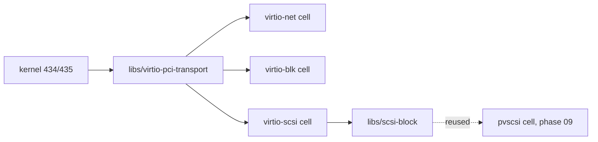

# Phase 05: virtio-pci cells and x86_64-vm profile

> **Required — deviation-log:** Log every Decision / Deviation / Surprise in § Deviation Log the moment it occurs — not at report time. On an edge case that diverges from this plan, choose the smallest reversible option, log four lines, and continue. Escalate only irreversible or contract-breaking divergence.

## Context Links

- `cells/drivers/virtio-blk/src/device.rs:156-248`, `cells/drivers/virtio-net/src/device.rs:107,167-221`
- Fork `kernel/third_party/virtio_drivers/src/transport/{mod.rs,pci.rs,pci/bus.rs}` (`bar_info` writes config space at `pci/bus.rs:267`)
- Stale `tests/integration/tests/virtio-x86.rs` (targets deleted kernel `virtio_pci.rs`, commit `543621013`)
- `hal/soc/x86/src/lib.rs:193-274` (profiles), `boards/pc/x86_64-pc/board.rs`, `boards/src/descriptor.rs:23` (`DriverId`)
- Virtio 1.2 §4.1 (PCI transport), §5.6 (SCSI host device)

## Overview

This slice makes Cellos boot a default KVM guest: virtio-net, virtio-blk and virtio-scsi over PCI, no HPET, with or without a vIOMMU. Closes S1.

## Key Insights

- Kernel Boundary Law: virtio stays in cells. The fork's `PciTransport` sizes BARs by writing config space, which cells cannot do, so a cell-side transport is built on syscall 434.
- virtio devices bypass a vIOMMU unless `VIRTIO_F_ACCESS_PLATFORM` (bit 33) is negotiated (QEMU `iommu_platform=on`). Under a `Required` profile the cell must refuse a device that does not offer it.
- virtio-drivers 0.7 has no SCSI device. The SCSI command layer is written once as a library and reused by PVSCSI in phase 09.

## Requirements

- Functional:
  - `libs/virtio-pci-transport`: implements `virtio_drivers::transport::Transport`.
    - Built from `PcieFunctionInfo` + vendor capabilities (common/notify/ISR/device cfg; `notify_off_multiplier`).
    - Uses MSI-X vectors from 435 (config vector + one per queue).
    - Requires `VERSION_1`; requires `ACCESS_PLATFORM` when the bound profile is `Required`.
    - Accepts modern IDs `1af4:1041/1042/1048` and transitional `1af4:1000/1001/1004` that expose modern caps. Refuses legacy-only devices with a named log.
  - virtio-blk and virtio-net cells: x86 path discovers by vendor:device through `FindPcieDeviceByVendor`. Block route and net bridge registration stay as they are today.
  - New `cells/drivers/virtio-scsi` + `libs/scsi-block`:
    - virtio-scsi: queues ctrl/event/req.
    - scsi-block: INQUIRY, REPORT LUNS, TEST UNIT READY, READ CAPACITY(16), READ(16)/WRITE(16), SYNCHRONIZE CACHE(10).
    - First disk LUN registered as a block route.
  - `x86_64-vm` profile (D-VM approved by the owner 2026-11-03; recorded in ADR-0031 by phase 00):
    - `hal_soc_x86::GENERIC_X86_VM` + `boards/vm/x86_64-vm`, `DmaIsolation::Optional`.
    - Accepted only by explicit `cellos.profile=x86_64-vm` with the hypervisor CPUID bit; boot logs `[x86-gate] dma isolation OFF (operator-selected VM profile)`.
  - `DriverId::VirtioPci` added to the q35, `x86_64-pc` and `x86_64-vm` descriptors.
  - Image composition: build, sign and package the three cells in the x86 ISO scripts and the `qemu-x86_64-boot` CI job.
- Non-functional: virtio-net reaches line rate of the QEMU user/tap backend within 20% of e1000 on the same lane (evidence only, not a gate).

## Architecture

## Assumptions

- **Verified (2026-11-03):** the fork's `Transport::queue_set` (`kernel/third_party/virtio_drivers/src/transport/mod.rs:45`) takes no vector argument, so the PCI transport writes `queue_msix_vector` inside its own `queue_set` (it owns the common-cfg writes) and `msix_config` in `begin_init`.
- **Claim:** QEMU q35 virtio-*-pci defaults to transitional with modern capabilities. **Confidence:** high. **How to verify:** lane log of 434 caps.
- **Claim:** the `FindPcieDeviceByVendor` ownership model lets two cells (net, blk) claim different 1af4 functions. **Confidence:** medium. **How to verify:** read `kernel/src/task/syscall.rs` handler for opcode 424.

## Related Code Files

- Create: `libs/virtio-pci-transport/`, `libs/scsi-block/`, `cells/drivers/virtio-scsi/`, `boards/vm/x86_64-vm/{board.rs,README.md}`
- Modify: `cells/drivers/virtio-{blk,net}/src/device.rs`, their `Cargo.toml`, `hal/soc/x86/src/lib.rs`, `boards/src/{lib.rs,descriptor.rs,catalog_tests.rs}`, `boards/pc/x86_64-pc/board.rs`, `boards/qemu/q35-x86_64/board.rs`, `scripts/x86/make-iso-ci.sh`, `scripts/x86/make_iso.py`, `.github/workflows/ci.yml` (qemu-x86_64-boot), `tests/integration/src/lib.rs` (constructor `boot_x86_kvm_default_vm`), `tests/integration/tests/virtio-x86.rs` (rewrite), workspace `Cargo.toml` members

## Implementation Steps

1. Transport library with capability parsing and MSI-X; host unit tests against a fake capability blob and fake BAR memory.
2. virtio-net x86 discovery + transport; lane: `-device virtio-net-pci` DHCP.
3. virtio-blk x86; lane: two-boot persistence on `-device virtio-blk-pci`.
4. `libs/scsi-block` with host tests (CDB encoding, sense decoding); `virtio-scsi` cell; lane: `-device virtio-scsi-pci -device scsi-hd` persistence.
5. `ACCESS_PLATFORM` enforcement; lane under `x86_64-pc` + `-device intel-iommu,caching-mode=on` with `iommu_platform=on,disable-legacy=on`, and a negative lane without `iommu_platform` that must fail closed with the named log.
6. `x86_64-vm` profile + catalog tests (refused without the hypervisor bit; refused without explicit cmdline).
7. Rewrite `virtio-x86.rs` to the new cell markers; wire CI.
8. Acceptance lane `kvm-default-vm`: `-accel kvm -cpu host -machine q35,hpet=off -smp 2 -m 1G`, `virtio-net-pci`, `virtio-blk-pci`, `virtio-scsi-pci`, `cellos.profile=x86_64-vm` → shell, DHCP lease, persistence on both disks.

## Todo List

- [x] Transport lib
- [x] virtio-net x86
- [x] virtio-blk x86
- [x] scsi-block + virtio-scsi
- [x] ACCESS_PLATFORM enforcement (cells, plus the kernel 418/424 gate after review)
- [x] x86_64-vm profile
- [x] Tests + CI + acceptance lane

## Success Criteria

- [x] The `kvm-default-vm` acceptance passes: `Cellos >`, `[net] DHCP acquired`, and two-boot persistence via virtio-blk and virtio-scsi. The log shows `clock=kvmclock` and `apic=x2apic`. `irq=msix` does not apply, because 04b is deferred and the log shows `irq=polled reason=04b-deferred` ([evidence](reports/phase-05-evidence.md)).
- [x] Under `x86_64-pc` + intel-iommu + `iommu_platform=on` everything binds, DHCP works and persistence holds. Without `iommu_platform` the kernel refuses each function with the named log, and the shell still comes up (SAFE MODE: the refused disk held the pin store).
- [x] The full x86 suite is green under TCG and KVM, except the pre-existing `x86_64-boot` 2/9. RISC-V virtio-MMIO: mount and DHCP pass. The shell-spawn failures come from a stale artifact (deviation log).
- [x] Review: an independent `haily-reviewer` pass was done and all findings are fixed (deviation log).

## Risk Assessment

- Two virtio cells racing for discovery (the same class of issue as the igb/e1000 race fixed by opcode 424). Mitigation: exact vendor:device per cell.
- SCSI devices with multiple LUNs or targets: only the first disk LUN is used, and others are logged.

## Security Considerations

ACCESS_PLATFORM enforcement is the DMA-isolation boundary for virtio. The `x86_64-vm` profile is the only path that skips it, and it is operator-explicit.

## Next Steps

S2 (phases 06, 07a, 07b) and S3 (phases 08, 09).

## Deviation Log

- **2026-11-04 Decision — polled virtio (04b deferred).** The owner deferred 04b. The virtio cells program `NO_VECTOR` (0xFFFF) for config and queues, poll with deadlines, and log `irq=polled reason=04b-deferred`. The success criterion `irq=msix` therefore does not apply in this phase.
- **2026-11-04 Surprise → CP2-04a amendment.** Cells had no way to learn whether an IOMMU translates their DMA: IOVA equals PA, `QueryMachineFacts` needs SpawnCap, and init passes no argv. The owner approved `ViPcieFunctionV1.flags` bit 3 `FLAG_DMA_REMAPPED`, set while VT-d is active. A cell requires `ACCESS_PLATFORM` exactly when that bit is set. This replaces "when the bound profile is `Required`": under `Required` without a remapper, DMA is already refused.
- **2026-11-04 Surprise → lock extension.** `/bin/virtio-scsi` needs entries in the boot ceiling, `CapSet::with_path_caps`, the launch-profile admission set, the signed policy table and `config/services.toml`. Packaging needs `scripts/assemble-x86-image.py`, plus its signing table (`scripts/cellos_sign/signing.py`: assembler hash and signed set) and its tests. The owner approved the extension (`.agents/cell-contract-0024-locks.md`).
- **2026-11-04 Surprise — Ethernet family gate.** The kernel's `ETHERNET_DRIVER_IDS` refused virtio-net (`1af4:1041`, `1af4:1000`), so 424 would never offer it. Both IDs were added; virtio-blk (`1af4:1042`) stays non-Ethernet in the test.
- **2026-11-04 Decision — boot log wording.** The binding log reads `[x86-gate] dma isolation optional (operator-selected VM profile)` instead of "OFF": under `x86_64-vm` a vIOMMU that is present is still activated, so "OFF" would be false.
- **2026-11-04 Decision — virtqueue in the SCSI cell.** The fork's `VirtQueue` is private, so `cells/drivers/virtio-scsi` carries its own single-request split virtqueue (one command in flight, polled, deadline-bounded). This avoids editing `kernel/third_party/virtio_drivers`.
- **2026-11-04 Decision — DMA pools.** `GrantDma` pins until the cell exits and has no revoke, so the blk and net cells authorize a fixed bounce pool once instead of authorizing per buffer. Per-buffer authorization would leak DMA quota.
- **2026-11-04 Note — delegation.** These parts were built by subagents against written contracts and verified here:
  - `libs/virtio-pci-transport` (41 host tests);
  - `libs/scsi-block` (49);
  - the virtio-blk and virtio-net x86 paths;
  - `cells/drivers/virtio-scsi` (14).
- **2026-11-04 Surprise — virtio-net header.** Under `VERSION_1` the virtio-net header is 12 bytes (`num_buffers`). The fork's `VirtIONet` hard-codes the 10-byte legacy header, so DHCP failed. The x86 path now uses `VirtIONetRaw` and writes and reads the 12-byte header itself. The MMIO path is unchanged.
- **2026-11-04 Surprise → owner (lock extension 2).** VFS scans block routes only at mount time, so `/bin/virtio-scsi`, spawned from `services.toml` after VFS, was never mounted. Init now spawns it with the block drivers (`cells/tools/init/src/boot.rs`), and the services entry was removed.
- **2026-11-04 Surprise — the machine pin gates `net`.** Under `x86_64-vm` and `x86_64-pc` init needs the pin store (ADR-0029 §3) before it starts `net`. The provisioned lanes therefore boot the virtio-blk disk from `scripts/x86/machine_pin_disk.py` (P1 FAT32 + P5 CellosFS). Boot 1 pins, boot 2 matches.
- **2026-11-04 Review (haily-reviewer, independent) — 1 HIGH, 3 MED, 6 LOW; all fixed.**
  - HIGH: any `PcieDriverCap` cell could claim a virtio function without `ACCESS_PLATFORM` and DMA around VT-d. Fixed in the kernel: under active VT-d, 418/424 refuse such a function before its first claim (`pcie_msi/virtio_gate.rs`; the verdict is cached and logged once as `[pcie] refusing … would bypass VT-d`). The cells' own check stays as defence in depth. The fail-closed lane now expects the kernel line.
  - MED fixes:
    - `VirtioPciTransport::new` resets the device before any DMA grant;
    - `queue_set` and `notify` are inert after a recorded failure;
    - virtio-blk reads and writes and virtio-net TX are deadline-bounded with a `DEVICE_NEEDS_RESET` check, and poison the device on expiry.
  - LOW fixes:
    - bounded reset wait, treating all-ones status as a gone device;
    - `Required` re-checked at feature write;
    - virtio-blk bounce slots raised to 6 (indirect table);
    - virtio-scsi frees its buffer when `authorize` fails;
    - `FLAG_DMA_REMAPPED` documented as "VT-d active", not proof of confinement before phase 12.
  - Accepted residual: virtio-blk flush stays blocking, because fork 0.7.5 has no non-blocking flush. It is refused when the device is poisoned or needs a reset.
- **2026-11-04 Limit — RISC-V lane.** The MMIO path of the rebuilt virtio-blk/net cells was exercised on QEMU riscv64 (`boot` suite): `fat_filesystem_mounts` and `network_dhcp_acquires_ip` pass. `boots_to_shell_prompt` and `vfs_fat16_reboot_persistence` fail with `Init: shell spawn failed`, a string that is not in the current init source. `[INFERENCE]` A stale RV64 init artifact, unrelated to this phase. Not re-run on a clean baseline.
