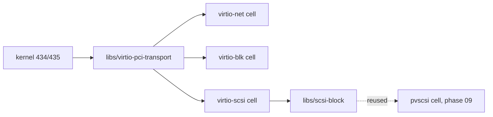

# Phase 05: virtio-pci cells and x86_64-vm profile

> **Required — deviation-log:** Log every Decision / Deviation / Surprise in § Deviation Log the moment it occurs — not at report time. On an edge case that diverges from this plan, choose the smallest reversible option, log four lines, and continue. Escalate only irreversible or contract-breaking divergence.

## Context Links

- `cells/drivers/virtio-blk/src/device.rs:156-248`, `cells/drivers/virtio-net/src/device.rs:107,167-221`
- Fork `kernel/third_party/virtio_drivers/src/transport/{mod.rs,pci.rs,pci/bus.rs}` (`bar_info` writes config space at `pci/bus.rs:267`)
- Stale `tests/integration/tests/virtio-x86.rs` (targets deleted kernel `virtio_pci.rs`, commit `543621013`)
- `hal/soc/x86/src/lib.rs:193-274` (profiles), `boards/pc/x86_64-pc/board.rs`, `boards/src/descriptor.rs:23` (`DriverId`)
- Virtio 1.2 §4.1 (PCI transport), §5.6 (SCSI host device)

## Overview

This slice makes Cellos boot a default KVM guest: virtio-net, virtio-blk and virtio-scsi over PCI, no HPET, with or without a vIOMMU. Closes S1.

## Key Insights

- Kernel Boundary Law: virtio stays in cells. The fork's `PciTransport` sizes BARs by writing config space, which cells cannot do, so a cell-side transport is built on syscall 434.
- virtio devices bypass a vIOMMU unless `VIRTIO_F_ACCESS_PLATFORM` (bit 33) is negotiated (QEMU `iommu_platform=on`). Under a `Required` profile the cell must refuse a device that does not offer it.
- virtio-drivers 0.7 has no SCSI device. The SCSI command layer is written once as a library and reused by PVSCSI in phase 09.

## Requirements

- Functional:
  - `libs/virtio-pci-transport`: implements `virtio_drivers::transport::Transport`.
    - Built from `PcieFunctionInfo` + vendor capabilities (common/notify/ISR/device cfg; `notify_off_multiplier`).
    - Uses MSI-X vectors from 435 (config vector + one per queue).
    - Requires `VERSION_1`; requires `ACCESS_PLATFORM` when the bound profile is `Required`.
    - Accepts modern IDs `1af4:1041/1042/1048` and transitional `1af4:1000/1001/1004` that expose modern caps. Refuses legacy-only devices with a named log.
  - virtio-blk and virtio-net cells: x86 path discovers by vendor:device through `FindPcieDeviceByVendor`. Block route and net bridge registration stay as they are today.
  - New `cells/drivers/virtio-scsi` + `libs/scsi-block`:
    - virtio-scsi: queues ctrl/event/req.
    - scsi-block: INQUIRY, REPORT LUNS, TEST UNIT READY, READ CAPACITY(16), READ(16)/WRITE(16), SYNCHRONIZE CACHE(10).
    - First disk LUN registered as a block route.
  - `x86_64-vm` profile (D-VM approved by the owner 2026-11-03; recorded in ADR-0031 by phase 00):
    - `hal_soc_x86::GENERIC_X86_VM` + `boards/vm/x86_64-vm`, `DmaIsolation::Optional`.
    - Accepted only by explicit `cellos.profile=x86_64-vm` with the hypervisor CPUID bit; boot logs `[x86-gate] dma isolation OFF (operator-selected VM profile)`.
  - `DriverId::VirtioPci` added to the q35, `x86_64-pc` and `x86_64-vm` descriptors.
  - Image composition: build, sign and package the three cells in the x86 ISO scripts and the `qemu-x86_64-boot` CI job.
- Non-functional: virtio-net reaches line rate of the QEMU user/tap backend within 20% of e1000 on the same lane (evidence only, not a gate).

## Architecture

## Assumptions

- **Verified (2026-11-03):** the fork's `Transport::queue_set` (`kernel/third_party/virtio_drivers/src/transport/mod.rs:45`) takes no vector argument, so the PCI transport writes `queue_msix_vector` inside its own `queue_set` (it owns the common-cfg writes) and `msix_config` in `begin_init`.
- **Claim:** QEMU q35 virtio-*-pci defaults to transitional with modern capabilities. **Confidence:** high. **How to verify:** lane log of 434 caps.
- **Claim:** the `FindPcieDeviceByVendor` ownership model lets two cells (net, blk) claim different 1af4 functions. **Confidence:** medium. **How to verify:** read `kernel/src/task/syscall.rs` handler for opcode 424.

## Related Code Files

- Create: `libs/virtio-pci-transport/`, `libs/scsi-block/`, `cells/drivers/virtio-scsi/`, `boards/vm/x86_64-vm/{board.rs,README.md}`
- Modify: `cells/drivers/virtio-{blk,net}/src/device.rs`, their `Cargo.toml`, `hal/soc/x86/src/lib.rs`, `boards/src/{lib.rs,descriptor.rs,catalog_tests.rs}`, `boards/pc/x86_64-pc/board.rs`, `boards/qemu/q35-x86_64/board.rs`, `scripts/x86/make-iso-ci.sh`, `scripts/x86/make_iso.py`, `.github/workflows/ci.yml` (qemu-x86_64-boot), `tests/integration/src/lib.rs` (constructor `boot_x86_kvm_default_vm`), `tests/integration/tests/virtio-x86.rs` (rewrite), workspace `Cargo.toml` members

## Implementation Steps

1. Transport library with capability parsing and MSI-X; host unit tests against a fake capability blob and fake BAR memory.
2. virtio-net x86 discovery + transport; lane: `-device virtio-net-pci` DHCP.
3. virtio-blk x86; lane: two-boot persistence on `-device virtio-blk-pci`.
4. `libs/scsi-block` with host tests (CDB encoding, sense decoding); `virtio-scsi` cell; lane: `-device virtio-scsi-pci -device scsi-hd` persistence.
5. `ACCESS_PLATFORM` enforcement; lane under `x86_64-pc` + `-device intel-iommu,caching-mode=on` with `iommu_platform=on,disable-legacy=on`, and a negative lane without `iommu_platform` that must fail closed with the named log.
6. `x86_64-vm` profile + catalog tests (refused without the hypervisor bit; refused without explicit cmdline).
7. Rewrite `virtio-x86.rs` to the new cell markers; wire CI.
8. Acceptance lane `kvm-default-vm`: `-accel kvm -cpu host -machine q35,hpet=off -smp 2 -m 1G`, `virtio-net-pci`, `virtio-blk-pci`, `virtio-scsi-pci`, `cellos.profile=x86_64-vm` → shell, DHCP lease, persistence on both disks.

## Todo List

- [ ] Transport lib
- [ ] virtio-net x86
- [ ] virtio-blk x86
- [ ] scsi-block + virtio-scsi
- [ ] ACCESS_PLATFORM enforcement
- [ ] x86_64-vm profile
- [ ] Tests + CI + acceptance lane

## Success Criteria

- [ ] `kvm-default-vm` acceptance passes: `Cellos >`, `[net] DHCP acquired`, two-boot persistence via virtio-blk and virtio-scsi; log shows `clock=kvmclock|tsc`, `apic=x2apic`, `irq=msix`.
- [ ] The same image under `x86_64-pc` + intel-iommu + `iommu_platform=on` passes; without `iommu_platform` it fails closed with the named log and the shell still comes up.
- [ ] Full x86 suite green under TCG and KVM; ARM/RISC-V virtio-MMIO lanes unchanged.
- [ ] Review: independent `haily-reviewer` pass on the transport + ACCESS_PLATFORM logic.

## Risk Assessment

- Two virtio cells racing for discovery (the same class of issue as the igb/e1000 race fixed by opcode 424). Mitigation: exact vendor:device per cell.
- SCSI devices with multiple LUNs or targets: only the first disk LUN is used, and others are logged.

## Security Considerations

ACCESS_PLATFORM enforcement is the DMA-isolation boundary for virtio. The `x86_64-vm` profile is the only path that skips it, and it is operator-explicit.

## Next Steps

S2 (phases 06, 07a, 07b) and S3 (phases 08, 09).

## Deviation Log

None.
