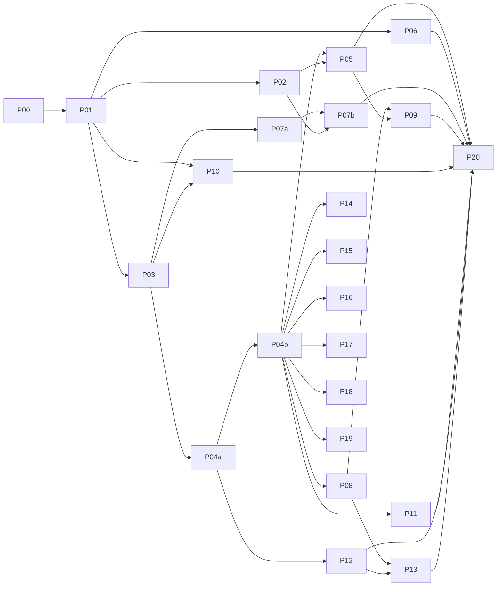

# x86-64 platform breadth — KVM, VMware, Intel PC/server

**Scope (owner decision 2026-11-03):** KVM + VMware + Intel physical PC/server. Intel VMD and server RAID controllers are handled as HCL constraints, not drivers. Not in scope: AMD (stays parked), cloud NICs (ENA, gVNIC, Hyper-V VMBus), GPU drivers, mlx5/bnxt/ice. **Authority:** needs an ADR-0022 amendment (phase 00); nothing is executable until phase 00 is approved.
**Recon:** [scout-report.md](scout-report.md) · **Red team:** [reports/red-team.md](reports/red-team.md) (self-run; 7 findings applied)

## Phases

| # | Phase | Slice | Dep | Ckpt |
|---|---|---|---|---|
| 00 | [Governance: ADR, portfolio, handoff, ABI items](phase-00-governance-adr-and-handoff.md) — completed 2026-11-04 ([approval](cp1-approval.md)) | S0 | — | ✓ |
| 01 | [ACPI table coverage (FADT, SPCR, multi MADT/MCFG/DMAR)](phase-01-acpi-table-coverage.md) — completed 2026-11-04 ([evidence](reports/phase-01-evidence.md)) | S1 KVM | 00 | |
| 02 | [Timekeeping without HPET (TSC, kvmclock, PM timer)](phase-02-timekeeping-without-hpet.md) — completed 2026-11-04 ([evidence](reports/phase-02-evidence.md)) | S1 | 01 | |
| 03 | [x2APIC and multi-IOAPIC](phase-03-x2apic-and-multi-ioapic.md) — completed 2026-11-04 ([evidence](reports/phase-03-evidence.md)) | S1 | 01 | |
| 04a | [PCIe function ABI and MSI/MSI-X](phase-04a-pcie-function-abi-and-msix.md) — completed 2026-11-04 ([evidence](reports/phase-04a-evidence.md)); CP2 approved ([package](cp2-04a-pcie-function-abi.md)) | S1 | 03 | |
| 04b | [IRQ-driven PCIe driver cells](phase-04b-irq-driven-pcie-drivers.md) — re-planned: [CP1 option B](cp1-04b-waitcompletion-irq.md) (`IRQ` source in `WaitCompletion`, MSI wake hint) approved 2026-11-04, scope nvme/ahci/xhci; **in Intel WIP lane from 2026-11-05** ([record](lane-04b-schedule-approval.md)) | S1+ | 04a | |
| 05 | [virtio-pci cells and x86_64-vm profile](phase-05-virtio-pci-cells.md) — completed 2026-11-04 ([evidence](reports/phase-05-evidence.md)); checkpoint 05 signed by the owner 2026-11-04, S1 closed | S1 | 02, 04b | ✓ |
| 06 | [ACPI reset, poweroff, power button](phase-06-acpi-power-and-reset.md) | S2 ops | 01, 03 | |
| 07a | [Per-CPU structures for N CPUs](phase-07a-percpu-generalization.md) | S2 | 03 | |
| 07b | [N-CPU scheduling on x86](phase-07b-n-cpu-scheduling-x86.md) | S2 | 07a, 02 | ✓ |
| 08 | [e1000 82545EM and e1000e 82574L](phase-08-e1000-family-vmware.md) | S3 VMware | 04b | |
| 09 | [vmxnet3 and PVSCSI](phase-09-vmxnet3-pvscsi.md) | S3 | 05, 08 | ✓ |
| 10 | [Console: SPCR, COM2/MMIO UART, framebuffer](phase-10-console-spcr-framebuffer.md) | S4 physical | 01, 03 | |
| 11 | [xHCI hubs, BIOS handoff, multi-controller](phase-11-xhci-hubs-multi-controller.md) | S4 | 04b | |
| 12 | [VT-d multi-unit, RMRR, interrupt remapping](phase-12-vtd-multi-unit-rmrr-ir.md) | S4 | 04a | ✓ |
| 13 | [Intel I219 (e1000e PCH)](phase-13-nic-i219.md) | S5 NIC | 08, 12 | |
| 14 | [Intel I350 (igb)](phase-14-nic-i350.md) | S5 | 04b | |
| 15 | [Intel I225/I226 (igc)](phase-15-nic-igc.md) | S5 | 04b | |
| 16 | [Realtek RTL8111/8125 (r8169)](phase-16-nic-realtek.md) | S5 | 04b | |
| 17 | [Broadcom BCM5720 (tg3)](phase-17-nic-bcm5720.md) | S5 | 04b | |
| 18 | [Intel 82599/X540/X550 (ixgbe)](phase-18-nic-ixgbe.md) | S5 | 04b | |
| 19 | [Intel X710 (i40e)](phase-19-nic-i40e.md) | S5 | 04b | |
| 20 | [Physical qualification and HCL rows](phase-20-physical-qualification-hcl.md) | S6 | 05-07b, 09-12 + machine NIC | ✓ |

## Sequencing rules

- One implementation slice in progress at a time (portfolio single-WIP rule). Order: S0 → S1 → S2 → S3 → S4 → S5 → S6.
- NIC phases 13–19 can only be completed with a physical capture on hardware carrying that NIC. Without hardware a phase stops at host-unit tests and is marked `blocked: hardware`. Buying hardware still needs separate approval (ADR-0022).
- Every phase that adds a cell updates the `qemu-x86_64-boot` CI job in the same change. Evidence ceilings (QEMU TCG, QEMU/KVM local, VMware local, physical) are never promoted.

## Rollback

Each phase is a revertable commit set; the ABI additions are append-only, and a revert removes their callers first. On-disk formats are unchanged. (The journal v2 effect recorded at validation was withdrawn on 2026-11-04: `cpu_accounting` is G1-private and in-memory; see phase 02.)

## Assumptions (unverified)

- A1: GitHub-hosted `ubuntu-24.04` runners expose `/dev/kvm`. If they don't, the KVM lanes stay local-only and are reported that way.
- A2: QEMU 8.2.2 `e1000-82545em` matches VMware's 82545EM for the register subset the e1000 driver uses. A3: VMware "Virtualize IOMMU" exposes a guest DMAR; phase 09 verifies both.

## Validation Log

2026-11-03: Full tier, 245 claims checked, 4 failed. Owner decisions: skip-owned device lookup, c2c-render bound, VMware citation fix, plus D-VM, static `\_S5_`, x2APIC whenever supported, first machine = Intel mini PC. The "journal v2" decision was withdrawn on 2026-11-04 because the failing claim was G1-private (phase 02 Deviation Log). Details: [reports/validation-log.md](reports/validation-log.md).
