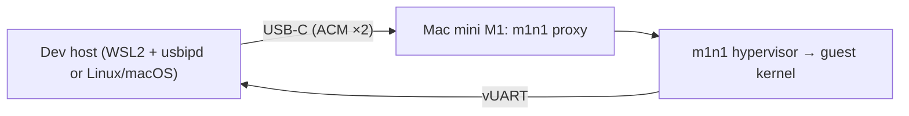

# Phase 01: m1n1 development bench and fact capture (AS-1)

> **Required — deviation-log:** Log every Decision / Deviation / Surprise in § Deviation Log the moment it occurs — not at report time. On an edge case that diverges from this plan, choose the smallest reversible option, log four lines, and continue. Escalate only irreversible or contract-breaking divergence.

## Context Links

- [Research §3, §5](research/asahi-linux-reference.md); m1n1 user guide (proxy mode, `linux.py`, `run_guest.py`); Asahi feature tables

## Overview

Set up a repeatable bring-up bench on one Mac mini M1 and capture the exact hardware facts the later phases need. No Cellos code is written. Without a machine this phase is `blocked: hardware`.

## Key Insights

- m1n1 proxy mode gives a USB load-and-run loop in seconds and a hypervisor with a virtual UART and MMIO tracing. That replaces the COM1 console used on x86.
- A stock Asahi install gives a known-good Linux for capturing the PCI IDs, FDT and firmware versions, and serves as the measurement baseline in phase 08.
- The developer host is Windows + WSL2. USB CDC-ACM devices need `usbipd` passthrough into WSL2, or a Linux/macOS host.

## Requirements

- Asahi Linux installed beside macOS with the official installer; record the installer, m1n1 stage-1 and macOS/system-firmware versions.
- Proxy bench: enter m1n1 proxy (backdoor mode per the m1n1 guide), load a stock Linux kernel with `linux.py`, run it under `run_guest.py` with the vUART.
- Captures stored under `evidence/` with SHA-256: the FDT as m1n1 passed it, `lspci -nn`, `/proc/cpuinfo`, `dmesg`, firmware/iBoot version, NVMe partition table.

## Architecture

## Related Code Files

- Create: `docs/baremetal/apple-silicon-bench.md` (bench procedure), `.agents/261104-0711-apple-silicon-group/evidence/**`
- Modify: none in source.

## Implementation Steps

1. Record the machine: model identifier, serial, SoC, RAM, storage size.
2. Run the Asahi installer (minimal/server image is enough). Record every prompt answer.
3. Under Asahi: capture `lspci -nn`, `/sys/firmware/devicetree` (as a `.dtb`), `dmesg`, cpuinfo.
4. Enable the m1n1 proxy backdoor; verify `linux.py` and `run_guest.py` from the dev host.
5. Write the bench guide. Note the recovery path (1TR, DFU restore from a second Mac).

## Todo List

- [ ] Machine identity
- [ ] Asahi install and captures
- [ ] Proxy and hypervisor loop from the dev host
- [ ] Bench guide

## Success Criteria

- [ ] Evidence files exist with hashes; the Ethernet and USB controller PCI IDs are recorded from capture, not from documentation.
- [ ] A stock kernel boots under the m1n1 hypervisor from the dev host with vUART output, three times in a row.

## Risk Assessment

- Repartitioning the internal SSD is risky. Mitigation: a Mac with no user data; follow the installer only; never resize or touch the macOS, recovery or iSC partitions by hand.
- The proxy backdoor needs SIP disabled for the Asahi volume; record it as a development-only state.

## Security Considerations

Permissive Security and `csrutil disable` lower that machine's boot security. The bench machine is development-only and holds no secrets.

## Next Steps

Phase 04 consumes the captures and the bench.

## Deviation Log

None.
