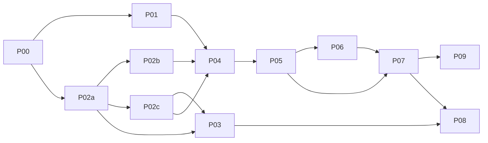

# Apple Silicon group — secondary lane

**Authority:** [ADR-0032](../../docs/decisions/0032-apple-silicon-secondary-lane.md), accepted for direction by the owner on 2026-11-04. This is the **secondary lane**: one Apple slice in progress at a time; it never takes file ownership from an Intel slice; Intel goes first at shared checkpoints.
**Research:** [Asahi reference analysis](research/asahi-linux-reference.md). **Provenance ledger:** [provenance.md](provenance.md).
**First target:** Mac mini M1 (t8103, J274). **Parked:** M4+, GPU/ANE/AMX, Thunderbolt, Wi-Fi, audio, laptop peripherals.

## Phases

| # | Milestone | Phase | Track | Dep | Ckpt | Ceiling |
|---|---|---|---|---|---|---|
| 00 | AS-0 | [Governance and provenance](phase-00-governance-and-provenance.md) | — | — | ✓ | docs |
| 01 | AS-1 | [m1n1 development bench and fact capture](phase-01-m1n1-bench-and-fact-capture.md) | bare metal | 00 | | S2-hv (no Cellos code) |
| 02a | AS-2 | [Linux Image entry and VHE host regime](phase-02a-image-entry-and-vhe-host.md) | shared core | 00 | ✓ | S1-qemu |
| 02b | AS-2 | [Paging: granule and wide physical address](phase-02b-paging-granule-and-wide-pa.md) | shared core | 02a | ✓ | S1-qemu |
| 02c | AS-2 | [FIQ, spin-table, N harts, GICv3](phase-02c-fiq-spin-table-n-harts-gicv3.md) | shared core | 02a | ✓ | S1-qemu |
| 03 | AS-3 | [Hosted track: guest on Apple Silicon macOS](phase-03-hosted-guest-on-macos.md) | hosted | 02a, 02c | ✓ | S1-hvf |
| 04 | AS-4 | [Bare-metal backend under the m1n1 hypervisor](phase-04-baremetal-backend-under-m1n1-hv.md) | bare metal | 01, 02a-02c | ✓ | S2-hv |
| 05 | AS-5 | [DART, Apple PCIe, Ethernet, xHCI](phase-05-dart-pcie-ethernet-xhci.md) | bare metal | 04 | ✓ | S2-hv |
| 06 | AS-6 | [Internal storage: ANS2 via RTKit and SART](phase-06-ans-storage-rtkit-sart.md) | bare metal | 05 | ✓ | S2-hv |
| 07 | AS-7 | [Native boot and HCL qualification](phase-07-native-boot-and-hcl.md) | bare metal | 05, 06 | ✓ | S2 |
| 08 | AS-8 | [CPU inference (NEON) and Haily measurement](phase-08-neon-inference-and-haily-measurement.md) | both | 03 or 07 | ✓ | S1-hvf / S2 |
| 09 | AS-9 | [Chip-generation expansion](phase-09-chip-generation-expansion.md) | bare metal | 07 | ✓ | S2 per chip |

## Sequencing rules

- Secondary-lane WIP: one Apple slice at a time. A slice that needs a file held by an Intel slice waits; it does not negotiate scope.
- Shared-core phases (02a–02c) keep the QEMU `virt` (`scripts/qemu-aarch64-test.sh`, `-hooks`, `QEMU_SMP=2`), `raspi3b` and RPi4 compile lanes green, plus the x86 lanes they touch.
- Hardware phases (01, 04–07, 09) stop at host tests and are marked `blocked: hardware` until an owner-approved Mac exists. Buying one is a separate decision.
- Every Apple source file carries its references in [provenance.md](provenance.md) before review. Tainted-session rule: ADR-0032 §7.
- Coordinate with x86 breadth: phase 07a (per-CPU N harts) and phase 17 (`bcm57xx`) are Intel-owned; Apple extends them after they land.

## Rollback

Every phase is an independently revertable commit set. Shared-core changes are selected per backend at compile time (ADR-0029 §6 static dispatch). Group-1 and `virt` behaviour is pinned by the existing lanes and the `.text` diff rule used by the split plan.

## Assumptions (unverified)

- A1: an Apple Silicon Mac is available to the owner for phase 03 (any M-series, macOS host). The bare-metal phases need a Mac mini M1 or M2 that may be repartitioned.
- A2: QEMU `-cpu max` provides VHE, 16 KiB granule and the FIQ path needed for S1-qemu evidence (verified in 02a/02b).
- A3: OpenBSD `apl*` drivers stay ISC and remain a sufficient behaviour reference for AIC1, DART, PCIe, ANS and RTKit.
