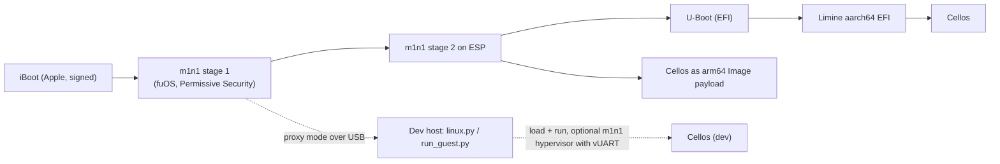

# Asahi Linux as a reference for the Cellos Apple Silicon group

**Date:** 2026-11-04. **Purpose:** input to [ADR-0032](../../../docs/decisions/0032-apple-silicon-secondary-lane.md) and the [plan](../plan.md). Facts are tagged `[verified: source]` when read on this date, `[inference]` otherwise.

## 1. Why this group, and what it can honestly deliver

The owner's motivation is that Apple Silicon Macs are now a common machine for running local AI agents (Haily is the planned consumer). Their appeal is a large unified memory, high memory bandwidth, and Metal GPU/ANE acceleration under macOS.

What Cellos can realistically offer on that hardware:

| Capability | macOS | Asahi Linux | Cellos (this plan) |
|---|---|---|---|
| CPU inference | yes | yes | yes, after NEON kernels (phase 08). `libs/tensor-math` and `libs/ai-engine` have no aarch64 SIMD today `[verified: grep, 2026-11-04]` |
| Unified memory capacity | yes | yes | yes, after a wide physical-address map (M1 Pro/Max DRAM starts at 1 TiB, phase 02b) |
| GPU (AGX) | Metal | `drm/asahi` kernel driver (Rust, `GPL-2.0-only OR MIT`) + Mesa userspace (MIT); M1/M2 only, not upstream | **out of scope for cost, not licence** (§6a). The driver is built on Linux's DRM/GEM/scheduler/firmware Rust abstractions, drives a firmware coprocessor through version-specific structures, and is useless without Mesa (shader compiler, Vulkan/OpenCL) on a Linux DRM uAPI. The M3 GPU is still missing in Asahi; M4 exists only in the Gravity fork |
| Neural Engine | CoreML | out-of-tree kernel module only | **out of scope** |

[inference] A bare-metal Cellos node will not match macOS + Metal/MLX token throughput on the same Mac. Its value is the Cellos model itself: authority, isolation, C2C, and a measured CPU/memory baseline. Phase 08 must compare against Asahi Linux and macOS (CPU-only) on the same machine and report the result whatever it is.

## 2. Hardware coverage (who to follow)

Asahi feature tables, read 2026-11-04:

- **M1 (t8103) and M1 Pro/Max/Ultra (t600x):** PCIe upstream since Linux 5.16, NVMe 5.19, DART 5.15/6.1, UART 5.13, AICv2 5.18. Mac mini (2020) has installer support, 1 GbE (5.16), 10 GbE (5.17) and USB-A ports (5.16) `[verified: asahilinux.org/docs/platform/feature-support/m1]`.
- **M3 series:** officially supported by the installer since 2026-09-06, except M3 Ultra (Mac Studio). Full DCP and GPU are still missing `[verified: asahilinux.org/2026/09/m2-episode-1]`.
- **M4 series:** no installer. PCIe, DART, UART, USB, GPU are TBA; NVMe is WIP; only AICv3, watchdog, I2C and GPIO are in `linux-asahi` `[verified: asahilinux.org/docs/platform/feature-support/m4]`. The Gravity Linux fork has an early-alpha M4 Mac mini desktop built with LLM-assisted reverse engineering `[verified: The Register, 2026-09-25]`. Its provenance policy is different from Asahi's and is not a reference for Cellos (§6).

Consequence: the first target is the **Mac mini M1 (t8103, J274)**, then M2 (t8112). M1/M2 Pro/Max/Ultra follow for memory capacity. M3 follows only once a permissive reference exists. M4 and later are parked: the M4 Mac mini is the popular "local AI" box, but nobody has documented its PCIe/DART/NVMe.

## 3. Boot chain

- The Asahi installer creates a macOS stub volume, sets **Permissive Security** for it in 1TR, and installs m1n1 stage 1 with `kmutil configure-boot … --raw` `[verified: m1n1 user guide]`.
- m1n1 builds the FDT from Apple's ADT, fills loader fields (`cpu-release-addr`, MAC addresses, framebuffer) and loads concatenated payloads: FDTs, a gzip/xz initramfs, an **arm64 Linux-format Image**, and `var=value` config `[verified: m1n1 user guide; t8103.dtsi]`.
- **Proxy mode** exposes two USB CDC-ACM devices on any Thunderbolt port. `linux.py` loads a kernel in seconds, and `run_guest.py` runs it under the **m1n1 hypervisor** with a virtual UART and MMIO tracing `[verified: m1n1 user guide]`. This is the development and evidence path for Cellos bring-up.
- Installed boot: the Asahi installer also offers a UEFI-only environment (m1n1 + U-Boot + ESP), which OpenBSD uses `[inference: installer option name to verify in phase 07]`. With that, Cellos boots through Limine aarch64 EFI and ships no GPL component.

Cellos gaps: the aarch64 image has no Linux arm64 Image header (`hal/arch/arm/src/aarch64/boot.rs`). Limine is used only on x86 (`kernel/src/main.rs:214-480`). Phase 02a adds the header; phase 07 decides the installed path.

## 4. SoC facts that hit the shared aarch64 core

| Fact | Evidence | Cellos today | Impact |
|---|---|---|---|
| CPUs are stuck in VHE: `HCR_EL2.E2H` is RES1 | Linux "arm64: Cope with CPUs stuck in VHE mode" (Zyngier, 2021-03); QEMU FEAT_E2H0 work (2026-02) models such CPUs | The host runs at EL2 non-VHE with `HCR_EL2 = RW|TGE` and mirrors TTBR/TCR into EL1 for EL0 (`hal/arch/arm/src/aarch64/el2.rs:47-64,171-182`) | **Blocker.** Needs a VHE host regime (EL2&0 translation, `TTBR0_EL2` for EL0 under `E2H=TGE=1`) and a VHE-aware vCPU switch (`vcpu.rs:568-597,721-730`) |
| Architected timer and fast IPIs arrive as **FIQ** | AIC binding (`apple,fiq-index`), `t8103.dtsi:706-720` | FIQ vectors branch to the sync handler (`trap.rs:371`, `el2.rs:291,322-326`, "nothing in this system raises FIQ") | **Blocker.** Needs a real FIQ path (timer, IPI, PMU) |
| No GIC; AIC1 (M1), AICv2 (M1 Pro+/M2), AICv3 (M4) | dts; Asahi tables | GICv2 only (`gic.rs`, backends) | New `ArmIrqController` impl. The split plan's trait is the seam |
| SMP via **spin-table**, `cpu-release-addr` filled by the loader; no PSCI, no EL3 | `t8103.dtsi:67-166` | `SecondaryStart::{Psci, None}` (`backend/mod.rs:113-118`) | Add `SecondaryStart::SpinTable` |
| 8–24 cores, P/E clusters | dts cpu nodes | aarch64 `MAX_HARTS = 2` (`kernel/src/task/smp.rs:16`) | Shares the generalization with x86 breadth phase 07a |
| DRAM at `0x8_0000_0000` (t8103/t8112) and `0x100_0000_0000` (t600x) | `t8103-jxxx.dtsi:37`, `t8112-jxxx.dtsi:35`, `t600x-j314-j316.dtsi:42` | 39-bit identity map (`paging.rs:3-4,319`) | M1/M2 base fits in 39 bits; t600x needs ≥ 41-bit VA/PA |
| DART uses **16 KiB** pages | OpenBSD `apldart.c` `DART_PAGE_SIZE 16384` (ISC) | 4 KiB granule only (`paging.rs:9`, `stage2_regs.rs:7`) | DART mappings must be 16 KiB-aligned. A 4 KiB CPU granule is still possible if every DMA buffer is 16 KiB-aligned and padded; this is decided in phase 02b |
| MMIO needs Device-nGnRnE; PCIe BARs are marked `nonposted-mmio` | `t8103.dtsi:395` | MAIR index 0 is nGnRnE (`paging.rs:317`) | OK; check per-range attributes in phase 03 |
| Console is the Samsung-style `apple,s5l-uart`, reachable only through a USB-C debug cable, or the m1n1 vUART | `t8103.dtsi:624` | PL011 and BCM mini-UART only | New small UART driver; m1n1 vUART covers development |

## 5. Devices for a headless agent node

- **PCIe** (`apple,pcie`): Mac mini Ethernet sits on root port 02 behind its own DART, and the loader fills its MAC address (`t8103-j274.dts:55-75`). USB-A ports are PCIe xHCI on the Mac mini `[verified: Asahi M1 table]`. Controller part numbers are recorded by capture, not assumed.
- **Ethernet**: Broadcom NetXtreme family on the M1 mini `[inference: BCM57762; capture the PCI ID]`. This is the same `bge`/tg3 family as x86 breadth phase 17 (BCM5720), so one `cells/drivers/bcm57xx` cell serves both. The 10 GbE option is Aquantia `[inference]`.
- **Storage**: internal NVMe is Apple **ANS2**. It is not a PCIe function: the NVMe controller is MMIO, gated by an RTKit coprocessor through the ASC mailbox, with DMA filtered by **SART** (an address filter, not a translating IOMMU). OpenBSD `aplns.c`, `aplrtk.c`, `aplmbox.c` and `aplsart.c` are the permissive references.
- **Power/reset**: the PMGR power domains must be enabled before a device is used (OpenBSD `apldart.c` calls `power_domain_enable`). Watchdog-based reset uses `apldog.c`. SMC, SPMI and RTC are later work.

## 6. Licensing and provenance (corrects ADR-0029 §7 / ADR-0030)

| Source | Licence (verified 2026-11-04) | Use in Cellos |
|---|---|---|
| Linux / Asahi drivers whose file SPDX is GPL-only: `irq-apple-aic.c` (GPL-2.0-or-later), `apple-dart.c` (GPL-2.0-only), `pcie-apple.c` and `nvme/host/apple.c` (GPL-2.0) | GPL | **Forbidden** (ADR-0030) |
| Linux / Asahi files with an MIT option: `drm/asahi/*.rs` (top-level files checked), `include/uapi/drm/asahi_drm.h` (MIT), `soc/apple/{rtkit,mailbox,sart}.c` (`GPL-2.0-only OR MIT`) | dual / MIT | Permissive **per file** under the MIT option (ADR-0030 reuse order 1); check each file's SPDX line, attribute in `NOTICE`. The Linux `kernel::` abstractions they call are GPL and are not copied |
| **m1n1 ≥ v2.0.0** | GPL-2.0-or-later. README: "Starting from version 2.0.0 … any code checked in thereafter is available under the terms of the GPL exclusively"; `src/aic.c` carries `GPL-2.0-or-later` | **Forbidden as source.** Allowed as a separate, unmodified boot/dev program that Cellos does not ship |
| m1n1 ≤ v1.9.9 (tag `v1.9.9`) | MIT (`LICENSE.MIT`) | Permissive reference; pin the tag and record the file path |
| OpenBSD `sys/arch/arm64/dev/apl*.c` (aplintc, apldart, aplpcie, aplns, aplrtk, aplmbox, aplsart, aplpmgr, apldog, aplcpu, aplspmi, aplsmc, …) | ISC (e.g. `apldart.c`, `aplintc.c` headers) | **Primary permissive reference**; attribution in `NOTICE` if code is adapted |
| OpenBSD/FreeBSD `bge(4)`, Aquantia drivers | BSD/ISC | NIC reference (shared with x86 phase 17) |
| Linux `arch/arm64/boot/dts/apple/*` | `GPL-2.0+ OR MIT` | Usable under MIT as hardware facts and fixtures |
| DT binding YAML | `GPL-2.0-only OR BSD-2-Clause` (Linux convention) | Usable under BSD-2-Clause |
| U-Boot Apple support | GPL-2.0+ | Separate boot program only; not shipped by Cellos |
| Apple binaries (macOS kexts, firmware, SPTM) | proprietary | **No disassembly** by anyone who writes Cellos code |

ADR-0030 lists "Asahi `m1n1` (MIT)" as a permissive example. That held only up to v1.9.9. It also says the Asahi kernel drivers are GPL-2.0-only, which is true per file only: several (GPU, RTKit, mailbox, SART) carry an MIT option. ADR-0032 records both corrections.

### 6a. Why the GPU is not used (2026-11-04 follow-up)

The licence allows reuse; the cost is what blocks it. Using the AGX GPU on bare metal needs all of these:

1. A Cellos GPU driver Cell: firmware-coprocessor bring-up over RTKit; GPU MMU (UAT) page tables; and the large initdata/event/queue structures, whose layouts change with the GPU firmware version and the GPU generation. `drm/asahi` handles that variation with versioned code under `fw/`.
2. Replacements for the Linux `kernel::` DRM/GEM/GPU-scheduler, DMA and firmware abstractions it is written against. Cellos has none of them.
3. A userspace: Mesa's AGX compiler plus a Vulkan or OpenCL driver (Rusticl needs LLVM/Clang). Mesa expects Linux DRM ioctls, sync objects and POSIX.
4. A compute stack for inference on top: llama.cpp's Vulkan backend, for example. Metal and MLX exist only on macOS.

Cheaper routes, in order:

- **(a) Hosted track.** macOS keeps the GPU; Cellos calls a host model server over the VM network. GPU use comes at once, but the model runs outside Cellos isolation.
- **(b) Bare metal with an Asahi Linux guest.** The Cellos hypervisor hands the GPU, its coprocessor, its DART and its interrupts to a Linux guest that runs `drm/asahi` + Mesa (Tier 3 pattern, ADR-0015). The m1n1 hypervisor already runs macOS and Linux with full device access, which shows this is possible `[inference]`. It needs a virtual AIC and device-passthrough work that is not planned.
- **(c) Native port** of (1)–(4). Largest effort; not proposed.

**Clean-room and agent rule.** Gravity Linux uses a "tainted session" rule: a session that has seen protected Apple implementation details may not write the corresponding component `[verified: The Register summary of gravitylinux.org/policies/llm]`. Cellos adopts the same rule for GPL sources and Apple binaries, and applies it to AI agent sessions too: an agent context that has loaded forbidden source for a component does not write that component. The writer works from a behavioural spec plus permissive sources.

## 7. Development and evidence ladder for this group

1. `S1-qemu`: QEMU `virt` with `-cpu max` (VHE, 16 KiB granule, FIQ injection) for shared-core changes. Every existing aarch64 lane (virt, `raspi3b`, RPi4 compile) must stay green.
2. `S1-hvf`: Cellos as a guest on an Apple Silicon Mac (Virtualization.framework `VZLinuxBootLoader` `[inference: expects the arm64 Image format]`, or QEMU `-accel hvf`). It exercises GICv3, virtio-pci and PSCI-HVC on Apple CPUs. It is **not** Apple SoC evidence.
3. `S2-hv`: bare metal under the m1n1 hypervisor (real AIC/DART/devices, hypervisor-trapped).
4. `S2`: native boot on one exact Mac with a capture. `S3`: governance-qualified.

No level substitutes for a higher one, and the HCL Apple table (HCL §7) accepts S2/S3 only.

## 8. Open questions (owned by phases)

- Q1 (02b): 16 KiB CPU granule, or 4 KiB granule with 16 KiB-aligned DMA buffers?
- Q2 (06): does SART-filtered ANS DMA satisfy `DmaIsolation::Required`, or does storage need a weaker named profile?
- Q3 (07): installed boot through U-Boot + Limine EFI, or m1n1 stage-2 payload?
- Q4 (02a): does the QEMU in use expose a "no E2H0" CPU model, so the VHE-only regime is testable without hardware?
