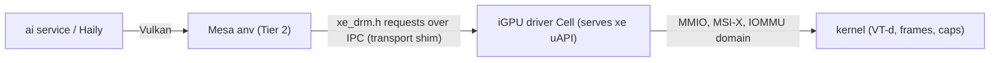

# Phase G1: `xe` uAPI as the GPU service interface; kernel ABI inventory

> **Required — deviation-log:** Log every Decision / Deviation / Surprise in § Deviation Log the moment it occurs — not at report time. On an edge case that diverges from this plan, choose the smallest reversible option, log four lines, and continue. Escalate only irreversible or contract-breaking divergence.

## Context Links

- Owner rule (2026-11-04): "Không nên sinh ra api mới". No new GPU API at any layer.
- `include/uapi/drm/xe_drm.h` (MIT) — the interface the GPU driver Cell serves; [ADR-0024](../../docs/decisions/0024-cell-kernel-authority-contract.md); `docs/code-standards.md` Law 1; `libs/api/src/abi/syscall.rs` (highest assigned 433; 434-436 approved for breadth)

## Overview

The driver Cell serves the **existing** Linux `xe` uAPI. It uses the same request numbers and the same structures from `xe_drm.h`, carried over Cellos IPC instead of `ioctl`. Mesa `anv` then talks to it through a thin transport shim, and applications use Vulkan. Cellos defines no GPU API of its own. G1 does two things: it selects the `xe` uAPI subset `anv` needs for compute, and it inventories the minimal **kernel** ABI deltas for Law-1 CP1. Those deltas are authority plumbing, not a GPU API.

## Key Insights

- **Neutrality comes from Vulkan, not from a Cellos layer.** Each Mesa driver already speaks its vendor's uAPI. A later vendor brings its own existing uAPI header (`amdgpu_drm.h`, the NVIDIA open-driver uAPI, `asahi_drm.h`) with its driver Cell. Vulkan applications do not change.
- **Unavoidable kernel deltas.** The GPU DMAs into buffers owned by client Cells, so mapping another Cell's pages into a device IOMMU domain, and revoking that mapping when the client dies, is new kernel authority. Completion should reuse `WaitCompletion` (242) sources if they fit, rather than add a wait primitive.
- **Where semantics differ.** File descriptors, `mmap` of buffer objects and DRM sync objects/fences have no direct Cellos equivalent. The shim maps them onto existing Cellos primitives. Any field that cannot be honoured returns the error `xe` itself returns for unsupported requests, never a silent success.

## Requirements

- An `xe` uAPI subset table: each request `anv` issues for compute (device query, VM create/bind, BO create/mmap offset, exec queue create/destroy, exec, sync objects, wait), with Cellos semantics and any refused fields.
- Kernel ABI inventory: each syscall, service-ID or allowlist change with wire layout and Law-1 classification. A service registry ID for the GPU driver is a registration, not an API.
- A host-testable fake `xe` backend that answers the subset, for G2/G3 tests.

## Architecture

## Related Code Files

- Create: `.agents/261104-0801-x86-igpu-compute/xe-uapi-subset.md`, `.agents/261104-0801-x86-igpu-compute/cp1-gpu-kernel-abi.md`, `third_party/xe-uapi/xe_drm.h` (pinned upstream copy, MIT), a fake backend under the driver Cell's host tests

## Implementation Steps

1. List the `xe` requests and structures `anv` uses for compute (read from Mesa source).
2. Define Cellos semantics per request; record refused fields.
3. Inventory the kernel ABI deltas; write the CP1 package; owner review.
4. Fake backend with tests for bounds, client death and cancellation.

## Todo List

- [x] `xe` uAPI subset table: [xe-uapi-subset.md](xe-uapi-subset.md) (Mesa `e5d5578`, `xe_drm.h` `05441d69`)
- [x] Kernel ABI inventory: draft [cp1-gpu-kernel-abi.md](cp1-gpu-kernel-abi.md) (D-G0…D-G13, 437–439 provisional)
- [x] CP1 approval (owner 2026-11-04, per §10 recommendations; [record](cp1-approval.md)). The handoff is approved, not yet effective.
- [x] Syncobj model with host tests (`libs/intel-gpu-core/src/syncobj.rs`)
- [x] Remaining backend objects (GEM, VM, exec queue). D-G1 = B (client-owned exports): a GEM object wraps an export lease, so these land with the 437–439 slice

## Success Criteria

- [x] The subset table names every request `anv` compute issues; no Cellos-specific request exists.
- [x] CP1 approved for every kernel ABI item.
- [x] Host tests: client death revokes GPU mappings before frame release; oversize requests are refused with the `xe` error; a cancelled exec signals its fence with an error.

## Risk Assessment

- `xe` uAPI changes upstream. Mitigation: pin one header revision. Mesa negotiates via the `xe` query interface, so the driver reports exactly what it implements.

## Security Considerations

The GPU can read and write anything mapped in a client VM. Only buffers the client owns and explicitly binds may be mapped. Isolation between clients comes from per-client GPU VMs plus VT-d; CP1 justifies whether one IOMMU domain per client is required.

## Next Steps

G2.

## Deviation Log

- Decision: the plan's own `accel` contract was replaced by the existing `xe` uAPI.
  Why: owner rule 2026-11-04, "Không nên sinh ra api mới".
  Impact: no `docs/specs/accel-service.md` or `libs/accel-proto`; later vendors serve their own existing uAPI.
  Revert: none intended.
- Decision: the fake backend is built from real driver logic in `libs/intel-gpu-core`, not a throwaway double. Syncobj semantics landed first. GEM/VM/exec-queue objects wait for CP1 D-G1.
  Why: `GEM_CREATE`/`GEM_MMAP_OFFSET` semantics depend on who owns buffer frames (D-G1).
  Impact: the G3 drm-shim harness can start with syncobjs only.
  Revert: none.
- Surprise: breadth phase 12 said the iGPU's VT-d unit may stay untranslated, which contradicts ADR-0033 §4.
  Why: written before ADR-0033.
  Impact: phase 12 Key Insights amended 2026-11-04 (CP1 draft D-G11).
  Revert: n/a.
