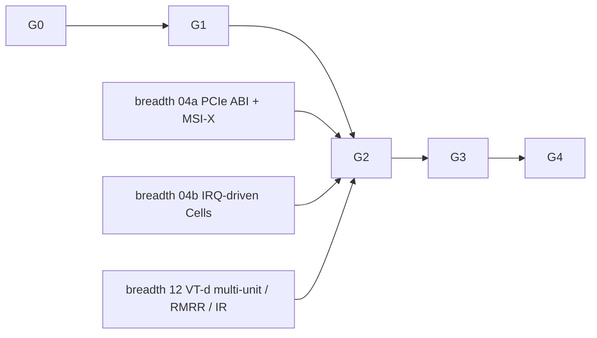

# Native GPU compute on Intel x86-64 — iGPU first

**Authority:** [ADR-0033](../../docs/decisions/0033-x86-intel-igpu-native-compute.md) (owner, 2026-11-04). Intel single-WIP rule applies.
**Evidence:** [vendor and platform evidence](research/vendor-and-platform-evidence.md).
**Scope:** compute only, headless, one exact Intel iGPU. **No new GPU API** (owner, 2026-11-04): applications use Vulkan, the driver Cell serves the existing `xe` uAPI, and only minimal kernel ABI is added. **Not in scope:** display, media, discrete Arc (later), NVIDIA (owner decides later), AMD.

## Phases

| # | Phase | Dep | Ckpt | Ceiling |
|---|---|---|---|---|
| G0 | [Governance, machine selection, firmware pin](phase-00-governance-machine-and-firmware.md) | — | ✓ | docs |
| G1 | [`xe` uAPI as the GPU service interface; kernel ABI inventory](phase-01-xe-uapi-service-and-kernel-abi.md) | G0 | ✓ (CP1) | host |
| G2 | [Intel iGPU driver Cell: bring-up to compute submission](phase-02-igpu-driver-cell.md) | G1; breadth 04a, 04b, 12 | ✓ | host + S2 |
| G3 | [Vulkan userspace: Mesa `anv` as a Tier-2 Cell](phase-03-mesa-anv-tier2.md) | G2 | ✓ (CP2) | S2 |
| G4 | [LLM inference on the iGPU and Linux comparison](phase-04-inference-and-measurement.md) | G3 | | S2 |

## Sequencing rules

- One Intel slice in progress at a time. The owner orders GPU slices against the remaining x86 breadth slices; G2 cannot start before 04a, 04b and 12 land.
- G0 and the G1 design text are documents and may be prepared while another slice holds the WIP lane. They take no source files.
- **Owner decision 2026-11-04 ("triển khai việc chưa cần máy trước trong khi tôi tìm mua máy").** Hardware-independent GPU work proceeds now, in parallel with the Intel WIP slice, within these bounds:
  - G1 documents (the `xe` uAPI subset and a draft CP1).
  - G2 pure logic with host tests in the new `cells/drivers/intel-gpu` crate (firmware header, GPU page-table encoding, GuC CT encoding, a fake `xe` backend).
  - G3 port-gap inventory.
  - It touches no kernel, HAL or ABI file and no file held by another slice; the only shared edits are the workspace `Cargo.toml` member line and `Cargo.lock`.
  - Kernel ABI waits for CP1.
- Hardware phases stop at host tests and are marked `blocked: hardware` until the G0 machine exists.
- Provenance: `xe`, `i915` and Mesa files are MIT; record each adapted file in [provenance.md](provenance.md). Firmware is never disassembled.

## Rollback

Every phase is a revertable commit set. ABI additions are append-only and pass Law-1 CP1/CP2. The driver Cell is selected by exact PCI ID; removing it leaves the machine on CPU inference.

## Assumptions (unverified)

- A1: compute submission needs GuC only, not HuC/GSC (G2 confirms from the `xe` init order).
- A2: the chosen machine's DMAR has a dedicated graphics DRHD and an RMRR for stolen memory, handled by breadth phase 12.
- A3 (restated 2026-11-04): Mesa `anv` needs no LLVM on the **target** (`-Dmesa-clc=system`); the **build host** does need LLVM for `mesa_clc`. It runs on mlibc `posix` plus the transport shim, not on the Tier-A POSIX shim ([port gaps](research/mesa-anv-port-gaps.md)).
