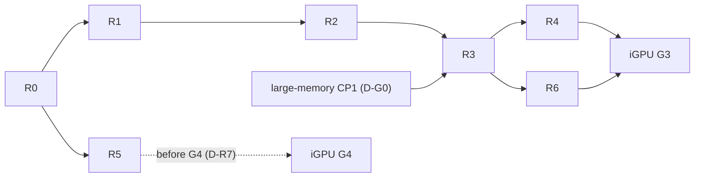

# x86 Tier-2 user-space runtime for the iGPU inference Cell

**State: owner decisions D-R1…D-R10 approved 2026-11-04 ("duyệt", per the recommendations; [record](owner-decisions-approval.md)).**
- Slices R1–R4 and R6 may run beside the Intel WIP slice (D-R2), each after a lock-inventory check.
- R5 (XSAVE) needs the Intel lane and its own CP1-style check.
- R4 needs ADR-0034.
- R3 needs the large-memory syscall implemented. Its CP1 is approved; the implementation waits for the lane.

The owner asked (2026-11-04) for port-gap Q4 (C++ runtime) and Q5 (hard-float ABI, XSAVE) to be separate plans ([port gaps](../261104-0801-x86-igpu-compute/research/mesa-anv-port-gaps.md) §7).
**Serves:** [phase G3](../261104-0801-x86-igpu-compute/phase-03-mesa-anv-tier2.md). The deliverable there is one Tier-2 Cell: inference engine + `anv` + mlibc + transport shim.
**Dependency, not designed here:** Tier-2 large memory ([cp1-tier2-large-memory.md](../261104-0801-x86-igpu-compute/cp1-tier2-large-memory.md), CP1 D-G0, approved 2026-11-04, implementation pending the lane).
**Out of scope:** admission of the inference Cell's artifact on production x86 profiles; transport request marshalling and BO mapping (G3 + GPU CP1 437-439); the Mesa OS-identity patch (G3).

## Phases

| # | Phase | Dep | Gate | Ceiling |
|---|---|---|---|---|
| R0 | [Governance: ADR, float-ABI rule, XSAVE CP1, handoffs](phase-00-governance-adr-cp1-handoffs.md) | — | owner | docs |
| R1 | [x86 C/C++ toolchain and the SSE2 float boundary](phase-01-x86-toolchain-and-float-abi.md) | R0 (D-R3) | handoff | host + QEMU x86 |
| R2 | [mlibc x86_64 base sysdeps: pin, CRT, syscall, TLS](phase-02-mlibc-x86-64-base.md) | R1 | handoff | host + QEMU x86 |
| R3 | [mlibc `posix`: threads, futex, time, memory, memfd, ELF](phase-03-mlibc-posix-enablement.md) | R2; large-memory CP1 implemented | handoff | QEMU x86 |
| R4 | [Hosted C++17 runtime profile](phase-04-hosted-cxx-runtime.md) | R3; ADR (D-R4) | ADR + handoff | host + QEMU x86 |
| R5 | [XSAVE/AVX user state](phase-05-xsave-avx-user-state.md) | R0 (D-R5, D-R6); Intel lane | CP1-style + CP2 | QEMU TCG + KVM |
| R6 | [libdrm-lite and the Cellos fd provider](phase-06-libdrm-lite-and-fd-provider.md) | R3 | handoff | host + QEMU x86 |

## Owner decisions (approved 2026-11-04)

| ID | Question | Recommendation |
|---|---|---|
| D-R1 | Register this plan separately, not admitted; admit slice by slice | Yes |
| D-R2 | R1-R4 and R6 touch no kernel, HAL or `libs/api` file. May they run beside the Intel WIP slice, like the 2026-11-04 hardware-independent exception? | Yes, with a lock-inventory check per slice; R5 needs the lane |
| D-R3 | Float ABI: (H1) Tier-2 C/C++ hard-float SSE2, Rust stays soft-float, no float or vector types across Rust↔C; (H2) new hard-float x86 Rust Cell target (Law 1); (H3) every x86 Cell hard-float | H1 |
| D-R4 | Hosted C++ profile `cpp-hosted` (LLVM libc++/libc++abi/libunwind, static, over mlibc `posix`, one exception-enabled build) by a new ADR amending ADR-0018 §2.3 | Yes; libstdc++ rejected |
| D-R5 | XSAVE v1 scope: XCR0 = x87, SSE, AVX; AVX-512, AMX and PKRU stay outside the saved mask | Yes |
| D-R6 | XSAVE is kernel/HAL only and outside Law 1's scope, but it changes user-visible CPU state. Run it through a CP1/CP2-style check anyway? | Yes |
| D-R7 | XSAVE timing: off the G3 critical path, required before the G4 Linux comparison | Yes |
| D-R8 | Pin mlibc and port `sysdeps/vicell` to upstream's `Sysdeps<Tag>` API; enable `posix` only (`linux`, `glibc`, `bsd` stay off) | Yes |
| D-R9 | libdrm-lite: pinned upstream libdrm subset (MIT); only device enumeration is reimplemented; identity comes from the existing `xe` `CONFIG` query plus a launch-config BDF | Yes; answers `xe-uapi-subset.md` Q7 |
| D-R10 | Production admission of the inference Cell artifact on x86 | Separate decision; QEMU witnesses use the development profile |

## ABI and governance

- **No new syscall is proposed.** Highest number in the tree: 435 (`libs/api/src/abi/syscall.rs:698`). 436 is approved for SystemPower, 437-439 are an approved design for GPU DMA export, and 440+ is proposed by the large-memory CP1 draft.
- Law 1 covers `libs/api` and `libs/types` (`docs/code-standards.md:42-46`). Only the rejected options H2/H3 would change `libs/api` behaviour. Any slice that finds it needs a `libs/api` edit stops and opens a CP1.
- R4 needs an ADR. R5 is outside Law 1 by scope; D-R6 recommends a CP1-style owner check.

## Findings recorded this session (details in phase files)

- `third_party/mlibc/sysdeps/vicell` uses `sys_*` free functions. The local upstream clone dispatches through `mlibc::sysdep<Tag>` and needs a `mlibc/sysdeps.hpp` that vicell does not ship, and `scripts/build-mlibc.sh:39` clones unpinned (R2).
- The C++ freestanding profile already admits x86_64 in code, but the guide and spec 05 still say RV64/AArch64 only (R4).
- `ocel-quickjs` compiles x86 C with SSE2 and calls soft-float Rust `libm` exports with `double` arguments: a possible calling-convention mismatch `[inference]` (R1).

## Rollback

Each phase is a revertable commit set. R1-R4 and R6 add user-space files and build rows. R5 keeps the FXSAVE path for CPUs without XSAVE, and that path is also the rollback.
