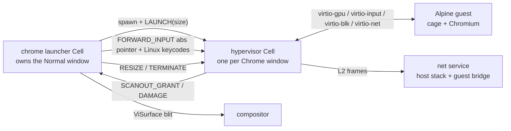

# Plan — real Chrome on the CellOS desktop (Tier 3 Linux guest)

Goal: the taskbar "Chrome" opens a window that shows **real Chromium**, running in an Alpine
Linux guest under the CellOS hypervisor on Intel VT-x. Its own tabs and address bar come from
Chromium itself, it loads real web pages over the network, it takes keyboard and mouse input,
it resizes with the window, and Close ends the guest. The fake browser UI in
`cells/apps/chrome` is deleted, not restyled.

User decision (2026-11-11): build the real Tier 3 path. Ocel stays as the native viewer.
Recon: [scout-report.md](scout-report.md).

## Target architecture

The launcher owns the window (title, icon, Cell Tab menu, resize, Close) through the
existing `WindowLifecycle`; the hypervisor stays a device model with no window of its own.

## Phases

| # | Phase | Slice outcome | Status |
|---|---|---|---|
| 01 | [ADR amendment and VMX guest boot](phase-01-vmx-guest-boot.md) | console Alpine guest boots on Intel VT-x (nested KVM) | done (reviewed) |
| 02 | [Guest display and input devices on x86](phase-02-guest-display-input.md) | guest probes virtio-gpu/input; a guest test pattern reaches the compositor | done, checkpoint (`qemu-tier3-display-x86.sh` PASS) |
| 03 | [Launcher window and session protocol](phase-03-launcher-session.md) | fake UI gone; guest pixels in a real window; input, resize, Close | done, checkpoint (`qemu-tier3-display-x86.sh` 31 checks PASS; resize unverified until startup is fast) |
| 04 | [Chromium guest image, storage and RAM](phase-04-chromium-guest.md) | cage + Chromium boots inside the window | done (real UI in the window; ~18 min startup: 2 MB/s block I/O, separate plan) |
| 05 | [Guest networking beside the host stack](phase-05-guest-network.md) | Chromium loads a real web page | done, checkpoint (display lane 41/41, Chrome lane 8/8: https://example.com/ rendered; VMX STI-shadow fix cut Chromium startup to ~132 s) |
| 06 | [Desktop image, lane and docs](phase-06-desktop-integration.md) | desktop ISO ships it; KVM lane gates it | done, checkpoint (Chrome lane 13/13 incl. resize + Close; guest kernel embedded: +50 MB kernel_fs; hypervisor spawn edges open) |

Dependencies: 01 -> 02 -> 03 -> 04 -> 05 -> 06. Phase 04's image builder can start beside 03.

## Cross-cutting rules

- No fabricated content anywhere: while the guest boots the window shows a real status
  (stage text from the hypervisor), and failures show the real error.
- Kernel files are shared with another ongoing effort: kernel changes (if phase 01 needs
  any VMX fix) are isolated, reviewed, and committed separately.
- ABI changes (`libs/api/src/services/vmm_session.rs`) get a `docs/abi-boundary-records.md` entry.
- Every phase updates `docs/project-changelog.md`; ADR-0017 is amended in phase 01.

## Top risks

1. Nested VMX in WSL2 KVM: the never-run VMX backend may fault (phase 01 gate; fallback is
   to fix the VMX backend, no SVM-on-Intel workaround exists).
2. Chromium RAM/CPU on one vCPU under nested virtualization: may be slow; SMP guest is
   out of scope unless phase 04 measures it unusable.
3. Guest image ≈ 200 MiB as xz squashfs (747 MB installed) vs the 256 MiB `/mnt/sd` partition (phase 04).
4. Net service: host stack and guest bridge are mutually exclusive today (phase 05).

## Evidence

Logs and screenshots go to `.agents/261111-1700-tier3-chrome/evidence/` (not shipped).
