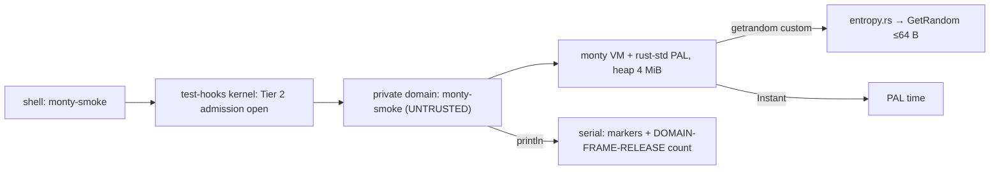

# Phase 6: Tier 2 monty-smoke cell and x86_64 QEMU witness

> **Required — deviation-log:** Log every Decision / Deviation / Surprise in § Deviation Log the moment it occurs — not at report time. On an edge case that diverges from this plan, choose the smallest reversible option, log four lines, and continue. Escalate only irreversible or contract-breaking divergence.

## Overview

This is the first runtime witness of a rust-std cell in a Tier 2 domain, and of Monty on Cellos. An `UNTRUSTED` cell
runs fixed Python on an x86_64 test-hooks image. On riscv64 and aarch64 it must link with no undefined symbols. This phase closes P0.

## Requirements

- Functional: `cells/demos/monty-smoke` has its own `[workspace]`, is excluded in the root `Cargo.toml`, and declares
  `tier = abi::manifest::PROTECTION_CLASS_UNTRUSTED`. It depends on `ostd`, `abi`, path `monty`/`monty-types`, and `getrandom = "0.3"`
  for the `Error` type.
- Functional: `src/entropy.rs` exports `__getrandom_v03_custom(dest: *mut u8, len: usize) -> Result<(), getrandom::Error>`.
  The export is a thin wrapper over a safe, host-testable `fill(buf, source: impl FnMut(&mut [u8]) -> usize) -> Result<(), Error>`,
  with the source being `ostd::syscall::sys_get_random` (≤64 B per call). A 0-byte return yields `Err(Error::UNSUPPORTED)`;
  the buffer is never zero-filled (PAL-019). getrandom 0.3 and 0.4 both resolve this symbol with the same `NonZeroI32` error layout.
- Functional: the cell's `.cargo/config.toml` sets `--cfg getrandom_backend="custom"` via `[target.'cfg(target_os = "cellos")'] rustflags`.
- Functional: cases, each printing a marker, then `[monty-smoke] PASS`. Every compile uses `source_scan_threshold = 0`.
  1. `fib(10)` → `55`.
  2. Expressions nested just under `MAX_NESTING_DEPTH` (200 in v1.6.0 `src/parse.rs:42`; re-read at `MONTY_PIN`) compile and evaluate.
     This makes ruff actually recurse on the cell's native stack.
  3. 10 000 nested `(` → `SyntaxError` from the pre-scan, with no fault.
  4. `random.random()` in `[0, 1)`. Under the test-hooks kernel this uses `dev-weak-rng` (`kernel/Cargo.toml:81`; TCG `qemu64` has no RDRAND),
     so it proves wiring only. The fail-closed path is covered by the host unit test below.
  5. `while True: pass` with the feed time limit (`ResourceLimits` field: `max_feed_duration: Option<Duration>` in v1.6.0; re-read at the pin)
     set to 0.5 s ends with a timeout error.
- Functional: a host unit test, `cargo test` on the host, asserts `fill` returns `Err` on a 0-byte source and fills
  across 64-byte chunk boundaries.
- Functional: `scripts/build-x86_64-monty-smoke-ci.sh` and `scripts/x86/qemu-monty-smoke.sh` are modelled on the pr-tier
  `scripts/build-x86_64-domain-test-ci.sh` for the image and kernel posture, and on `qemu-cpp-hosted-smoke.sh` for shell typing and the
  domain-release counting (`:93-124`). The cell is built as in `run-std-smoke-qemu.sh:86-91`. A `--link-only` mode builds riscv64 and aarch64.
- Functional: runner pass = all case markers + `[monty-smoke] PASS` + the `DOMAIN-FRAME-RELEASE: PASS` count rising by exactly
  one across the run (the marker names no cell, `address_space.rs:1347-1352`), with no `KERNEL PANIC`, `panicked at` or `[fault] Cell`.
- Functional: the runner prints the ELF size and the PAL heap high-water mark. The std PAL heap is a fixed 4 MiB (`HEAP_SIZE` in
  the patch's `alloc.rs`); the default cell quota is 16 MiB (`cell_quota.rs:34`).
- Non-functional: `check-catalog.py`, `check-lanes.py` (one row **per new script**: two rows) and `cellos-sign --check --strict` pass.

## Architecture

Verified by red-team, so not repeated as assumptions:
- A signed UNTRUSTED cell gets a private domain (`governed_spawn.rs:72-82`).
- A `plain()` catalog row lets the shell launch it.
- The signer ignores `third_party/` (`policy.py:60`).
- `c-ffi` on an UNTRUSTED cell is consistent (`allowlist.py:48-50`).

## Assumptions

- **Claim:** a rust-std cell runs correctly inside a Tier 2 domain on x86_64. There is no precedent.
  **Confidence:** low. **How to verify:** case 1. On failure, stop and escalate with the log. Never fall back to Tier 1.
- **Claim:** the native stack holds ruff's recursion at depth just under 200.
  **Confidence:** medium. **How to verify:** case 2. There is **no in-cell fallback**: the PAL ignores `thread::Builder::stack_size`
  (`Thread::new(_stack, …)`, patch ≈936-938). A failure means escalating for a PAL or kernel stack-size change.
- **Claim:** Monty's initialisation and cases 1–5 fit in the 4 MiB PAL heap.
  **Confidence:** medium. **How to verify:** the heap high-water print. If exceeded, escalate. Changing `HEAP_SIZE` is a PAL change that falls under phase 3's governance.
- **Claim:** `build-x86_64-domain-test-ci.sh` is green on `N`.
  **Confidence:** medium. **How to verify:** run it first as a baseline (it is pr-tier, so phase 4's checkpoint covers it via `x86-c2c`).

## Related Files

- Create: `cells/demos/monty-smoke/{Cargo.toml,Cargo.lock,build.rs,.cargo/config.toml,src/main.rs,src/entropy.rs}`
- Create: `scripts/build-x86_64-monty-smoke-ci.sh`, `scripts/x86/qemu-monty-smoke.sh`
- Modify: root `Cargo.toml` (`exclude`), `kernel/src/catalog.rs` (`plain("/bin/monty-smoke")` with the x86 Tier-2 witnesses), `scripts/catalog.generated.json`
- Modify: `scripts/lanes.toml` (two rows; tier matches the job that runs them), `scripts/unsafe-allowlist.toml` (`[[file]]` entropy.rs `c-ffi`; `[[crate]]`)
- Modify: `.github/workflows/ci.yml` (`rust-std-lane`: fetch, link-only rv64/a64, x86 build+boot; `security`: fetch + `cargo deny` on the cell manifest)
- Modify: `docs/project-changelog.md`, `CHANGELOG.md`, `third_party/README.md`

## Implementation Steps

1. Run `fetch-monty.sh`. Scaffold from `cells/demos/std-smoke`, with the std-smoke syscall list minus `Spawn`/`Wait` unless the PAL needs them
   (the kernel's denial log tells you).
2. Write `entropy.rs`: the safe `fill`, plus the `#[unsafe(no_mangle)]` export with a `// SAFETY:` note; then its host unit test and the allowlist entries.
3. Read the crate README at the pin, then write cases 1–5.
4. `cargo tree -e features -i stacker` for the cellos target must be empty; commit `Cargo.lock`. Run `cargo deny` on the cell
   and fill `deny.toml` exceptions from its output (phase 5 rule).
5. Write the scripts; add the catalog and lanes rows; run `check-catalog.py` and `check-lanes.py`.
6. Baseline-run `build-x86_64-domain-test-ci.sh` and its QEMU script, then `--link-only`, then the x86_64 boot (`X86_ACCEL=tcg`).
7. Wire CI; run `ci-local.py run rust-std-lane`, `run security`, `run lint`.

## Success Criteria

- [x] `qemu-monty-smoke.sh` (TCG): 6 case markers, `[monty-smoke] PASS`, domain-release count +1 per run, no panic or fault line. The ELF size is printed by the build. The heap high-water mark is not printed (see Deviation Log).
- [x] Host `cargo test` for `entropy::fill` passes (0-byte → `Err`; chunking).
- [x] `--link-only` passes for riscv64 and aarch64.
- [ ] Checkpoint: `ci-local.py run rust-std-lane`, `run security` and `run lint` pass; `cellos-sign --check --strict` passes. The parts were run individually (Evidence); the full jobs have not been run as one, and `lint`'s rust-std-promotion step fails until phase 3.

## Evidence

- `scripts/x86/qemu-monty-smoke.sh` with `X86_ACCEL=tcg`: `MONTY-SMOKE: PASS (runs: 1)`, then `MONTY_SMOKE_RUNS=3`: `PASS (runs: 3)`, with every case ×3 and 3 domains released.
  - The log shows `[domain] admitted cell 'monty-smoke' to Tier 2 Paged Domain (CR3 isolation)` and `S22-X86-DOMAIN-LIVE: PASS`.
  - Cases: fib, nesting-at-limit (200), nesting-over-limit (10 000 → SyntaxError), random, json, feed-timeout.
- `build-x86_64-monty-smoke-ci.sh --link-only`: `MONTY-SMOKE-LINK: PASS` for riscv64 (17.0 MB at -O3; smaller now), aarch64 and x86_64 (8.2 MB at `opt-level = "s"`), with `nm -u` empty.
- `cargo test --target x86_64-unknown-linux-gnu --bin monty-smoke`: 2 passed.
- `cellos-sign --check --strict`: F1/F5/tier-class/Tier-1 closure OK (156 crates; the Tier-1 total is unchanged at 587/37).
- `check-catalog.py` OK (120 rows); `check-lanes.py` OK; `cargo deny` on the witness workspace OK.
- Independent review (`KernelStackReview`, 2026-11-22) found 1 blocking issue (lock/config ignored by git), 1 major (stack size keyed on the spawner-chosen basename) and 3 minor. All but the frame-allocator scan speed were fixed; see below.

## Security Considerations

The witness runs trusted, fixed Python and has no `max_memory` cap (P1), so it ships only in the test-hooks image.
The entropy export is the only new unsafe code and must fail closed.

## Risk Notes

- Case 5's 0.5 s budget under TCG: bound the run with the runner's wall clock (`BOOT_WINDOW`), not a tighter Python limit.
- The witness runs only on self-hosted or heavy CI (`ci.yml:516`), so normal PRs will not catch a regression. This is accepted for P0 and stated in `plan.md`.

## Deviation Log

- Surprise: the first boot failed with `[signing] OOM: signed payload of 12858376 bytes`, `PrepareChild refused … OutOfMemory`. The kernel copies a signed ELF minus its signature into its heap to verify it (`kernel/src/signing.rs:237-255`).
  Why: Monty at the default `-O3` produced a 12.9 MB image.
  Impact: the cell profile is `opt-level = "s"`, `lto = "fat"`, `codegen-units = 1` (8.2 MB). Larger Python cells will hit this kernel limit again; signing in place is a P1 kernel item.
  Revert: n/a.
- Surprise: with the 256 KiB default user stack, `nesting-at-limit` overflowed into the guard page (`#PF user … page not present`). The fault was contained: only the cell ended, `DOMAIN-FRAME-RELEASE: PASS leaked=0`, and the shell survived.
  Measured (host, same profile, no stacker): 224 KiB holds about 31 levels of `[`/`if`/`+`-chain nesting, 1 MiB about 156, 2 MiB about 317.
  Decision (user, 2026-11-22): give Monty cells a 2 MiB user stack in the kernel inside P0, rather than capping nesting.
  Impact: kernel. `task::LARGE_STACK_PAGES = 512`, plus `task::user_stack_pages_for(path, kernel_resolved, name)`, which returns the large size only for the kernel-resolved path `/bin/monty-smoke` (review finding 2: never by basename). `elf_prepare::prepare_elf_task_with_user_stack`, called from `governed_spawn`. In `loader::va_alloc`, a separate 64-slot × 4 MiB large-stack arena above the regular stack arena: `alloc_stack_va(total_pages)` routes by size, `free_stack_va` frees in both, and `ALLOCATED_VA_END` is extended. Host test `a_stack_too_big_for_a_regular_slot_takes_a_large_slot_above_the_arena`; the test-hooks boot self-test `stack_sizing_policy_self_test` checks the path gating. Kernel stacks keep `stack_pages_for`.
  Revert: delete the arena, `LARGE_STACK_PAGES`, `user_stack_pages_for` and `prepare_elf_task_with_user_stack`, and restore `alloc_stack_va()`.
- Deviation: the root user stack, large or not, stays unbilled (`Stack::new_user`, `Charge::KERNEL`), as for every ELF cell today. Gating on the catalog path bounds the exposure to `/bin/monty-smoke` launches.
  Why: billing root stacks is a pre-existing gap, not introduced here.
  Impact: none new beyond 2 MiB per witness launch.
  Revert: n/a.
- Deviation: review finding 3 (the `allocate_contiguous` restart scan is O(frames × n) under the allocator lock; n = 512) was not changed.
  Why: it is frame-allocator TCB code outside this plan's scope, and correctness is unaffected.
  Impact: recorded for P1.
  Revert: n/a.
- Deviation: the PAL heap high-water mark is not printed. The PAL allocator exposes no usage counter. All cases passed inside the fixed 4 MiB heap.
  Why: printing it would need a PAL API change, which is phase 3 governance.
  Impact: none.
  Revert: n/a.
- Deviation: the manifest has `spawn = false` and no `Spawn`/`Wait` syscalls. Monty is single-threaded, and `plain()` catalog ceilings grant no spawn.
  Why: least privilege.
  Impact: none.
  Revert: n/a.
- Deviation: added a `json` case (jiter's scalar path: a 30-digit bigint, a float, an escaped unicode string).
  Why: the jiter patch changes code that runs only on cellos.
  Impact: none.
  Revert: n/a.
- Deviation: added allowlist entries (`[[file]]` entropy.rs `c-ffi`, `[[crate]]` monty-smoke) with `approver = "dmin"`, citing this approved plan. **Confirmed by the owner (dmin) on 2026-11-22.**
  Why: the signer requires them.
  Impact: `scripts/unsafe-allowlist.toml`.
  Revert: remove both entries.
