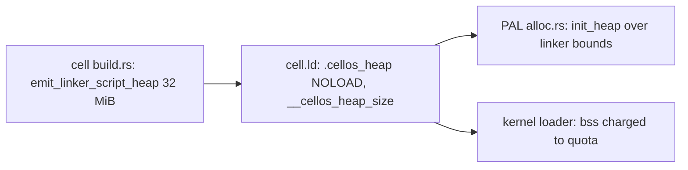

# Phase 1: Per-cell PAL heap size + governance re-pin

> **Required — deviation-log:** Log every Decision / Deviation / Surprise in § Deviation Log the moment it occurs — not at report time. On an edge case that diverges from this plan, choose the smallest reversible option, log four lines, and continue. Escalate only irreversible or contract-breaking divergence.

## Overview

The rust-std PAL heap is a fixed 4 MiB static array, which is too small for real Python. This phase lets a std cell choose
its heap size at link time and keeps 4 MiB as the default. A PAL change reopens the signed compiler-strategy decision, so
the phase ends with a re-pin and re-sign.

## Requirements

- Functional: a std cell can set its PAL heap size. The python cell uses the largest size that fits its VA slot: about 20 MiB in the default
  32 MiB slot, and up to 128 MiB with `large-cell-va`. A cell that sets nothing keeps exactly 4 MiB and today's `std-smoke` behaviour.
- Functional: an allocation that does not fit still returns null to the Rust allocation handler. Never grow silently past the declared size.
- Non-functional: no new syscall and no runtime discovery. The size is fixed in the image so that the kernel's image/bss quota
  accounting sees it (phase 2 sizes the quota from it).
- Non-functional: `HEAP_LOCK`, the over-alignment tag and first-fit coalescing are unchanged; only the backing region and its length move.

## Architecture

Preferred design (to be confirmed in step 1 by reading `pal/cellos/alloc.rs` and `libs/cell-build/src/cell.ld.in`):
- The heap backing moves from `static HEAP_MEM: [u8; HEAP_SIZE]` into a `NOLOAD` `.cellos_heap` section that the cell linker script
  places after `.bss`. Its size comes from a linker symbol `__cellos_heap_size`.
- That symbol defaults to 4 MiB through `PROVIDE` in `cell.ld.in`. `cell_build::emit_linker_script_heap(bytes)` overrides it from the
  cell's `build.rs`. The PAL reads the start and end from `__cellos_heap_start`/`__cellos_heap_end` instead of the array.
- Alternative, rejected unless step 1 shows a blocker: a `#[no_mangle] static` read by the PAL. It needs an unsafe export in every
  std cell, and the size would not be visible to the loader as bss.

## Assumptions

- **Claim:** the loader treats a `NOLOAD` section inside a `PT_LOAD` as zero-fill bss, as it does `.bss` today.
  **Confidence:** medium. **How to verify:** `readelf -lW` of std-smoke after the change; the boot of std-smoke must still pass.
- **Fact (verified 2026-11-22):** the cell VA slot is 32 MiB by default and 256 MiB with `large-cell-va` (`kernel/src/loader/va_alloc.rs:81-87`).
  The python image loads at roughly 7 MB of segments, so a 32 MiB heap does **not** fit the default slot. Step 1 picks the heap as
  slot − image − a 2 MiB margin (about 20 MiB) and adds a link-time check in `cell-build` that fails when image + heap exceeds the slot.
- **Claim:** the PAL support map has exactly one hook that names the heap (PAL-007), so the re-inventory is small.
  **Confidence:** medium. **How to verify:** `rg HEAP .agents/260821-1800-tier1-rust-std-pal-feasibility/artifacts/pal-hook-support-map.json`.

## Related Files

- Modify: `patches/rust-std-cellos.patch` (`pal/cellos/alloc.rs`), `libs/cell-build/src/lib.rs`, `libs/cell-build/src/cell.ld.in`
- Modify: `.agents/260821-1800-tier1-rust-std-pal-feasibility/{artifacts/*,approvals/*}` (via the regen tool)
- Modify: `docs/roadmap/runtime-and-platform-tracks.md` (PAL heap paragraph)

## Implementation Steps

1. Read `pal/cellos/alloc.rs` (patched tree) and `cell.ld.in`. Confirm the bss/NOLOAD loader path and the VA-slot fit. Choose the heap size and log it.
2. Implement the linker-provided heap and the `cell_build` helper. Rebuild the sysroots (×3) and re-run `std-smoke` on all three architectures with the
   default size.
3. Point `monty-smoke` at the new helper with the size chosen in step 1. Add a case that allocates more than 4 MiB of Python objects.
   Re-run the x86 witness.
4. Run the regen tool `--write`, write the re-decision section ("PAL allocator backing"), run an independent reviewer agent over the PAL diff,
   get the user's signatures for both roles, then `--bind-records`. `tests/rust-std-promotion` must pass 33/33.

## Success Criteria

- [ ] `build-cellos-sysroot.sh` ×3 PASS; `run-std-smoke-qemu.sh` PASS on riscv64/aarch64/x86_64 with the default heap.
- [ ] Monty witness PASS with a case that holds more than 4 MiB live.
- [ ] `tests/rust-std-promotion` 33/33 after signing; independent review has no blocking findings.

## Security Considerations

The heap stays private to the cell's domain. The size is fixed at link time and charged as bss, so a cell cannot
raise it at run time. Out-of-memory still fails closed.

## Risk Notes

- The VA-slot stride may cap the heap. That is the main unknown and is resolved in step 1.
- A PAL re-pin touches the same governed records as P0 phase 3. Run it after any other PAL work has landed, so it is signed only once.

## Deviation Log

None.
