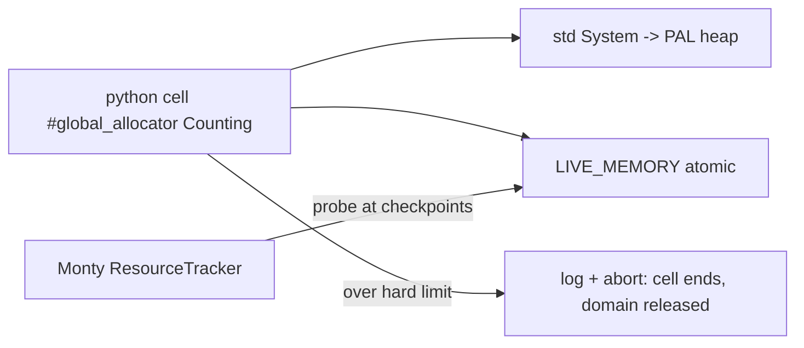

# Phase 3: Counting allocator and Monty resource limits

> **Required — deviation-log:** Log every Decision / Deviation / Surprise in § Deviation Log the moment it occurs — not at report time. On an edge case that diverges from this plan, choose the smallest reversible option, log four lines, and continue. Escalate only irreversible or contract-breaking divergence.

## Overview

Make Monty's `max_memory` real on cellos and pick the default limits the python cell runs with. Monty enforces memory only through
`monty_types::resource::LIVE_MEMORY`, which only a counting global allocator updates.

## Requirements

- Functional: the python cell's `#[global_allocator]` wraps `std::alloc::System` (the PAL heap) and keeps `LIVE_MEMORY` exact for alloc,
  dealloc, realloc and alloc_zeroed. A hard limit ends the cell with a logged reason (`MemoryError` is not reachable below the interpreter).
- Functional: defaults are set in one table: `max_memory` (soft; for example heap − 4 MiB headroom from `memory_limit_with_headroom`),
  `max_feed_duration`, `max_recursion_depth` (1000) and `max_total_sleep_secs`. The REPL can raise them only through flags and never past the hard limit.
- Non-functional: reuse `monty-alloc` if it builds and exits correctly on cellos (its `exit-code` path uses `std::process`; the PAL `exit` arm aborts).
  Otherwise write the ~60-line equivalent in the cell. Never vendor-patch monty-alloc.

## Architecture

## Assumptions

- **Claim:** `monty-alloc` compiles for `x86_64-unknown-cellos` and its exit path works with the PAL.
  **Confidence:** low. **How to verify:** add it to the witness and build. A hard-limit case must end the cell with its message and no fault line.
- **Claim:** `LIVE_MEMORY` counting excludes nothing Monty allocates (everything goes through the global allocator in a std cell).
  **Confidence:** high (no other allocator exists in the cell).

## Related Files

- Create: `cells/runtimes/python/src/limits.rs` (defaults table and allocator if not monty-alloc). Phase 4 owns the crate scaffold; in
  this phase the code lives in `cells/demos/monty-smoke` and moves in phase 4.
- Modify: `cells/demos/monty-smoke/{Cargo.toml,src/main.rs}` (memory cases), `third_party/README.md` if monty-alloc is used.

## Implementation Steps

1. Try `monty-alloc` in the witness. If it fails, write the counting wrapper and log why.
2. Add witness cases: `[0] * 100_000_000` → `MemoryError` (soft limit); a host-side hard-limit test → the cell ends with the logged
   reason and the runner sees the domain released and no `[fault] Cell`.
3. Host unit test for the counting wrapper (alloc/realloc/dealloc balance, zero-size) if it is hand-written.

## Success Criteria

- [ ] The witness `memory-soft` case prints `MemoryError`; the hard-limit run ends the cell cleanly (released domain, no fault line).
- [ ] Host tests for the wrapper pass (when hand-written).

## Security Considerations

The soft limit is the sandbox's main defence against memory bombs. The hard limit plus the cell quota are the backstop, so a bomb
never reaches the kernel allocator beyond the cell's charge.

## Risk Notes

- If `std::process::exit` is unsupported in the PAL (the `exit` arm aborts), the hard-limit path becomes abort with a prior log
  line. That is acceptable; log it.

## Deviation Log

None.
