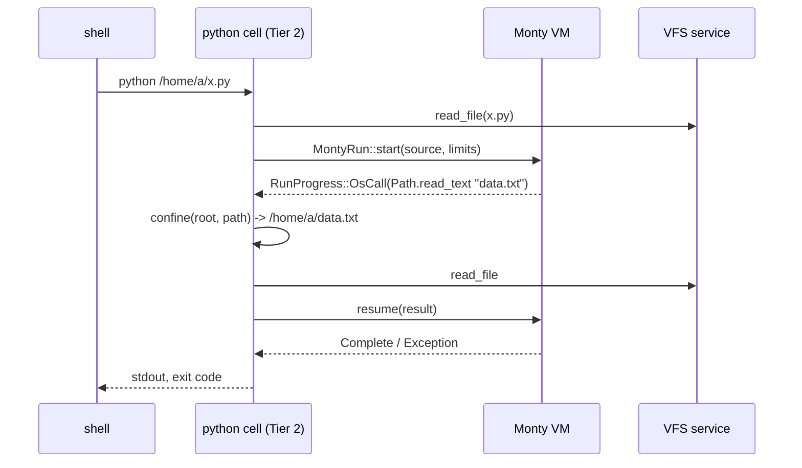

# Phase 4: `python` runtime cell: VFS OS calls, script/REPL, imports

> **Required — deviation-log:** Log every Decision / Deviation / Surprise in § Deviation Log the moment it occurs — not at report time. On an edge case that diverges from this plan, choose the smallest reversible option, log four lines, and continue. Escalate only irreversible or contract-breaking divergence.

## Overview

Ship `/bin/python`: an `UNTRUSTED` Tier 2 rust-std cell. `python FILE.py [args]` runs a script; `python` without an argument
starts a REPL. Monty's suspensions are served on the host side of the cell: filesystem through the VFS service, clock and entropy
through syscalls, imports from VFS `.py` files.

## Requirements

- Functional, OS calls (`OsFunctionCall`, see scout report):
  - every `Path.*` and `open` call maps onto `ostd::clients::vfs`;
  - `os.getenv`/`os.environ` return a fixed, empty-by-default environment, never the cell's real one;
  - `time.time`/`datetime.now`/`date.today` use `GetTime` plus the configured TZ (UTC);
  - `os.urandom` uses `GetRandom` through `entropy::fill` and is fail-closed;
  - `time.sleep`/`asyncio.sleep` yield until the deadline;
  - `import` answers `ModuleFile` from VFS candidates, `import_stubs` answers `NotFound`;
  - anything unmapped answers `OsFunctionCall::no_handler_result`.
- Functional, path confinement: OS-call paths are resolved against a sandbox root (default: the script's directory; `--root DIR`).
  Use `monty_types::normalize_virtual_path` first. `..`/absolute paths outside the root and symlinks are refused with
  `PermissionError` before any VFS call. Writes go only under the root.
- Functional, I/O: `print` goes to the console (stdout), tracebacks go to stderr, exit code is 0 on success and 1 on an uncaught exception.
- Functional, REPL: `ostd::repl::Repl` line editing; `MontyRepl::feed_run` keeps state across lines; multi-line blocks continue
  until a blank line.
- Functional, packaging: the crate moves from `cells/demos/monty-smoke` to `cells/runtimes/python`. Entropy, limits and runner
  modules are reused. monty-smoke stays as the CI witness, built from the same modules or kept minimal. Catalog row `target("/bin/python")`
  with phase 2's quota and stack. Image and boot plan entries follow the `lua` precedent.
- Non-functional: ELF ≤ 8.5 MB at `opt-level="s"` (in-kernel signature copy limit, P0). Every new module stays under 200 lines.

## Architecture

Modules: `main.rs` (argv, mode), `oscall.rs` (dispatch), `confine.rs` (path policy, host-tested), `vfs_io.rs`, `imports.rs`,
`repl.rs`, `limits.rs`, `entropy.rs`.

## Assumptions

- **Claim:** `ostd::clients::vfs` works from a std cell in a Tier 2 domain (copied IPC).
  **Confidence:** medium (Ocel uses VFS from Tier 2). **How to verify:** first read case in the witness.
- **Claim:** `RunProgress::OsCall` exposes the typed call plus `resume(result)`, as in the crate README's FunctionCall flow.
  **Confidence:** medium. **How to verify:** `third_party/monty-src/crates/monty/src/run_progress.rs`.
- **Claim:** the console Read/RecvTimeout path that `ostd::repl` uses works under the PAL's stdin.
  **Confidence:** low. **How to verify:** REPL lane step 5; the fallback is a line-at-a-time `std::io::stdin` loop.

## Related Files

- Create: `cells/runtimes/python/{Cargo.toml,Cargo.lock,build.rs,.cargo/config.toml,src/*.rs}`, `scripts/x86/qemu-python-smoke.sh`, build script
- Modify: `kernel/src/catalog.rs` (+ export), root `Cargo.toml` exclude, `.gitignore` negations, `scripts/unsafe-allowlist.toml`, `scripts/lanes.toml`,
  `.github/workflows/ci.yml` (rust-std-lane), cell-store/image lists for x86 test-hooks image

## Implementation Steps

1. Scaffold the crate, move entropy/limits from monty-smoke, and add host tests for `confine` (root escape, `..`, absolute, NUL, symlink refusal,
   normalization) and the OS-call dispatch table (every variant mapped or explicitly unhandled).
2. Implement the script mode and the VFS OS calls, and test them with a VFS fixture tree on the image: read/write/stat/iterdir/mkdir/unlink/rename.
3. Imports: a two-module package on VFS with `from pkg import mod`.
4. REPL: state persists across lines, multi-line `def`, Ctrl-D exits.
5. Witness `qemu-python-smoke.sh`: types `python /tmp/t/main.py` and a REPL session, then asserts the outputs, exit codes, domain release and absence of faults.
6. Checkpoint: link-only on rv64/aarch64; `rust-std-lane`, `lint`, `security`, `qemu-x86_64-boot`.

## Success Criteria

- [ ] Host tests for `confine` and the dispatch table pass.
- [ ] `qemu-python-smoke.sh` PASS: script I/O round-trip, import, REPL state, exception → exit 1, sandbox-escape attempt → `PermissionError`.
- [ ] ELF ≤ 8.5 MB; rv64/aarch64 link.
- [ ] Checkpoint ci-local jobs pass.

## Security Considerations

Path confinement is the new trust boundary inside the cell: Monty only asks, and this code decides. Refuse before calling VFS,
host-test every escape shape, and never expose the real environment or argv beyond the script's own.

## Risk Notes

- ELF growth from REPL/VFS code may cross 8.5 MB. If it does, trim (`opt-level="z"`, drop the `typing` stubs) or escalate to the
  out-of-scope in-place signature work.

## Deviation Log

None.
