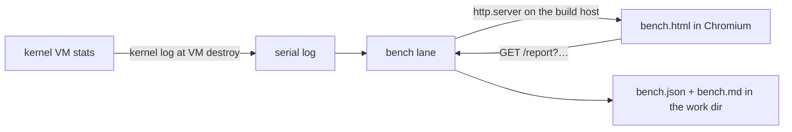

# Phase 2: Smoothness baseline

> **Required — deviation-log:** log every Decision / Deviation / Surprise in § Deviation Log when it happens.

## Overview

"Smooth" needs numbers before anything is tuned. This phase adds a bench page Chromium runs in
the guest and VM-exit statistics from the kernel, and records both for today's guest.

## Requirements

- Functional: a bench lane (`scripts/qemu-tier3-chrome-bench-x86.sh`, manual tier, KVM) serves a
  static page from the build host (the guest reaches it at the user-network gateway), opens it
  in Chromium and collects what the page reports to `/report`:
  - `raf`: frame count and p50/p95/max interval over 5 s of `requestAnimationFrame`;
  - `timer`: p50/p95/max lateness of 200 `setTimeout(4)` callbacks;
  - `js1` / `jsN`: wall time of one fixed integer loop, alone and in four Web Workers at once;
  - `scroll`: frames and p95 interval while a long text page is scrolled by script for 5 s;
  - `paint`: frames while a full-window gradient canvas is redrawn for 5 s.
- Functional: the lane also records click -> Chromium UI and navigation -> report.
- Functional: per-VM exit statistics in the kernel, printed once when the VM is destroyed:
  `[hv-x86] vm N stats: runs=… exits hlt=… ext=… io=… ept=… msr=… cpuid=… cr=… guest_ms=… total_ms=…`.
  Counters live in the VM's own structure (no new statics, no syscall).
- Functional: the kernel logs once which VMX controls the CPU offers that later phases want
  (preemption timer, VMCS shadowing, TPR shadow, APIC-register virtualization, VPID, MSR bitmaps).
- Non-functional: the counters cost two `RDTSC` per world switch and nothing else on the path.

## Architecture

## Assumptions

- **Claim:** the guest reaches a server on the build host at `10.0.2.2` through the bridged
  virtio-net and QEMU's user network. **Confidence:** medium (the guest already leases
  `10.0.2.16` and loads HTTPS pages). **Verify:** first lane run.
- **Claim:** Chromium does not throttle `requestAnimationFrame` in the focused single window
  under cage. **Confidence:** medium. **Verify:** `raf` frame count is non-zero and stable
  across three runs.
- **Claim:** three runs are within 10 % of each other on a quiet host. **Confidence:** low.
  **Verify:** report the spread; widen the sample if not.

## Related Files

- Create: `tests/guests/chrome-bench/bench.html`, `scripts/qemu-tier3-chrome-bench-x86.sh`,
  `scripts/tier3_chrome_bench.py`
- Modify: `scripts/lanes.toml` (manual row), `kernel/src/arch/x86_64/hypervisor/svm_registry.rs`
  (per-VM counters, log at destroy), `hal/arch/x86/src/x86_64/vmx_vcpu.rs` (count by exit
  reason, guest time), `hal/arch/x86/src/x86_64/vmx.rs` (capability report),
  `docs/guides/tier3b-linux-vm.md` (how to run the bench)

## Implementation Steps

1. Bench page and report endpoint; run it under plain QEMU/KVM first (reference numbers).
2. Kernel counters and capability line; `scripts/ci-local.py run x86_64-lint`.
3. Lane; three runs; write `evidence/phase02-baseline.md` with the table and the spread.
4. Changelog entry.

## Success Criteria

- [x] `evidence/phase02-baseline.md` holds the bench table for the CellOS guest and for the
      same image under plain QEMU/KVM, three runs each, with the spread.
- [x] The serial log of a lane run shows the VM statistics line and the VMX capability line.
- [x] `x86_64-lint`, the Chrome lane (21/21) and the four x86 Tier 3 CI jobs still pass.

## Security Considerations

The bench server listens on the build host's loopback only and serves one directory. The
statistics line carries counts and times, no guest data.

## Risk Notes

Numbers taken under three levels of nesting rank changes; they are not what a physical
machine will show. The baseline file says so.

## Deviation Log

- **Deviation (2026-11-25):** the `baseline` target reported two of its three rounds; the
  third ended in `CHROME_GUEST_EXITED:133` before any report (`evidence/phase02-baseline.md`
  line 45). Its medians rest on two runs; the CellOS head and reference targets have three.
- **Closed (2026-11-26):** the VMX capability line (`[hv-x86] VMX offers: …`) and the VM
  statistics lines are in every lane serial log since (e.g.
  `/tmp/cellos-tier3-chrome-kiosk/chrome-serial.log`); `x86_64-lint`, the Chrome lane (now
  24 checks, see phases 04-06) and the x86 Tier 3 CI jobs pass on the current tree.
