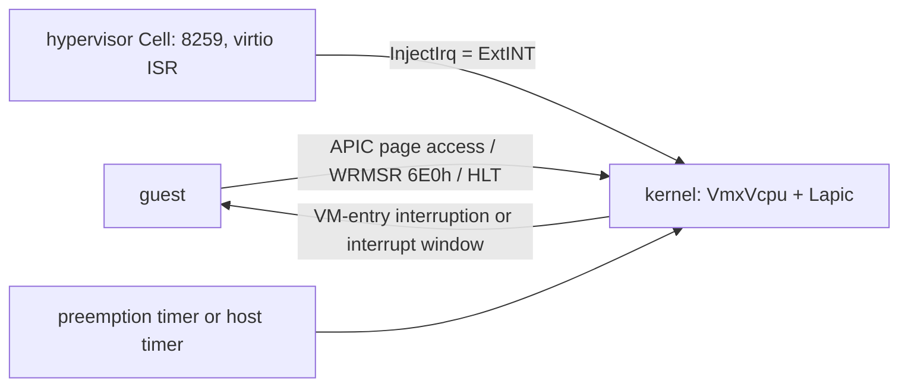

# Phase 4: Guest APIC and timer

> **Required — deviation-log:** log every Decision / Deviation / Surprise in § Deviation Log when it happens.

## Overview

The guest's only clock event is the Cell's PIT tick, delivered when the vCPU happens to exit,
with `nohz=off highres=off`; an injected interrupt is dropped if the guest cannot take it at
that instant. Chromium's 16.6 ms frame timers ride on that. This phase gives each vCPU a local
APIC in the kernel with a TSC-deadline timer and a pending-interrupt model, which phase 05 also
needs for IPIs.

## Requirements

- Functional: per-vCPU xAPIC state in the kernel: ID, version, TPR, PPR, EOI, SVR, ISR/IRR/TMR,
  LVT timer and LINT0/LINT1, ICR (self and, in phase 05, others), with the SDM's priority rules.
  The page at `0xFEE0_0000` is no longer guest RAM: its accesses are EPT violations decoded by
  the existing MMIO decoder (`vmx_vcpu/mmio_access.rs`) and served in the kernel.
- Functional: TSC-deadline timer (`IA32_TSC_DEADLINE`, CPUID.1:ECX[24] shown to the guest).
  While the guest runs, the deadline is met by the VMX preemption timer when the CPU offers it,
  otherwise by a host timer that interrupts the CPU; while it is halted, the kernel sleeps the
  task until the deadline, a pending interrupt or a message.
- Functional: `HLT` is handled in the kernel. The Cell is entered for device exits, on budget
  expiry and when it has a message.
- Functional: interrupts stay pending until deliverable (interrupt-window exiting); the Cell's
  8259 output is ExtINT on LINT0 of the boot vCPU. `InjectIrq` on x86 therefore never loses a
  vector (Law 1: `libs/abi/abi/syscalls.toml` text, CP1 before the edit).
- Functional: Chrome guest command line without `nohz=off highres=off lpj=…`.
- Non-functional: SVM keeps its current LAPIC handling; the console and fixture guests boot
  unchanged on both backends.

## Architecture

## Assumptions

- **Claim:** Linux uses the LAPIC TSC-deadline timer as its clock event when the CPUID bit is
  present and the TSC frequency is given (`tsc_early_khz`), without needing the PIT tick.
  **Confidence:** medium. **Verify:** guest boot log and `/proc/timer_list` under the microvm
  reference and under CellOS.
- **Claim:** KVM offers CellOS the VMX preemption timer here. **Confidence:** medium.
  **Verify:** phase-02 capability line. Fallback is the host timer path.
- **Claim:** the existing decoder covers every instruction form Linux uses on the APIC page.
  **Confidence:** medium. **Verify:** an undecodable access stops the VM with the bytes logged
  (as the virtio window does today); extend the decoder for what appears.
- **Claim:** the kernel has a one-shot timer that can wake a sleeping task at a nanosecond
  deadline. **Confidence:** low. **Verify:** `kernel/src/sched/`, completion `TIMER` source.

## Related Files

- Create: `hal/arch/x86/src/x86_64/vmx_vcpu/lapic.rs` (register model, priority, timer),
  host tests for it
- Modify: `hal/arch/x86/src/x86_64/vmx_vcpu.rs`, `vmx_vcpu/msr_access.rs`,
  `vmx_vcpu/mmio_access.rs`, `vmx_vcpu/vmcs_scope.rs`, `guest_cpuid.rs`,
  `kernel/src/arch/x86_64/hypervisor/svm_registry.rs`, `kernel/src/arch/x86_64/memory/ept.rs`
  (APIC page hole), `cells/services/hypervisor/src/x86-irq-dispatch.rs`, `run_loop_x86.rs`,
  `boot_x86_profile.rs`, `libs/abi/abi/syscalls.toml` (text), `docs/abi-boundary-records.md`

## Implementation Steps

1. CP1 for the `InjectIrq` text; record in `docs/abi-boundary-records.md`.
2. `lapic.rs` with host tests (priority, EOI, timer arithmetic) from the SDM, vol. 3 ch. 11.
3. Trap the APIC page; serve reads and writes; interrupt window; ExtINT path.
4. TSC-deadline MSR, preemption timer or host timer, in-kernel `HLT`.
5. Command line; measure; lanes.

- [x] Guest `/proc/timer_list` names the LAPIC deadline device with high-resolution mode on
      (marker `CHROME_GUEST_CLOCK` printed by the guest init into the serial log).
- [x] Bench `timer` p95 lateness and `raf` p95 interval reported before and after
      (deviation log; `evidence/phase04a-bench.*`).
- [x] No interrupt is lost: the virtio-e2e and hostile CI jobs pass; a 10-minute video page
      shows no stall in the serial log.
- [x] `lapic.rs` host tests, `x86_64-lint`, Chrome lane, display lane and the x86 Tier 3 CI jobs pass.

## Security Considerations

The APIC model is kernel code reachable by the guest: every register write is validated,
reserved bits are ignored as the SDM states, and vectors below 16 are rejected. The timer can
make the kernel sleep; the sleep is bounded by `budget_ns`.

## Risk Notes

Timer bugs show as a hung guest. The PIT path stays in the Cell for the console profile until
this path has run the lanes; the profile switch is one constant.

## Deviation Log

- Decision (step 1): CP1 for the `InjectIrq` text was given with the plan's approvals
  (2026-11-25). Text in `libs/abi/abi/syscalls.toml`, record `docs/abi-boundary-records.md`
  §21 (with `RunVcpu`'s `budget_ns` and the `Hlt` meaning). CP2 pending.
- Deviation: the 8259 is not routed as ExtINT on LINT0. A raised vector waits in a per-vCPU
  set (`hal/.../pending_irqs.rs`) beside the APIC's IRR and is injected like INTR: lower
  priority than the APIC's own requests, held back by the task priority, no APIC EOI. Same
  effect for the guest (the 8259 is acknowledged at the 8259), less model.
- Deviation: virtio lines are raised on the rising edge of the device's ISR (once per guest
  acknowledgement, `VirtioMmio::take_interrupt_edge`), and the PIT when a tick is due, before
  every entry; before, both were offered only at HLT and host-interrupt exits and dropped
  when the guest had IF=0.
- Measured, pending interrupts alone (`phase04a-bench.*`, three rounds in turns, quiet host):
  `timer` p95 7.3 -> 6.4 ms, `js1` 549 -> 400 ms, `raf` frames 256 -> 274; launch 25.4 ->
  26.5 s, scroll frames 275 -> 223, `RunVcpu` calls 82.9k -> 71.4k. HLT exits 34.9k -> 0:
  the guest now idles halted in the guest until the run's budget ends (`halts_in_guest`).
- Surprise: with the APIC timer on and the guest's periodic tick flags dropped, the first boot
  took 125 s to mount its root. Two causes: the UART flushed a partial line at every
  preemption (the guest's log arrived in fragments, each a host `print`), and a masked PIT
  line that stayed due cut every run's budget to the 50 µs floor. Fixed: a partial line goes
  out after two quiet boundaries in a row; the budget ignores a tick whose line is masked.
- Measured, APIC timer (`phase04c` in the lane logs, three rounds): `timer` p50/p95 6.0/7.3 ->
  1.5/3.8 ms, `js1` 594 -> 457 ms, `raf` frames 259 -> 290, launch 24.4 -> 24.5 s; scroll
  frames 267 -> 221 and paint 257 -> 217 fell. MSR exits 13k -> 21k and EPT exits 13k ->
  23k: the guest's one-shot timer is a `WRMSR` per event and its EOI an APIC-page write, each
  a trip into the kernel.
- Decision (entry path, follow-up of the above): the guest's KERNEL_GS_BASE and SYSCALL MSRs
  are switched once per `RunVcpu` instead of around each entry (8 trapped MSR accesses per
  in-kernel exit before), the host's SYSCALL values are kept per CPU, and the exit path reads
  RIP and the instruction length only when it finishes an instruction.

- Closed (2026-11-26): `CHROME_GUEST_CLOCK event=lapic-deadline source=tsc hres=1` in every
  lane run (lane check `guest-apic-deadline-timer`). `hal-x86` host tests 57 pass; Chrome
  lane, display lane, `x86_64-lint` and the x86 Tier 3 CI jobs pass on the current tree.
- Deviation (soak): no video page was used. The guest image has no video codec test page
  and no host media; the soak reloads `tests/guests/chrome-bench/bench.html` (animation at
  60 fps, scrolling, timers, workers) in one Chromium for 10 minutes: 608 s, 27 rounds, no
  missing report, nothing matching a lockup, RCU stall, segfault or oops in the serial log
  (`BENCH_SOAK=600`, `/tmp/cellos-tier3-soak2/soak.log`).
