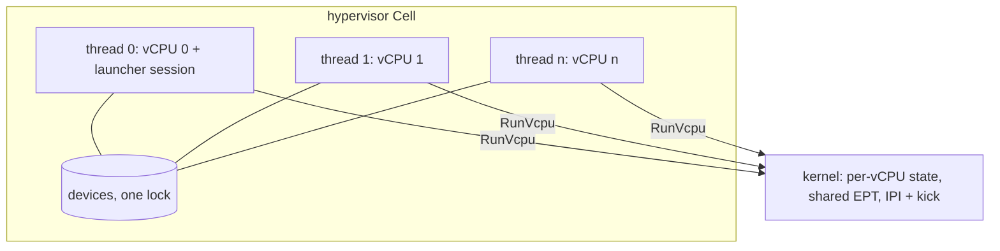

# Phase 5: More vCPUs

> **Required — deviation-log:** log every Decision / Deviation / Surprise in § Deviation Log when it happens.

## Overview

Chromium is a set of processes and threads sharing one vCPU. With the APIC of phase 04 the
guest can start more: this phase lets the Chrome guest boot N vCPUs, each a thread of the
hypervisor Cell on its own host CPU.

## Requirements

- Functional: `CreateVcpu` for a VM's second and later vCPUs builds an application processor:
  APIC ID = its index, waiting for INIT/SIPI (Law 1: `libs/abi/abi/syscalls.toml` text, CP1).
  INIT and SIPI written to the ICR by another vCPU reset it and start it in real mode at the
  SIPI vector (unrestricted guest is already required).
- Functional: the registry lock is not held while a guest runs. A vCPU is owned by the task
  inside `RunVcpu`; other threads can run other vCPUs, inject, and copy guest memory.
- Functional: fixed, NMI, INIT and SIPI IPIs between vCPUs; a vCPU running on another host CPU
  is interrupted with a host IPI, a halted one is woken.
- Functional: CPUID topology per vCPU (leaf 1 EBX, leaves 4 and 0Bh) and one MADT local-APIC
  entry per vCPU.
- Functional: the hypervisor Cell runs one thread per vCPU (`Spawn` in its allowlist and
  catalog row: CP1). Device models sit behind one lock; port and MMIO exits arrive from any
  vCPU; the 8259 output goes to the boot vCPU.
- Functional: the Chrome profile uses `min(4, host CPUs - 1)` vCPUs, at least 1; the console
  and fixture profiles stay at 1. `run-desktop.sh` and the KVM lanes give the machine 4 CPUs.
- Non-functional: SVM refuses a second vCPU with `NotSupported`.

## Architecture

## Assumptions

- **Claim:** a Cell can learn the number of online host CPUs. **Confidence:** low.
  **Verify:** `libs/ostd/src/syscall.rs`; otherwise the launcher passes a count it is given.
- **Claim:** holding one device lock across a VFS or net IPC is acceptable at 4 vCPUs.
  **Confidence:** medium. **Verify:** bench `jsN` and a download while a video plays.
- **Claim:** the kernel has an IPI that only forces the target CPU out of guest mode.
  **Confidence:** medium (`hal/arch/x86/src/x86_64/apic.rs:178` `send_ipi`). **Verify:** read it.
- **Claim:** Linux brings up APs from MADT entries with INIT/SIPI in xAPIC mode without an
  IOAPIC. **Confidence:** medium. **Verify:** microvm reference with `noapic`-like tables, then CellOS.

## Related Files

- Modify: `kernel/src/arch/x86_64/hypervisor/svm_registry.rs`, `kernel/src/task/syscall/vm.rs`,
  `hal/arch/x86/src/x86_64/vmx_vcpu.rs`, `vmx_vcpu/lapic.rs`, `guest_cpuid.rs`,
  `kernel/src/catalog.rs` (hypervisor row), `libs/abi/abi/syscalls.toml`,
  `cells/services/hypervisor/src/main.rs` (allowlist), `boot_x86.rs`, `boot_x86_profile.rs`,
  `acpi.rs`, `run_loop_x86.rs`, device models (lock), `run-desktop.sh`, `scripts/tier3_vm.py`
- Regenerate: `scripts/catalog.generated.json`, syscall headers, mutable-globals inventory

## Implementation Steps

1. CP1 for `CreateVcpu` and the catalog row; records in `docs/abi-boundary-records.md`.
2. Kernel: vCPU ownership without the registry lock; kick IPI; IPIs through the ICR; AP state.
3. Cell: device lock, vCPU threads, MADT, profile count.
4. Guest marker `CHROME_GUEST_DEVICES … cpus=N`; lane check; bench.
5. Soak: 10 minutes of a video page plus scrolling; no stall, no lost wake-up.

## Success Criteria

- [x] The Chrome guest reports N = 4 CPUs on a 5-CPU machine and 1 on a 1-CPU machine (lane).
      (Changed by the owner's decision in the deviation log: 1 by default, 4 with
      `/chrome-guest-vcpus` on the lane's 8-CPU machine; lane check `guest-four-vcpus`.)
- [x] Bench `jsN` wall time falls with N; every bench row before and after.
      (958 -> 723 -> 517 ms for 1, 2, 4 vCPUs; `evidence/phase05-vcpus.md`.)
- [x] Chrome lane, display lane, hypervisor smoke (KVM) and the x86 Tier 3 CI jobs pass.
      (Chrome lane: four of five runs with four vCPUs, see the evidence file.)
- [x] The soak run ends with the guest responsive and no kernel warning.
      (Four vCPUs, 8 CPUs: 622 s, 20 reloads, slowest 35.7 s on a busy host; one vCPU:
      608 s, 27 reloads. No lockup, stall, segfault or oops in either serial log.)

## Security Considerations

Thread spawn is a new right for the hypervisor Cell; its ceiling stays the reviewed row. A
guest can now make host CPUs busy up to its vCPU count; the count is fixed by the profile and
the guest budget charge per vCPU already applies. INIT/SIPI state changes are validated in the
kernel against the SDM's wait-for-SIPI rules.

## Risk Notes

Races between vCPU threads and device models are the main risk; the single lock trades speed
for a small proof. Per-device locks are a later change if the bench asks for it.

## Deviation Log

- **Decision (2026-11-26):** kernel keeps each vCPU in `VcpuSlot { vcpu: Spinlock<X86Vcpu>,
  shared: VcpuShared }` (`kernel/src/arch/x86_64/hypervisor/vcpu_slot.rs`); `RunVcpu` clones
  the VM's `Arc<[Arc<VcpuSlot>]>` under the registry, releases it, and holds only the vCPU's
  own lock across the run. Other threads reach a running vCPU through its mailbox
  (`hal/.../vmx_vcpu/shared.rs`: VMM lines, fixed IPIs, INIT/SIPI, logical ID, running CPU)
  and a kick (`sched::smp::send_ipi`), which ends its time in the guest via
  external-interrupt exiting.
- **Decision:** NMI IPIs are not delivered (not modelled); lowest-priority delivers as fixed
  to every addressed vCPU. Recorded in `docs/abi-boundary-records.md` §23.
- **Decision:** the device lock is `ostd::sync::Mutex` taken through `yield_lock::lock`
  (spin 64, then yield) instead of a new lock type: a Cell-local lock type needs `unsafe`,
  which needs an F1 allowlist entry.
- **Surprise:** `Machine` was `!Send` because `virtio_gpu::resource::ScanoutGrant` holds the
  Grant base as `*mut u8`. An `unsafe impl Send` was refused by the Tier-1 `unsafe` ceiling
  (588 > 587). Going through `ostd::grant::with_shared_bytes_mut` instead failed on the AP
  threads: the kernel keys a Grant by its registering *task* (`grant.owner.tid`), so the
  guest's `TRANSFER_TO_HOST_2D`/`SET_SCANOUT` from an AP got `RESP_ERR_OUT_OF_MEMORY` and
  Chromium never drew (bench run, serial log). **Final:** the GPU stays on the BSP's thread
  (`x86-machine.rs` module note); an AP's access to the GPU slot is handed over and served at
  the BSP's next loop head; with more than one vCPU the BSP's runs stay at the 1 ms poll.
  `virtio_gpu/*`, `scripts/unsafe-allowlist.toml` and `scripts/tcb-unsafe-baseline.toml` are
  unchanged (587 at the ceiling).
- **Decision:** a host interrupt that ends a VMX run before its budget no longer ends the
  `RunVcpu` call: `run_vcpu_hal` lets the host take it with the vCPU's lock released and
  re-enters (`svm_registry.rs`). Kicks then reach a guest without a trip through the Cell
  and its scheduler queue. Bench (8 CPUs, 4 vCPUs vs 1, same rounds): paint frames 252 ->
  271 of 283; scroll frames unchanged (188-194 vs 283).
- **Measured:** 4 vCPUs on a 5-CPU machine starved the BSP and compositor (raf 148 vs 301
  frames, timer p95 17 vs 3 ms); hence one vCPU per two machine CPUs. A re-enter-at-once AP
  loop (no yield after `Preempted`) drew nothing in 2 of 2 runs, but those runs also had the
  Grant bug above, so the cause is not separated; the yield stays.
- **Decision (owner, 2026-11-26, CP2 question):** the Chrome guest keeps **one vCPU by
  default**; the SMP code stays. Same-round bench, 8-CPU machine, 4 vCPUs vs 1: jsN 517 vs
  958 ms, raf frames 279 vs 302, scroll frames 155 vs 283, paint 242 vs 286, timer p95 3.2 vs
  1.3 ms. More vCPUs come from an image file `/chrome-guest-vcpus` (one number, capped at 4
  and at half the machine's CPUs); the Chrome lane adds it with 4.
- **Deviation:** the first switch was a Cargo feature plus `assemble-x86-image.py
  --cell-feature`; the signing route refused it (`scripts/assemble-x86-image.py differs from
  its reviewed SHA-256 pin`). Reverted; the lane uses `tier3_build_iso`'s existing extra-file
  arguments instead.
- **Deviation:** a guest-side pin of cage to CPU 0 (to keep GPU accesses on the first vCPU)
  did not remove hand-overs (282 in one run; DRM work also runs in kernel workers) and
  Chromium died with signal 5 in 4 of 4 SMP runs; reverted.
- **Deviation:** the catalog row was not changed: `ostd::task::spawn` (threads) needs only
  the `Spawn` allowlist bit (`declare_syscalls!`); the manifest's `spawn` right (new Cells)
  stays off. Nothing to regenerate in `scripts/catalog.generated.json`.
- **Deviation:** exit counts (`[hv-x86] exits to the Cell`) cover the first vCPU only; the
  others' kernel-side stats are in `[hv-x86] vm N vcpu N stats` at reap.

