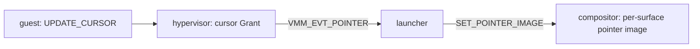

# Phase 8: Pointer shape

> **Required — deviation-log:** log every Decision / Deviation / Surprise in § Deviation Log when it happens.

## Overview

Since phase 01 the only pointer over the Chrome window is the host's arrow: it never becomes
an I-beam over text or a hand over a link. The guest already sends its cursor image on the
virtio-gpu cursor queue; this phase lets the host pointer wear it.

## Requirements

- Functional: compositor request `SET_POINTER_IMAGE` (`0x14`): a surface owner gives an image
  of at most 64x64 BGRA with a hot spot, or none (hide), for the pointer while it is over that
  surface's content. Leaving the surface restores the arrow. Works on the software cursor path
  and, where the display driver has one, the hardware cursor (`GpuCursor`).
- Functional: `VMM_EVT_POINTER` (`0x84`): the hypervisor tells the launcher that the guest's
  cursor image changed (a small Grant it owns, size, hot spot) or was hidden; the launcher
  forwards it to the compositor.
- Non-functional: pointer moves still cost no scanout copy; an image change is one 16 KiB copy.

## Architecture

## Assumptions

- **Claim:** cage sends a new cursor image for each shape Chromium asks for.
  **Confidence:** high (the cursor plane was absent from the microvm screen dumps in phase 01).
  **Verify:** count `UPDATE_CURSOR` with distinct resources while moving over text and links.
- **Claim:** the compositor can composite a 64x64 alpha image at the pointer without tearing
  its damage logic. **Confidence:** medium. **Verify:** `cursor_state.rs`, `render.rs:115`.

## Related Files

- Modify: `libs/wire/src/display.rs` (opcode), `libs/ostd/src/display/` (client call),
  `cells/services/compositor/src/{cursor_state,cursor_sprite,render}.rs`, `message_handler/`,
  `libs/wire/src/vmm_session/events.rs`, `cells/services/hypervisor/src/virtio_gpu*`,
  `cells/apps/chrome/src/app.rs`, `docs/abi-boundary-records.md` (two records, CP1 first)

## Implementation Steps

1. CP1 for the two wire frames; records.
2. Compositor: per-surface pointer image, software and hardware paths, host tests for the
   decoder (reserved bytes, size limits, foreign surface).
3. Hypervisor: keep the cursor resource's pixels in a Grant; event; launcher forward.
4. Lane: pointer over the omnibox is not the arrow, and is still exactly one pointer.

## Success Criteria

- [x] Lane: over the omnibox the pointer's pixels differ from the arrow sprite; over the page
      background they match it again; one pointer in both.
      (As changed in the deviation log: `pointer-follows-guest-cursor`.)
- [x] Compositor and wire host tests pass; `check-service-wire-literals.py` passes.
      (compositor 85, wire 95; `service wire literals: OK`.)
- [x] Chrome lane and display lane pass. (Chrome lane 25/25, display lane 43/43, 2026-11-26.)

## Security Considerations

The image is guest-controlled data shown by the compositor: size is capped at 64x64, the
Grant must be owned by the sender's hypervisor, and the image applies only inside the sender's
own surface, so a guest cannot draw over other windows or hide the pointer elsewhere.

## Risk Notes

A hidden guest cursor (video playback) hides the host pointer over the window; it reappears
on the next guest cursor update or when it leaves the window.

## Deviation Log

- **Deviation (criterion 1):** "over the page background they match [the arrow sprite]
  again" cannot hold: over the page the guest sends its own arrow, whose pixels differ from
  the compositor's sprite. The lane check `pointer-follows-guest-cursor` instead measures the
  pointer as the pixels that change when it leaves the window, at an empty page spot and over
  the omnibox: both are one pointer within 32x32, and the two shapes differ (2026-11-26: page
  94 px in 10x16, omnibox 86 px in 9x16; screenshots confirm arrow and I-beam).
- **Decision:** the image reaches the compositor in a Grant, not inline: the compositor reads
  512 bytes of a request, a 64x64 image is 16 KiB. Grants belong to the task that registered
  them, so the hypervisor's cursor Grant is copied by the launcher (owner-checked) into its
  own, which the compositor copies (owner-checked) on receipt.
- **Decision:** the shown look is that of the surface a pointer event would reach (its
  capture, else the content under the pointer), recomputed once per compositor turn; window
  decorations, menus, drags and resizes show the arrow. The hardware cursor path uploads a
  64x64 sprite when the look changes.
- **Surprise (fixed on the way):** the software pointer was composited even while the
  hardware cursor was active (`render_frame` always drew it); it is now drawn only on the
  software path.
- **Surprise:** the first lane run drew the guest cursor on an opaque black 64x64 square: I had
  treated the fourth byte of a B8G8R8X8 cursor resource as padding and made it opaque, but the
  guest writes alpha there (the console path, which blends it as alpha, always drew correctly).
  Fixed; the lane check bounds the pointer to 32x32 so the square would fail it.
