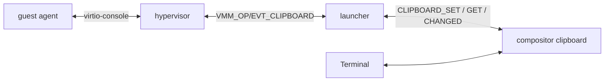

# Phase 9: Clipboard

> **Required — deviation-log:** log every Decision / Deviation / Surprise in § Deviation Log when it happens.

## Overview

CellOS has no clipboard: Files, the editor and Terminal each keep their own. A bridge to the
guest needs a host clipboard first. This phase adds a text clipboard held by the compositor,
bridges it to Chromium, and gives it one native user so a copy can cross in both directions.

## Requirements

- Functional: compositor requests `CLIPBOARD_SET` (`0x15`) and `CLIPBOARD_GET` (`0x16`) and
  event `CLIPBOARD_CHANGED` (`0xA4`). UTF-8 text, at most 64 KiB (the size `PASTE_MAX` already
  uses), carried in a Grant. Only the owner of the focused surface may set or get; the event
  goes to the surface that gains focus when the content changed since it last saw it.
- Functional: guest side: a small agent (`wl-clipboard`, pinned) watches Chromium's selection
  and sets it; it speaks a framed byte protocol on a virtio-console port (the device model
  exists, `virtio_console.rs`, and gets its x86 slot here).
- Functional: `wire::vmm_session` gains `VMM_OP_CLIPBOARD` (host -> guest) and
  `VMM_EVT_CLIPBOARD` (guest -> host), both carrying a Grant id and a length.
- Functional: Terminal pastes the clipboard (Ctrl+Shift+V) through its existing paste path
  and copies its screen selection, if it has one; otherwise the editor (`text-engine`) is the
  native user. One native user is required for the phase to close.
- Non-functional: nothing moves while the Chrome window is unfocused; binary and file
  clipboard types are out of scope.

## Architecture

## Assumptions

- **Claim:** cage 0.2.0 offers `wlr-data-control`, so `wl-paste --watch` and `wl-copy` work
  without a focused surface of their own. **Confidence:** low. **Verify:** microvm reference
  first; if absent, the agent must be a real Wayland client inside cage (re-plan the guest side).
- **Claim:** `wl-clipboard` and its dependencies fit in the 10 MiB left on `/mnt/sd`.
  **Confidence:** medium. **Verify:** builder output size.
- **Claim:** the compositor is the right holder (it already owns focus). **Confidence:** medium.
  A separate service would need a service id in `libs/abi` (Law 1); the compositor route needs
  only wire opcodes. **Verify:** owner decision at CP1.

## Related Files

- Modify: `libs/wire/src/display.rs`, `libs/ostd/src/display/`, `cells/services/compositor/src/`
  (clipboard state, focus hook, decoders), `libs/wire/src/vmm_session.rs`,
  `cells/services/hypervisor/src/{virtio_console.rs,x86-mmio-dispatch.rs,app_session_x86.rs,boot_x86_profile.rs}`,
  `cells/apps/chrome/src/`, `cells/apps/terminal/src/`, `scripts/build-chrome-guest-image.sh`,
  `scripts/chrome-guest/init.sh`, `docs/abi-boundary-records.md`

## Implementation Steps

1. Microvm check of the guest agent idea; CP1 for the wire frames.
2. Compositor clipboard with host tests (focus rule, size, UTF-8, reserved bytes).
3. virtio-console on x86, session frames, launcher bridge.
4. Terminal (or editor) integration.
5. Lane: copy in Chromium -> paste in Terminal; copy in Terminal -> paste in Chromium.

## Success Criteria

- [x] Lane: text selected and copied in a Chromium page appears when pasted into the native
      app, and the reverse, each checked from pixels or the serial log.
      (`chromium-copy-pastes-in-terminal`, `terminal-copy-pastes-in-chromium`: the pasted URL loads.)
- [x] An unfocused window's `CLIPBOARD_GET` is refused (host test and lane negative check).
      (`only_the_focused_surfaces_owner_sets_or_gets`; lane `unfocused-guest-gets-no-clipboard`.)
- [x] Wire and compositor host tests, `check-service-wire-literals.py`, Chrome lane pass.
      (wire 98+, compositor 90, terminal 70, hypervisor 38; Chrome lane 31/31 twice; display lane
      43/43; CI lint, x86_64-lint, unit-tests, hypervisor-boot, virtio-e2e, python pass; hostile
      passed on rerun, the first run lost its marker to interleaved serial output.)

## Security Considerations

The clipboard crosses the VM boundary in both directions: the guest sees what the user copies
on the host only while the Chrome window has focus, and the host takes guest text only then.
Text is length-checked and validated as UTF-8 before it reaches a native app. The agent runs
as the guest's unprivileged user.

## Risk Notes

A page can read the clipboard only with Chromium's own permission prompt; that policy stays
Chromium's. If cage lacks data-control the guest side grows; the host side does not change.

## Deviation Log

- **Surprise (assumption 1 false):** cage 0.2.0 does not create `wlr-data-control`; its binary
  creates only the primary-selection manager (`strings`: `wlr_primary_selection_v1_device_manager_create`),
  while `libwlroots-0.18.so` has `zwlr_data_control_manager_v1`.
- **Decision (owner, 2026-11-26):** route (a): an `LD_PRELOAD` shim beside `no-key-repeat.so`
  creates the data-control manager on cage's display; host side unchanged. CP2 for phases
  02-08 approved the same day.
- **Decision:** the guest line protocol is text, not framed binary: one line per clipboard text,
  `C` + base64 + `\n`, so the agent stays a shell script around `wl-paste --watch` / `wl-copy`
  (busybox `base64`, `head -c 65536`). The host trims a cut UTF-8 tail and drops other invalid
  text; a line over 90000 bytes is discarded.
- **Decision:** the compositor marks a surface as having seen the text only when the
  `CLIPBOARD_CHANGED` send went through, and retries on its next turn; it re-shares its Grant
  with each receiver (the kernel keeps one receiver per Grant).
- **Decision:** Terminal had no selection; it gets one (left-drag over cells, inverted colours),
  Ctrl+Shift+C / Ctrl+Shift+V, and a pending paste expires after 1 s so an offer that arrives
  on a later focus change is never pasted unasked.
- **Surprise:** the first agent set `stty raw -echo` on `/dev/hvc0` and then opened it again;
  hvc resets a port's terminal settings at its last close, so the guest added CR to every
  newline (the host's base64 refused each line) and echoed what it received. The agent now
  holds the port open on fd 3 and sets the mode while it does.
- **Surprise:** `x86-mmio-dispatch` gained slot 2; the console's direct `inject_irq` and
  `vmm::device_irq` are now aarch64-only (x86 raises the console on the shared display line).
- **Surprise (lane bug, pre-existing):** `poll_screen` checked for a downed guest in the whole
  serial log, so in the second session the first session's `[hv-x86] guest exited` ended the
  page wait at once; the lane then pressed Ctrl+Shift+W, which looked like Chromium quitting
  (exit 0) after the paste. 4 of 5 runs failed that way; with the wait scoped to the session
  (`since`) they pass. Also added: the guest init prints Chromium's fatal lines
  (`CHROME_GUEST_WHY`) and the agent's log (`CHROME_GUEST_CLIPBOARD_LOG`) when cage ends.
