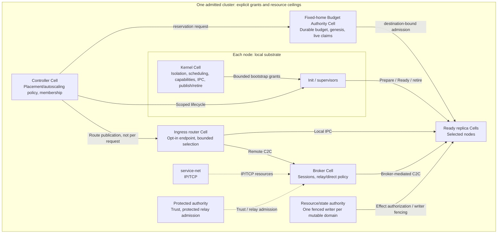

# Cellos

[](https://github.com/dxsl-org/cellos/actions/workflows/ci.yml)
[](https://ko-fi.com/dxsl_org)
[Tiếng Việt](./README_VN.md)

**Cellos is a Rust-native research operating system for explicit Cell-to-Cell communication on Intel x86-64.**

Its design unit is the **Cell**: a principal with scoped authority, bounded resources and a recoverable lifetime—not a process per request or a distributed address space. The goal is to connect native Cells, isolated C/C++ workloads and VM guests through defined service contracts, locally and across admitted nodes, without hiding authorization or failure.

**Architecture selected; runtime cutover pending.** [ADR-0024](./docs/decisions/0024-cell-kernel-authority-contract.md), [Spec 25 v1.3](./docs/specs/25-cell-kernel-authority-contract.md) and [Spec 26 v1.1](./docs/specs/26-workload-placement-scaling-contract.md) define the target. Existing local evidence does not qualify cluster routing, recovery or autoscaling.

## Key ideas

- **Cell-owned authority.** The target uses one shared, kernel-protected capability space per Cell incarnation: typed generational handles, attenuated delegation and bounded revocation. Names, signatures, thread IDs and authenticated peer connections do not themselves grant method or resource rights.
- **One operation contract, explicit failures.** Local IPC and remote C2C share correlation, admission, deadlines, cancellation and incarnation binding—not pointers or identical failure behavior. Copied IPC is the default; authorized local grants/rings are optional transports. After dispatch, a timeout or lost reply can mean uncertain effects, not permission to replay.
- **A small privileged substrate, explicit service owners.** Kernel Cell is the exceptional root and local enforcement substrate. VFS owns file/directory semantics; service-net owns IP/TCP; a broker owns peer sessions and bounded connection pools; protected authority owns peer trust and protected relay admission.
- **Recovery separate from execution.** Replacement prepares, restores committed business state, reacquires resource rights and becomes Ready before publication. Mutable state has one fenced writer per state domain. Recovery must match the declared failure class; serialized handles and a worker-local snapshot are not durable authority.
- **Opt-in workload distribution, independently enforced budget.** Compatible typed methods use bounded weighted routing; concrete endpoints remain pinned. Controller chooses placement/scaling; an isolated Budget Authority enforces the cluster-wide application vector, including control overhead and uncertain children. Automatic scaling uses homogeneous domains and reconciled generation-complete demand.
- **Compatibility without making POSIX the core.** The selected native model uses C2C directly. Optional local runtime adapters and domain-selected POSIX personality Cells provide only the compatibility semantics a workload requires; full Linux binary compatibility is not promised.

These are design choices to implement and measure, not claims of universal security, zero-copy across machines, hard real-time behavior or superiority to Linux.

## Architecture

A **node is one kernel instance**, on physical hardware or in a VM. A cluster contains multiple nodes. Each Cell incarnation resides on exactly one node; its threads stay node-local. Hundreds of requests can use a Cell's bounded workers and operations without hundreds of Cells or connections.

The following is a **selected target diagram**, not a map of shipped cluster services:



Router verifies destination Ready provenance and preserves immutable origin payload/deadline/operation with one issuer-sealed target; no retry, hedge or implicit remote fallback. Receiver-start challenges bound freshness; unresolved old ingress generations freeze scaling. Budget Authority reserves before spawn, retains unknown charges and requires live destination claims. Controller is neither cluster root nor budget issuer. No distributed shared memory, cross-node threads or automatic authority-home promotion.

Kernel Cell is not an ordinary restartable service: kernel failure requires node recovery. Internal kernel functions need not become queued RPCs. Resource issuers retain their own semantic authority; the kernel does not duplicate every service ACL.

## Status and evidence boundaries

| Area | Existing foundation / selected work | Current limit |
|---|---|---|
| Local foundation | Generation-bound principals/endpoints, bounded RPC mechanisms, directory capabilities and userspace supervision; x86 q35 boot/CPL3 integration evidence | Prior evidence keeps its exact architecture/profile scope. It does not establish the complete new Cell contract. |
| Shared Cell authority | **Selected; pending** Kernel Cell identity, one shared CSpace, typed delegation/revocation and aggregate budgets (P02/P05) | Existing per-task capability snapshots are not the target shared authority model. |
| Threads and SMP | **Selected; pending** unified thread ownership, multi-wait operations, whole-Cell retirement and CPU/DMA quiescence (P03/P04) | Existing scheduler/completion work is reused; the new lifetime and multicore contract is not qualified by it. |
| State and recovery | **Selected; pending** committed-state watermark, single-writer fencing, resource reacquisition and bounded crash evidence (P06) | Node/power-loss recovery needs durable state and ordering proof. Whole-kernel warm snapshot remains disabled and unqualified. |
| Remote C2C | **Selected; pending** authenticated exports, remote operations/lifecycle and reconciliation (P08) | No shipped cluster-runtime claim. Relay-first is the baseline; direct LAN and protected relay/production activation have separate gates. |
| Workload distribution | **Selected; pending** logical pools, bounded weighted routing, deterministic constrained placement and demand-based autoscaling (P08/P10) | Durable application reservations, hysteresis/cooldown, safe drain and actual load-driven spawn still require implementation and runtime evidence. |
| Intel tiers and hardware | q35 software evidence and retained test-image Tier 2/runtime evidence; Intel VMX and physical qualification remain required (P07/P09/P10) | QEMU does not qualify a physical PC, Intel VMX/EPT or protected production authority. No physical x86 HCL entry is qualified. |

Spec 25 owns **AC-01..AC-50**, all pending implementation; Spec 26 supplies normative detail. The [controlling plan](./.agents/261011-1200-cell-contract-authority/plan.md) has ten pending phases. [38 overlapping-plan locks](./.agents/cell-contract-0024-locks.md) remain active: documentation does not approve ABI bytes or activate remote/production paths.

### Active scope

[ADR-0022](./docs/decisions/0022-intel-x86-64-c2c-only-direction.md) makes **headless Intel x86-64 C2C Anywhere the sole active direction**. Qualify one exact configuration, then a separately qualified second Intel node; the same model is preferred, not assumed qualified. Hardware requirements and evidence live in the [HCL](./docs/hardware-compatibility-list.md).

Existing ARM, RISC-V, AMD and other board code/evidence remain available for necessary shared-code regressions. New platform work and independent GUI/browser, AI, robotics and general-purpose OS programs are paused. Every task must name an Intel C2C deliverable, dependency or necessary regression. Performance comparisons require the same scoped workload and hardware; no “faster than Linux” claim follows from this architecture.

## Execution tiers and trust

Roles such as application, service, driver and supervisor are separate from isolation tier. Tier or locality never grants authority.

| Tier | Intended boundary | Trust and qualification |
|---|---|---|
| **1 — Native SAS** | Admitted native safe Rust and reviewed privileged/unsafe substrate share a Single Address Space | Trusted components, not a hostile native-code sandbox. Rust language-based isolation depends on the compiler, kernel and reviewed unsafe-code trust base. |
| **2 — Paged domain** | Hardware-isolated native C/C++, FFI, dynamic runtimes and other untrusted native code | Never downgrade to SAS when admission fails. Test-image/runtime evidence is not Intel production qualification. |
| **3 — VM guest** | Guests participate through explicit scoped adapters/bridges | Separate guest identity and grants; no inherited host root. Intel VMX is incomplete; AMD SVM/QEMU evidence cannot qualify Intel. |

All three tiers remain part of the C2C destination. A guest boot, a local native demo or an application running in a VM is not end-to-end all-tier C2C completion. Software requires an explicit port or adapter; arbitrary applications do not become distributed automatically.

## Getting started

1. Read the [getting-started guide](./docs/getting-started.md) for setup and lane selection.
2. For the active x86 software lane, follow the checked-in [QEMU q35 build and integration instructions](./boards/qemu/q35-x86_64/README.md), including their prerequisites and separate production/test images. This is a software witness, not physical or production certification.
3. Before choosing work, consult [current focus](./docs/roadmap/current-focus.md), the [contract cutover plan](./.agents/261011-1200-cell-contract-authority/plan.md) and [lock register](./.agents/cell-contract-0024-locks.md).

Use the relevant guide's exact commands and evidence scope rather than a generic workspace build/test recipe or a legacy RV64 default quickstart.

## Source layout

```text
kernel/     Privileged boot, scheduling, memory, loader, IPC and enforcement
hal/        Architecture mechanisms, SoC contracts, core and hardware traits
boards/     Board identities, firmware/device contracts and board instructions
libs/       ABI/types, ostd SDK, runtime adapters and shared libraries
cells/      Apps, services, drivers, runtimes, guests, demos, tools and test Cells
scripts/    Build, image, integration and evidence runners
tools/      Host-side image, SDK and development tooling
tests/      Host/integration suites, fixtures and acceptance harnesses
docs/       Specifications, decisions, guides, roadmaps and recorded evidence
```

This tree includes retained historical programs; their presence does not make them active or make proposed controller/router services implemented.

## Documentation and contributing

- **Documentation entrypoint:** [docs index](./docs/README.md)
- **Direction and status:** [ADR-0022](./docs/decisions/0022-intel-x86-64-c2c-only-direction.md) · [current focus](./docs/roadmap/current-focus.md) · [project roadmap](./docs/project-roadmap.md)
- **Canonical target:** [ADR-0024](./docs/decisions/0024-cell-kernel-authority-contract.md) · [Spec 25](./docs/specs/25-cell-kernel-authority-contract.md) · [Spec 26](./docs/specs/26-workload-placement-scaling-contract.md)
- **System and trust:** [system architecture](./docs/system-architecture.md) · [security model](./docs/security-model.md) · [hardware guide](./docs/hardware-dev-guide.md)
- **Contribution rules:** [CONTRIBUTING](./CONTRIBUTING.md) · [code standards](./docs/code-standards.md)

Read the applicable contract and admission gates before implementation. Preserve frozen interfaces; exact ABI changes require their existing Law-1 approvals. Use trait objects (`dyn Trait`) for dynamic dispatch at prescribed boundaries. Tie cleanup to actual thread, operation, Cell and issuer/resource lifetimes: RAII handles normal ownership release, but fatal faults require enforced retirement and quiescence, not an assumption that destructors run. Select verification from the affected guide/profile and report only the evidence actually obtained. Contributions require DCO sign-off as described in the contribution guide.

Cellos draws inspiration from Theseus OS, Asterinas, Tock and Redox OS.
