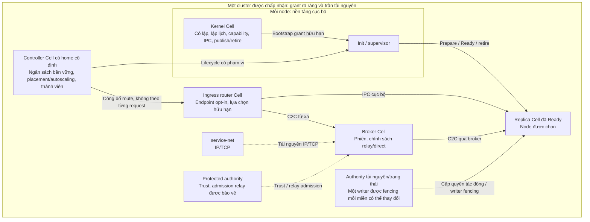

# Cellos

[](https://github.com/dxsl-org/cellos/actions/workflows/ci.yml)
[](https://ko-fi.com/dxsl_org)
[English](./README.md)

**Cellos là hệ điều hành nghiên cứu Rust-native dành cho giao tiếp Cell-to-Cell có hợp đồng rõ ràng trên Intel x86-64.**

Đơn vị thiết kế là **Cell**: một chủ thể có quyền hạn giới hạn, tài nguyên hữu hạn và vòng đời có thể phục hồi—không phải một process cho mỗi request hay một không gian địa chỉ phân tán. Mục tiêu là kết nối Cell native, workload C/C++ được cô lập và guest VM qua hợp đồng dịch vụ xác định, cả cục bộ lẫn giữa các node được chấp nhận, mà không che giấu việc phân quyền hoặc lỗi.

**Đã chọn kiến trúc; chuyển đổi runtime chưa triển khai.** [ADR-0024](./docs/decisions/0024-cell-kernel-authority-contract.md), [Spec 25 v1.2](./docs/specs/25-cell-kernel-authority-contract.md) và [Spec 26](./docs/specs/26-workload-placement-scaling-contract.md) định nghĩa đích thiết kế bên dưới. Cơ chế và bằng chứng cục bộ hiện có là nền tảng, không chứng minh routing, recovery hay autoscaling trong cluster đã được cung cấp.

## Ý tưởng cốt lõi

- **Quyền hạn thuộc về Cell.** Thiết kế đích dùng một capability space chung, do kernel bảo vệ, cho mỗi incarnation của Cell: handle định kiểu có generation, ủy quyền chỉ thu hẹp quyền và thu hồi có giới hạn. Tên, chữ ký, thread ID hay kết nối peer đã xác thực không tự cấp quyền gọi phương thức hoặc dùng tài nguyên.
- **Một hợp đồng thao tác, lỗi minh bạch.** IPC cục bộ và C2C từ xa dùng chung quy tắc tương quan request/reply, admission, deadline, cancellation và ràng buộc incarnation—không dùng chung con trỏ hay có hành vi lỗi giống hệt nhau. IPC sao chép là mặc định; grant/ring cục bộ được cấp quyền là transport tùy chọn. Sau dispatch, timeout hoặc mất reply có thể khiến tác động chưa xác định, không phải quyền để thực hiện lại.
- **Nền tảng đặc quyền gọn, chủ sở hữu dịch vụ rõ ràng.** Kernel Cell là root đặc biệt và nền tảng cưỡng chế cục bộ. VFS sở hữu ngữ nghĩa file/directory; service-net sở hữu IP/TCP; broker sở hữu phiên peer và pool kết nối hữu hạn; protected authority sở hữu niềm tin peer và admission cho relay được bảo vệ.
- **Tách phục hồi khỏi thực thi.** Cell thay thế được chuẩn bị, khôi phục trạng thái nghiệp vụ đã commit, xin lại quyền tài nguyên và đạt Ready trước khi công bố. Mỗi miền trạng thái có thể thay đổi có một writer được fencing. Recovery phải đáp ứng loại lỗi đã khai báo; handle được serialize và snapshot riêng của worker không phải quyền hạn bền vững.
- **Phân phối workload phải opt-in.** Phương thức định kiểu tương thích có thể dùng logical workload endpoint với routing weighted round-robin hữu hạn; endpoint cụ thể gắn generation vẫn được ghim. Controller riêng có home cố định chọn placement và điều chỉnh replica trong một ngân sách bền vững cho toàn ứng dụng, tính cả router/controller và child chưa rõ kết quả.
- **Tương thích mà không biến POSIX thành lõi.** Mô hình native đã chọn dùng C2C trực tiếp. Adapter runtime cục bộ tùy chọn và POSIX personality Cell được chọn theo domain chỉ cung cấp ngữ nghĩa tương thích workload cần; không hứa tương thích nhị phân Linux đầy đủ.

Đây là lựa chọn thiết kế cần triển khai và đo lường, không phải tuyên bố an toàn tuyệt đối, zero-copy giữa các máy, hard real-time hay vượt trội hơn Linux.

## Kiến trúc

Một **node là một kernel instance**, chạy trên phần cứng thật hoặc trong VM. Cluster gồm nhiều node. Mỗi incarnation của Cell chỉ nằm trên một node; thread của nó không rời node đó. Hàng trăm request có thể dùng worker và operation hữu hạn trong một Cell mà không cần hàng trăm Cell hay kết nối.

Sơ đồ sau mô tả **thiết kế đích đã chọn**, không phải các dịch vụ cluster đã được triển khai:



Router giữ nguyên quyền của chủ thể gốc và cố định một đích cụ thể khi submit. Nó không âm thầm retry, hedge hay chuyển lỗi cục bộ thành fallback từ xa. Controller không phải cluster root hoặc bộ lập lịch theo từng request. Nó reserve trước dispatch tạo Cell, tiếp tục tính ngân sách cho kết quả chưa rõ và drain công việc đã được nhận trước scale-down. Thiếu telemetry thì đóng băng scaling; partition hoặc timeout không cho phép thay controller hay state authority. Hợp đồng này không bao gồm bộ nhớ chia sẻ phân tán, di chuyển thread giữa node, tự động resharding hay consensus multi-writer tổng quát.

Kernel Cell không phải dịch vụ có thể restart như Cell thông thường: lỗi kernel đòi hỏi phục hồi node. Hàm nội bộ kernel không bắt buộc trở thành RPC qua hàng đợi. Issuer tài nguyên giữ quyền ngữ nghĩa riêng; kernel không sao chép ACL của mọi dịch vụ.

## Trạng thái và giới hạn bằng chứng

| Hạng mục | Nền tảng hiện có / công việc đã chọn | Giới hạn hiện tại |
|---|---|---|
| Nền tảng cục bộ | Principal/endpoint gắn generation, cơ chế RPC hữu hạn, directory capability và supervision userspace; bằng chứng tích hợp boot/CPL3 trên x86 q35 | Bằng chứng cũ giữ nguyên phạm vi kiến trúc/profile cụ thể. Nó không xác minh toàn bộ hợp đồng Cell mới. |
| Quyền hạn Cell dùng chung | **Đã chọn; chưa triển khai** danh tính Kernel Cell, CSpace chung, delegation/revocation định kiểu và ngân sách tổng (P02/P05) | Capability snapshot theo task hiện tại không phải mô hình quyền hạn chung đích. |
| Thread và SMP | **Đã chọn; chưa triển khai** quyền sở hữu thread thống nhất, operation multi-wait, retirement toàn Cell và quiescence CPU/DMA (P03/P04) | Tái dùng công việc scheduler/completion hiện có; nó không xác minh hợp đồng vòng đời và đa lõi mới. |
| Trạng thái và phục hồi | **Đã chọn; chưa triển khai** watermark trạng thái đã commit, single-writer fencing, xin lại tài nguyên và crash evidence hữu hạn (P06) | Phục hồi mất node/nguồn cần trạng thái bền vững và bằng chứng thứ tự ghi. Warm snapshot toàn kernel vẫn tắt và chưa đạt chuẩn. |
| C2C từ xa | **Đã chọn; chưa triển khai** export được xác thực, operation/lifecycle từ xa và reconciliation (P08) | Không tuyên bố cluster runtime đã được cung cấp. Relay-first là mặc định; direct LAN và kích hoạt protected relay/production có gate riêng. |
| Phân phối workload | **Đã chọn; chưa triển khai** logical pool, weighted routing hữu hạn, placement xác định theo ràng buộc và autoscaling theo nhu cầu (P08/P10) | Reservation bền vững toàn ứng dụng, hysteresis/cooldown, drain an toàn và spawn thực sự theo tải vẫn cần triển khai và bằng chứng runtime. |
| Tier Intel và phần cứng | Bằng chứng phần mềm q35 và bằng chứng Tier 2/runtime trong test image được giữ lại; vẫn cần Intel VMX và xác minh phần cứng thật (P07/P09/P10) | QEMU không xác minh PC vật lý, Intel VMX/EPT hay protected authority cho production. Chưa có mục x86 vật lý đạt chuẩn trong HCL. |

Spec 25 sở hữu **AC-01..AC-43**, tất cả chưa triển khai; Spec 26 mở rộng nó mà không lập acceptance ledger cạnh tranh. [Kế hoạch điều khiển](./.agents/261011-1200-cell-contract-authority/plan.md) có mười phase đang pending. **CELL-CONTRACT-0024** giữ nguyên [38 quyết định xử lý kế hoạch chồng lấn](./.agents/cell-contract-0024-locks.md): viết xong tài liệu không mở khóa thực thi, duyệt byte ABI hay kích hoạt đường từ xa/production.

### Phạm vi đang hoạt động

[ADR-0022](./docs/decisions/0022-intel-x86-64-c2c-only-direction.md) xác định **C2C Anywhere trên Intel x86-64 headless là hướng đang hoạt động duy nhất**. Xác minh một cấu hình chính xác, rồi node Intel thứ hai được xác minh riêng; ưu tiên cùng mẫu, không mặc nhiên coi đã đạt chuẩn. Yêu cầu phần cứng và bằng chứng nằm trong [HCL](./docs/hardware-compatibility-list.md).

Mã và bằng chứng ARM, RISC-V, AMD cùng các board khác được giữ cho hồi quy mã dùng chung cần thiết. Phát triển nền tảng mới và chương trình độc lập GUI/browser, AI, robot, OS đa dụng đều tạm dừng. Mỗi việc phải nêu đầu ra Intel C2C, phụ thuộc hoặc hồi quy cần thiết. So sánh hiệu năng cần cùng workload có phạm vi rõ ràng và cùng phần cứng; kiến trúc này không chứng minh “nhanh hơn Linux”.

## Tier thực thi và ranh giới tin cậy

Vai trò application, service, driver và supervisor độc lập với tier cô lập. Tier hay vị trí thực thi không tự cấp quyền.

| Tier | Ranh giới dự kiến | Tin cậy và xác minh |
|---|---|---|
| **1 — Native SAS** | Safe Rust native được chấp nhận và nền tảng đặc quyền/unsafe đã duyệt dùng chung Single Address Space | Thành phần tin cậy, không phải sandbox cho mã native thù địch. Cô lập bằng ngôn ngữ Rust phụ thuộc compiler, kernel và nền tảng mã unsafe đã duyệt. |
| **2 — Paged domain** | Cô lập phần cứng cho C/C++ native, FFI, dynamic runtime và mã native không tin cậy khác | Không hạ xuống SAS khi admission thất bại. Bằng chứng test image/runtime không phải xác minh production trên Intel. |
| **3 — VM guest** | Guest tham gia qua adapter/bridge có phạm vi rõ ràng | Danh tính và grant guest riêng; không kế thừa host root. Intel VMX chưa hoàn tất; bằng chứng AMD SVM/QEMU không xác minh Intel. |

Cả ba tier đều thuộc đích C2C. Boot guest, demo native cục bộ hay ứng dụng chạy trong VM không phải hoàn thành C2C end-to-end cho mọi tier. Phần mềm cần bản port hoặc adapter rõ ràng; ứng dụng bất kỳ không tự trở thành phân tán.

## Bắt đầu

1. Đọc [hướng dẫn bắt đầu](./docs/getting-started.md) để thiết lập và chọn lane.
2. Với lane phần mềm x86 đang hoạt động, theo [hướng dẫn build và tích hợp QEMU q35 trong repo](./boards/qemu/q35-x86_64/README.md), gồm prerequisite và image production/test riêng. Đây là bằng chứng phần mềm, không phải chứng nhận phần cứng thật hay production.
3. Trước khi chọn việc, xem [trọng tâm hiện tại](./docs/roadmap/current-focus.md), [kế hoạch chuyển đổi hợp đồng](./.agents/261011-1200-cell-contract-authority/plan.md) và [sổ khóa](./.agents/cell-contract-0024-locks.md).

Dùng đúng lệnh và phạm vi bằng chứng của hướng dẫn liên quan, thay vì công thức build/test workspace chung hoặc quickstart RV64 cũ làm mặc định.

## Cấu trúc mã nguồn

```text
kernel/     Boot đặc quyền, lập lịch, bộ nhớ, loader, IPC và cưỡng chế
hal/        Cơ chế kiến trúc, hợp đồng SoC, core và trait phần cứng
boards/     Danh tính board, hợp đồng firmware/thiết bị và hướng dẫn board
libs/       ABI/type, SDK ostd, runtime adapter và thư viện dùng chung
cells/      App, service, driver, runtime, guest, demo, tool và Cell kiểm thử
scripts/    Runner build, image, tích hợp và thu thập bằng chứng
tools/      Công cụ image, SDK và phát triển chạy trên host
tests/      Bộ test host/tích hợp, fixture và acceptance harness
docs/       Đặc tả, quyết định, hướng dẫn, roadmap và bằng chứng ghi nhận
```

Cây mã chứa cả chương trình lịch sử được giữ lại; sự hiện diện của chúng không khiến chúng hoạt động trở lại hoặc chứng minh controller/router được đề xuất đã triển khai.

## Tài liệu và đóng góp

- **Điểm vào tài liệu:** [chỉ mục docs](./docs/README.md)
- **Định hướng và trạng thái:** [ADR-0022](./docs/decisions/0022-intel-x86-64-c2c-only-direction.md) · [trọng tâm hiện tại](./docs/roadmap/current-focus.md) · [roadmap dự án](./docs/project-roadmap.md)
- **Thiết kế đích chính thức:** [ADR-0024](./docs/decisions/0024-cell-kernel-authority-contract.md) · [Spec 25](./docs/specs/25-cell-kernel-authority-contract.md) · [Spec 26](./docs/specs/26-workload-placement-scaling-contract.md)
- **Hệ thống và tin cậy:** [kiến trúc hệ thống](./docs/system-architecture.md) · [mô hình bảo mật](./docs/security-model.md) · [hướng dẫn phần cứng](./docs/hardware-dev-guide.md)
- **Quy tắc đóng góp:** [CONTRIBUTING](./CONTRIBUTING.md) · [chuẩn mã nguồn](./docs/code-standards.md)

Đọc hợp đồng và gate admission áp dụng trước khi triển khai. Giữ nguyên interface đã đóng băng; thay đổi ABI cụ thể cần các phê duyệt Law-1 hiện hành. Dùng trait object (`dyn Trait`) để dispatch động tại ranh giới được quy định. Gắn cleanup với vòng đời thực của thread, operation, Cell và issuer/tài nguyên: RAII giải phóng quyền sở hữu thông thường, nhưng lỗi nghiêm trọng cần retirement và quiescence được cưỡng chế, không giả định destructor sẽ chạy. Chọn kiểm chứng theo guide/profile bị ảnh hưởng và chỉ báo cáo bằng chứng thực sự thu được. Đóng góp cần DCO sign-off theo hướng dẫn đóng góp.

Cellos lấy cảm hứng từ Theseus OS, Asterinas, Tock và Redox OS.
