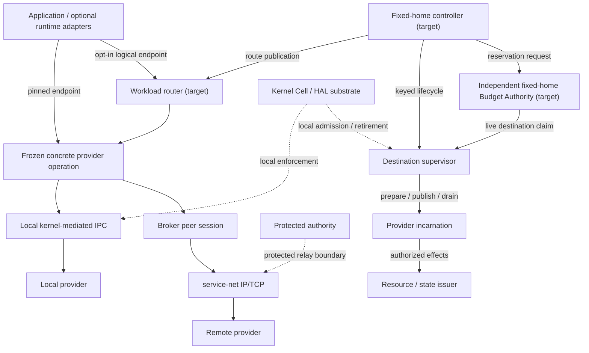
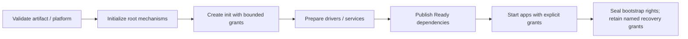
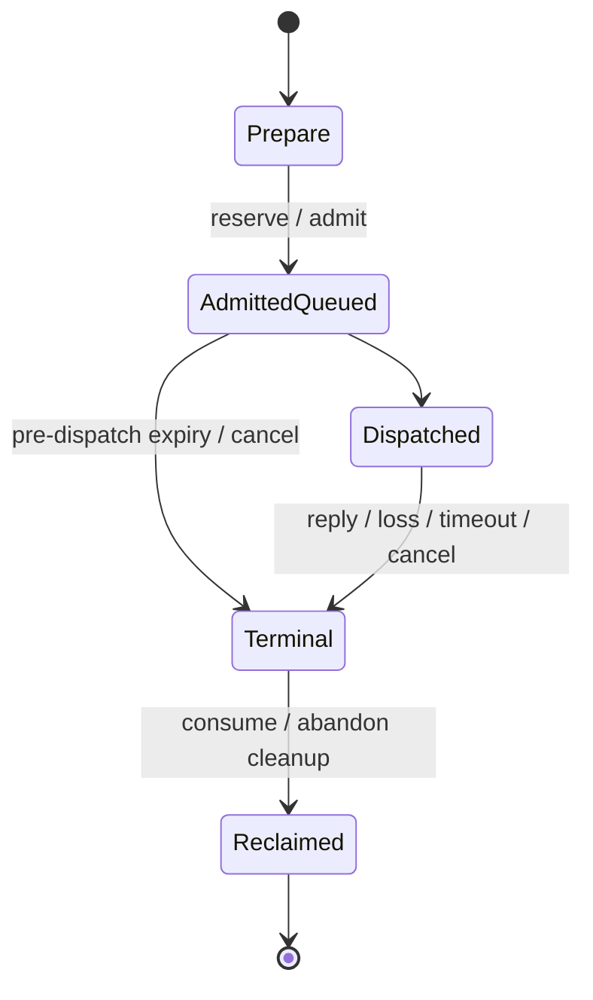
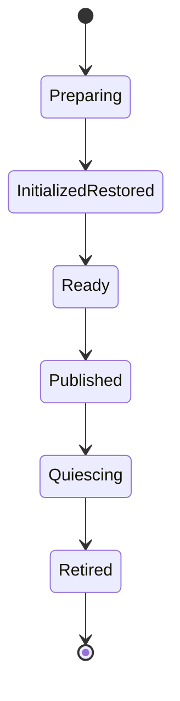

# Cellos System Architecture

**Audience:** developers integrating Cells, services and C2C consumers  
**Updated:** 2026-10-11  
**Scope:** operational architecture, ownership and implementation boundaries

## 1. Read this guide with the contracts

The selected architecture is **Cell-centric authority and recovery on a local
kernel substrate**, with explicit C2C transports and scoped cluster workload
policy. It is not a distributed kernel or a shared address space across machines.
The sole active development direction is **Intel x86-64 C2C Anywhere** under
[ADR-0022](decisions/0022-intel-x86-64-c2c-only-direction.md).

This guide explains the design and the reusable baseline; it does not ratify an
ABI or report that the selected design is implemented. In particular,
[Spec 25 v1.3](specs/25-cell-kernel-authority-contract.md) has **AC-01..AC-50 pending
implementation**. [Spec 26](specs/26-workload-placement-scaling-contract.md) supplies
normative workload routing, placement, application-budget and autoscaling detail
under that same acceptance ledger. The ten implementation phases remain pending;
documentation completion does not release the 38 scoped lock dispositions.

| Question | Authoritative source |
|---|---|
| Cell identity, Kernel Cell, authority, threads, operations and recovery | [ADR-0024](decisions/0024-cell-kernel-authority-contract.md), [Spec 25](specs/25-cell-kernel-authority-contract.md) |
| Logical workload routing, placement, budgets and autoscaling | [Spec 26](specs/26-workload-placement-scaling-contract.md) |
| What must remain privileged | [Spec 15 — Kernel Boundary Law](specs/15-kernel-boundary.md) |
| Isolation tiers | [ADR-0015](decisions/0015-dual-mode-hybrid-architecture.md), [Spec 18](specs/18-cell-trust-tiers.md), [Spec 22 implementation gate](specs/22-native-domain-cell-implementation-gate.md) |
| Runtime profiles and userspace POSIX translation | [ADR-0018](decisions/0018-cell-native-portability-and-runtime-profiles.md) |
| Existing local service binding and wire behavior | [ADR-0023](decisions/0023-local-service-generation-binding.md), [Spec 17](specs/17-ipc-wire-contract.md) |
| Essential command suite, typed pipelines and terminal/TUI boundaries | [ADR-0028](decisions/0028-cellbox-cli-first-structured-pipelines-and-tui.md), [Cellbox design](cellbox-cli.md); implementation pending |
| Current work admission | [Current focus](roadmap/current-focus.md), [plan portfolio](../.agents/plan-portfolio.md), [controlling plan](../.agents/261011-1200-cell-contract-authority/plan.md) |
| Recorded capability evidence | [Native SDK ledger](app-tier-acceptance-ledger.json), [review projection](app-tier-acceptance-matrix.md), [evidence directory](evidence/) |

**Precedence:** selected semantics do not reinterpret frozen bytes. Current
ratified ABI remains normative for running code until each exact approved
cutover. Conceptual CSpace, router and controller names below are target roles,
not proof of existing public symbols, opcodes, manifest fields or services.
Historical implementation statements in older documents retain their original
revision, architecture, feature and evidence ceiling.

## 2. Units and identities

A **node** is one kernel instance on physical hardware or in a VM. A **cluster**
contains multiple nodes. One Cell incarnation resides on exactly one node.
An application can comprise multiple Cells and compatible replicas across
selected nodes of one admitted cluster; it does not become one distributed Cell.

A **Cell** is the target authority principal, recovery boundary and resource
accounting unit. It owns one incarnation, shared capability space, admission
ceiling and namespace of granted service references. App, service, driver and
supervisor are roles, not privilege classes. Tier and locality are separate axes
and neither grants authority.

Threads are execution contexts inside a Cell. Libraries, arbitrary objects,
connections and individual requests are not independently scheduled Cells.
Hundreds of concurrent requests may use bounded operations and threads in one
Cell; adding replicas is an explicit workload policy decision.

| Identity | Meaning | Must not substitute for it |
|---|---|---|
| Node principal | Authenticated machine authority | IP address, beacon or discovery result |
| Boot/session incarnation | Non-reusable session under the admitted replay model | Uptime or an arbitrary timestamp |
| Cell incarnation | Local `(cell_id, generation)`; additionally node/boot-bound remotely | TID, executable path, role or service name |
| Thread identity | One execution context within one Cell incarnation | Independent authority or budget owner |
| Logical service identity | Publisher-controlled namespace binding | Permission to invoke or old resource inheritance |
| Object reference | Issuer incarnation, object generation and typed handle | Raw pointer or globally meaningful integer |
| Operation identity | Correlation within caller incarnation and retained lifetime | Reply order or provider worker TID |

Restart creates a fresh incarnation. Only the publication authority may rebind a
logical service. Generations and identifiers must fail closed before reuse/wrap
can alias retained or stale references. The exceptional kernel identity remains
reserved; this guide does not assume `CellId(0)` is already an ordinary record.

## 3. Ownership: local substrate, service semantics and policy

Kernel Cell is the **first, exceptional root principal**. Firmware entry,
platform/memory validation, privileged setup and creation of the first scheduler
context are its bootstrap stage. It does not need an already running scheduler
to create the scheduler. Internal kernel functions need not become queued RPCs.

| Owner | Responsibility | Boundary |
|---|---|---|
| Kernel Cell | Memory/domain protection; CPU scheduling and budget enforcement; kernel object capability integrity; safe copying/ownership; IRQ routing; mapping/TLB/DMA safety; atomic publish/retire; bounded fault capture | Local enforcement, not cluster connection or placement policy |
| Init and supervisors | Scoped bootstrap and lifecycle policy, dependency readiness, named subtree recovery | No transferable app root, arbitrary service control or override of kernel admission |
| VFS | Directory/file object tables, generations, resource rights and semantic checks | Typed service resources, not a duplicate kernel filesystem ACL |
| service-net | IP/TCP resources and network-service semantics | Transport resource ownership is not peer trust or workload policy |
| Broker | Peer sessions, bounded reusable connection pool, multiplexing, reconnect and qualified relay/direct selection | Cannot mint destination rights, scale workloads or replace protected relay TLS ownership |
| Protected authority | Peer trust and protected relay admission/TLS endpoint | No broker-owned TLS substitute or insecure fallback |
| Resource/state authority | Method/resource authorization, committed outcomes and writer fencing | Reachable endpoint or extra replica does not create effect authority |
| Workload controller/router | Explicit workload control and request routing described in section 9 | Proposed surfaces; not existing cluster runtime |

Kernel enforcement stays load-bearing while policy moves to Cells. Kernel code
must not synchronously call policy services while holding scheduler, memory or
authority locks. Services must validate their authoritative resource capabilities
and attested subjects, not spend broad downstream rights on arbitrary
caller-supplied paths or objects.

The kernel is bounded **by responsibility**, not a frozen line count or syscall
count. [Generated code metrics](code-metrics.generated.md) own size/trend evidence.
Board descriptors contain integration data; HAL owns hardware mechanisms rather
than application or cluster policy. Historical non-Intel board support is retained
without opening an active platform program.

## 4. Boot and readiness

The baseline has kernel initialization, an ELF/PIE loader, init, service Cells
and a shell. The selected target makes the authority and readiness handoff explicit:

Names, paths and parentage do not grant an application root authority. A prepared
or restored provider is not yet a published Ready provider. Startup failure must
remain invisible as a usable service, and control/router capacity must bootstrap
independently of the replicas it manages.

A supervisor may recover only its authorized subtree/set. Init or root-supervisor
restart is not assumed safe without a separately qualified recovery authority
and dependencies. Kernel failure or corruption outside the admitted isolation
boundary requires **node recovery**, not a successful ordinary Cell restart.

Use the [getting-started guide](getting-started.md) and the owning
[qualification plan](../.agents/261011-1200-cell-contract-authority/plan.md) for
image and runner selection. A historical seven-Cell boot list is not a universal
boot contract, and a generic workspace build does not qualify the architecture.

## 5. Capability authority: selected model and current gaps

The target is **typed object capabilities in one kernel-protected shared CSpace
per Cell incarnation**, with an immutable admission ceiling and explicit
post-start receive/delegate policy. The ceiling is an upper bound, not a grant.
Manifest declarations request rights; signatures establish artifact provenance.
Neither confers permission to every resource or operation.

Effective authority is the intersection of:

- issuer grant;
- delegator's live rights;
- destination admission ceiling and receive policy;
- applicable operator policy.

An opaque generational handle binds issuer/object identity, rights, holder
incarnation, revocation lineage and optional expiry. Invocation validates these
atomically with admission. Forged integers, wrong types, stale slots and another
Cell's handle fail before delivery or effect. Names resolve already-authorized
bindings or require a separately authorized bind operation.

Delegation requires a delegable right, named destination incarnation, subset
rights and bounded charged lineage. Close releases one holder reference; it is
not global revoke. Closing the original holder does not erase descendants'
revocation ancestry. Issuer death invalidates its local resource references;
creator death alone does not revoke independently held resources unless the
object/grant is explicitly owner-tied.

Revocation has two different milestones:

1. **Admission cut:** no new authorized operation may enter the revoked lineage.
2. **Quiesced completion:** mapped users, retained operations, CPUs/TLBs and device
   DMA no longer use the protected resource; storage can safely be reclaimed.

A dispatched effect is not rolled back by revocation. Missing CPU/device
acknowledgement means refusal or quarantine, never frame reuse. Validation and
cleanup use bounded lineage checks/batches, not an unbounded global traversal or
per-local-call cryptographic verification.

**Current gap:** the reusable baseline still contains per-task capability
snapshots/CapSet, name/path-selected launch policy and existing service-specific
checks. Those checks remain enforced until equivalent replacement is approved
and migrated. Current spawn-only VFS grants do not become post-start transferable
because the target allows bounded opt-in receipt. Shared CSpace, derivation,
whole-Cell revocation and every caller migration are pending P01/P02/P05 work.
The kernel must not create a competing copy of VFS/NET object ACLs.

## 6. Threads, budgets and SMP lifetime

The baseline has same-Cell thread creation and architecture-scoped runtime
mechanisms. It does not establish the complete target thread/authority model.

In the selected contract, each thread owns registers, stack, TLS/errno,
FPU/SIMD state and receive context. The Cell owns CSpace, namespace and aggregate
quotas. Per-thread sublimits may narrow an allowance; creating workers cannot
multiply rights or budget. Mutually distrusting components need separate Cells,
not separate threads in shared memory.

Budgets account for memory and stacks, threads, capability/lineage storage,
queued bytes, in-flight and retained operations, CPU runtime and delegated
resource leases. Terminal reservations stay charged until consuming take or
abandon cleanup. Node admission independently accounts aggregate Cell reservations
and refuses overflow before publication/effect. CPU entitlement is a scheduling
limit, not MHz, a request-capacity estimate or a hard-real-time promise.

Clean worker exit retires that thread and its owned operations. Root exit,
explicit Cell stop or an unhandled worker fault that can compromise shared Cell
memory retires the **whole incarnation**. No arbitrary worker becomes root.
This target rule changes narrower existing task-fault behavior and is gated.

Operation ownership remains tied to its owner thread. A same-Cell consumption
handle can hand off result consumption, not owner lifetime or a duplicate
reservation. Owner-exit cleanup and consuming take must linearize; only one
releases the result. Waiting alone does not transfer ownership.

Freeze/retirement closes thread and operation admission, captures participants,
quiesces running/switching contexts and fences resources before reclaim. A racing
spawn joins before the cutoff or fails without publication/leaks. Partial park or
shootdown acknowledgement is not success. Local CPU migration requires qualified
context-save and mapping behavior. **Cross-node threads and distributed shared
memory are not part of the design.**

## 7. C2C operations, data transport and failure

One operation contract spans synchronous wrappers, asynchronous local IPC and
future remote adapters:

Admission reserves terminal capacity before effect. Exact correlation binds
caller/provider incarnations; terminal and interrupt append paths do not allocate.
Concurrent producers/waiters must publish before wake, register/recheck before
park and allow exactly one consuming take. Scoped waits must not steal another
worker's terminal or exhaust a wait budget on unrelated retained results.

| Observed outcome | Meaning for the caller |
|---|---|
| Local Busy/refusal before acceptance | No effect through this submission |
| Pre-dispatch timeout/cancel | Dispatch prevented; this operation cannot execute later |
| Reply | Known application result, including failure; not automatic retry permission |
| Peer loss or timeout/cancel after dispatch | Effect may be uncertain; reconcile using application request identity |
| Transport loss after upstream admission | Not global refusal; retain/query or report uncertainty |

Cancellation acknowledges cancellation state, not transactional rollback.
Destination refusal is a distinct downstream result and does not erase upstream
admission. An old operation never silently retargets to a replacement; reconnect,
routing and scaling cannot replay or hedge ambiguous effects. Exactly-once side
effects require transactional application/state authority, not transport alone.

### Local and remote are the same contract, not the same mechanism

- **Copied IPC is the default.** Small messages are bounded kernel-owned copies.
- Large local buffers require explicit offset/length/rights, owner lifetime,
  pinning and revocation. Submission snapshots validated metadata. A raw pointer
  is not a capability.
- Local grants or rings are optional authorized data transports. SPSC assumptions
  do not support an MPMC workload; shared address reachability proves neither
  authority nor safe retirement.
- Remote frames serialize data or scoped exported resource references, never
  local pointers, grant IDs or CSpace slot integers.
- C2C hides transport mechanics, not latency, admission, deadlines, cancellation,
  provider loss or uncertain-effect behavior. Local failure is not implicit remote
  fallback.

### Reusable local baseline

[ADR-0023](decisions/0023-local-service-generation-binding.md) freezes
`LookupServiceBound` and provider `(tid, cell_id, generation)` binding. A TID is a
route, not the service principal; within-boot non-reuse is load-bearing. Existing
SDK synchronous/bounded RPC uses the kernel exact-operation lifecycle; immediate
replies use an exact receive context and nested/deferred work retains explicit
reply tokens. Same-incarnation workers may complete such work; foreign, duplicate
or late tokens cannot.

This is reusable implementation evidence, not completion of Spec 25's shared
CSpace, multi-wait ownership or retirement contract. [Spec 17](specs/17-ipc-wire-contract.md)
remains the ratified wire reference. [Spec 20](specs/20-unified-ipc-contract.md)
remains a draft remote contract, not a runtime-status oracle.

## 8. Recovery, state and remote authority

### Spawn and replacement

The target lifecycle is:

Lifecycle authority, publication authority and resource rights are separate.
Replacement validates provenance/reservations, restores committed business state,
reacquires issuer-approved resources and atomically switches the service binding.
Failure before publication rolls back without a visible provider or wider rights.
One-for-one recovery is the default; restarting dependents requires explicit policy.

Planned replacement stops old writer admission, drains/classifies mutations,
fences the writer and captures the **final committed-state watermark** at the
state authority. The replacement restores/catches up to that revision before
publication. A snapshot taken while old writes continue is insufficient. Crash
replacement also uses the authority's latest committed revision, not just the
worker's last checkpoint. Resuming a fenced old writer needs a fresh writer epoch.

An acknowledged mutation must survive the declared failure class before success:
independent RAM may cover worker failure; node/power loss needs durable
journal/checkpoint, flush and ordering semantics. Deduplicated recovery stores
request identity, outcome and state revision atomically. Missing, poisoned,
incompatible or uncommitted required state returns `RecoveryFailed`; an empty
cold start requires explicit application opt-in.

Serialized handles are not restored live authority. Files, sockets and sessions
need resource-specific reacquisition; state serialization alone preserves none
of them. State authority has its own recovery domain; no universal state service
is mandated. Whole-kernel warm snapshot is separately gated and is not a Cell
recovery prerequisite or measured warm-boot claim.

Before reclaim, the kernel captures bounded fault evidence with node/boot,
Cell/thread incarnation, artifact and known operation/state correlation. A
Diagnostics Cell persists/symbolicates outside trap context. Buffer bounds and
dropped-record counts are observable; diagnostic failure cannot prevent termination.

### Across nodes

A remote binding includes authenticated node, boot/session, service/export and
provider generation. The source kernel attests its local principal; an admitted
node authority vouches for it. Sending a claimed CellId does not authenticate an
end user. Exports are destination-owned, subject/audience/method/resource-bound,
epoch-fenced and expiry/revocation-limited. Peer authentication or connection
reachability does not grant method authority.

Broker sessions multiplex bounded operations over service-net IP/TCP resources.
**Relay-first** remains the baseline; direct LAN needs separate locality,
authority and qualification gates. [ADR-0008](decisions/0008-protected-relay-tls-endpoint-ownership.md)
and [ADR-0009](decisions/0009-correlate-relay-packet-failures.md) retain protected
TLS ownership and correlated failures. No local plaintext/software-root shortcut
substitutes for their protected route.

A remote create uses durable intent, stable creation key, same-boot kernel
publication record and durable result. Coordinator restart reconciles by key
before spawning again. A destination reboot ends the old incarnation; original
create identity is not permission to recreate it silently. Lost result persistence
means pending/uncertain, not another privileged child.

Mutable partition behavior is fail-closed at admission and the effect/commit
boundary. Cached pre-partition authorization cannot admit a new mutable request;
already dispatched effects may finish and remain uncertain. Global revoke stays
pending until required destination/commit acknowledgements arrive.

Queues subtract monotonic residence time rather than resetting deadlines per hop.
Without qualified clock/error bounds, a remote destination cannot prove origin
absolute expiry during transit. It enforces receipt-relative bounds while the
origin enforces its end-to-end limit and reports post-dispatch uncertainty.
Origin-time cutoff semantics require authenticated expiry plus conservative clock
bounds and commit-time checks, or the method remains unavailable.

**Single writer per mutable state domain** is the baseline. The state/fencing
authority has one assigned home and recovers durable epochs/revisions before
mutation admission. Timeout or partition cannot promote another authority.
Multi-writer consensus, authority-home failover, transparent relocation and
federation are not implied by cluster workload policy.

## 9. Workload routing, placement and autoscaling: selected, not shipped

[Spec 26](specs/26-workload-placement-scaling-contract.md) selects three separate
decisions: routing chooses an existing replica, placement chooses where to create
a replica, and autoscaling changes desired count from admitted demand. Saturation
is not authority to spawn, spill over remotely or replay a request.

### Endpoints and request routing

Concrete generation-bound endpoints remain **pinned**. A caller must explicitly
opt into an authorized **logical workload endpoint** for replication-compatible
typed methods with matching schema/effect semantics. Stateful shard/writer/session
affinity follows an approved ownership map; unavailable ownership is not permission
to use an independent copy. Automatic resharding/session migration is excluded.

A router Cell at each admitted ingress node owns bounded admission, FIFO queue,
replica selection and correlated completion. It preserves original attested subject
and delegated scope; it cannot use ambient router rights as caller authority.
Selection binds one concrete provider generation and route revision **before
submission**. One selected submit attempt is frozen: refusal is returned, while
ambiguous outcomes are neither retried nor hedged.

The selected algorithm is **bounded weighted round-robin** over authorized Ready
members. Stable replica order and normalized positive integer concurrency weights
produce a precomputed finite slot cycle (A:2/B:1 gives A,A,B). Member/slot bounds,
cursor inspection and preallocated counters make selection bounded. Ineligible,
draining, stale or saturated members are skipped; destination admission remains
authoritative. Locality may add an explicit bounded weight, not unconditional
local preference or a promise of equal throughput.

Per-router per-replica in-flight shares fit the replica envelope. Router restart
must fence its prior generation and reconcile retained work before reusing shares.
No silent share borrowing or fresh allowance per ingress. Queue capacity, subject
limits and remaining deadlines bound waiting; expiry removes work before dispatch.
A TCP connection or heartbeat alone is not Ready.

### Placement and one application budget

The controller owns desired replicas, placement/scaling policy and versioned
membership. Independent fixed-home **Budget Authority Cell** enforces durable
application reservations and fences; controller cannot mint allowance. Budget
Authority and destination kernel are the enforcement TCB. Application issuer
precommits genesis and control envelopes before spawn; supervisor consumes a
one-use keyed bootstrap grant rather than inventing an initial balance.

Authority reserves the finite vector before create dispatch; destination performs
a live atomic claim before publication. Authority/controller/router overhead and
preparing/live/draining/unknown children remain charged. Unknown claim fails closed;
same-key recovery cannot create another allowance. No offline copied budget lease.

Placement filters granted destinations, artifact/tier/architecture, resource and
state-locality constraints and fresh authenticated capacity. Rank eligible nodes
by fewest application-charged replicas, greatest normalized resource headroom,
then stable NodeId. Capacity observations are hints; atomic destination admission
can refuse a raced request without effect. Ambiguous creates reconcile before
another placement, not implicit spillover.

Growing an envelope reserves its positive delta before destination acceptance.
Shrink below charged use remains a pending target with new growth closed; safe
drain/reconciliation must fit it before adoption. It is not forced request loss,
grant revocation or an already-satisfied lower budget. Release needs proof of
absence/retirement and key closure against delayed publication, never timeout,
unreachable node or stale inventory.

### Bounded demand-based scaling and outage

Only authorized eligible queued-plus-in-flight requests contribute once, within
an explicitly homogeneous interchangeable template/resource/concurrency domain.
Receiver-start bounded nonce challenges cover routes, health, capacity and telemetry;
late unseen higher sequences cannot renew age from arrival. A prior unresolved
ingress generation remains required until authoritative operation reconciliation
and retired-share fencing; a new generation's zero cannot erase it. Both scale
directions freeze while coverage is incomplete.

Each domain computes `clamp(ceil(demand / targetConcurrencyPerReplica), min, max)`
with hysteresis/cooldown/rate/pending bounds and shared application budget. Affine
or noninterchangeable unmet demand reports unsatisfied, not a useless sibling.

Scale-to-zero requires explicit policy and charged always-on Authority/controller/router
capacity. Authorized cold wakes are bounded/coalesced into one creation intent;
requests retain ordinary queue/deadline limits and expired work never replays.
Scale-down withdraws routing, closes destination admission, drains/classifies
accepted work, retires and releases proven charge in that order. Long streams and
state ownership cannot migrate merely to meet a replica target.

Controller outage may leave healthy replicas serving only within reserved shares,
valid/fresh unchanged membership and **live destination authority/state fencing**.
A cached route is not cached authorization. No placement, resize, scaling or
budget release proceeds without recovered durable ledger/epoch. Partition cannot
promote another controller or state home. Stale routers cannot bypass a destination
drain cutoff.

Destination Ready evidence independently binds artifact/tier/application/reservation/
creation key/export/schema/generation. Origin proof binds immutable payload, deadline
and operation; origin kernel/approved issuer seals one concrete target and permits
only that attenuation. Router cannot mint a second target. Incarnation maxima remain
immutable; live allocation growth reserves its delta, above-max growth needs explicit
replacement and below-use shrink stays pending.

## 10. Isolation tiers, native SDK and optional POSIX

[ADR-0015](decisions/0015-dual-mode-hybrid-architecture.md) retains three execution
tiers. Tier, language/runtime profile, SDK module, stability and availability are
separate dimensions; a source symbol or successful compilation alone is not
qualified support.

| Tier | Selected boundary | Qualification caveat |
|---|---|---|
| Tier 1 trusted SAS | Admitted safe Rust plus audited unsafe driver/substrate; shared address space and authorized local data sharing | Not a hostile native-code sandbox; unsafe/FFI corruption can defeat language isolation. Signing/provenance is not a resource grant or physical security proof. |
| Tier 2 native domain | Private hardware page-table domain for untrusted/FFI native code; copied IPC and explicitly qualified grants | Requires architecture-specific admission, pointer-copy, switch, revoke and DMA lifetime proof. Failure never downgrades to SAS. |
| Tier 3 VM guest | Hardware guest boundary for whole Linux stacks; scoped C2C bridge with separate guest authority | Guest boot or AMD SVM evidence does not qualify Intel VMX/EPT, guest routing or production security. |

The one [Native SDK contract](specs/23-native-sdk-contract.md) defines named modules,
not a numbered SDK-tier hierarchy. Evidence is per exact target/profile/module in
the [acceptance ledger](app-tier-acceptance-ledger.json); bounded runtime witnesses
do not silently promote every SDK cell or production-admission profile.

Native Rust and native C/C++ use C2C **without requiring POSIX**. Under
[ADR-0018](decisions/0018-cell-native-portability-and-runtime-profiles.md) and the
Spec 25 amendment, optional local adapters own libc/C++ ABI, allocator, fd maps,
errno/TLS and pthread object layout. A domain-selected personality Cell can supply
only required process/job/session semantics over native services. Boot, lifecycle,
VFS and NET do not depend on a universal POSIX broker.

Privileged TLS installation, wait/wake or bounded stream mechanisms may remain
kernel-owned when Spec 15 requires it; Unix fd semantics do not. The current shim
and runtime primitives are reused, but removing ambient POSIX linkage and migrating
all consumers remains P07 target work. Consult the
[generated POSIX shim contract](guides/posix-shim-contract.generated.md) for actual
symbols and failures. Do not infer Linux binary ABI, `fork`, full signals, dynamic
loading or hosted C++ from the freestanding profile or compatibility terminology.

## 11. Current baseline, remaining gates and execution ownership

This is a compact boundary summary, not a duplicate milestone ledger. Retained
witnesses below describe their recorded images and environments; none is a new
check performed by this documentation change.

| Area | Reusable baseline / recorded evidence | Not established by that evidence |
|---|---|---|
| Local service identity and RPC | Frozen ADR-0023 binding; SDK exact-operation stranding cutover ([raw witness](evidence/c2c-stranding-cutover-x86.log)) | Shared Cell CSpace and full Spec 25 wait/retirement contract |
| Bounded operation behavior | x86 QEMU saturation, deadlines and caller-death [record](evidence/c2c-saturation-deadline-caller-death-x86.txt); replacement/raw-event [record](evidence/c2c-restart-event-coexistence-x86.txt); peer pressure [record](evidence/c2c-peer-pressure-x86.txt) | Unbounded starvation freedom, full all-profile/SMP qualification or remote operation |
| Cross-tier local calls | Named Tier-2/VFS and refusal [record](evidence/c2c-named-tier2-service-x86.txt) | Protected remote exports or cross-node guest authority |
| x86 Tier 2 and C++ | CR3-isolated `cpp-freestanding` [QEMU record](evidence/c2c-x86-cpp-freestanding-runtime.txt); subsequent TCG/KVM/VMware domain [record](evidence/vmware-domain-test.txt). Portfolio records later switch-ordering gate closure. | Physical Intel qualification, hosted C++, every runtime/SDK admission row or production security |
| Intel platform | QEMU controller and boot evidence retained in the portfolio and board records | Physical HCL row, exact NIC/storage qualification or two identified Intel-node acceptance |
| Intel Tier 3 | Existing ARM guest and AMD SVM/QEMU reference evidence retained | Intel VMX/EPT guest execution/qualification and complete guest bridge target |
| Broker/relay | Local broker/oracle and protected-authority software records retained | Protected two-node relay runtime, qualified direct LAN or public/production export |
| Workload control | Spec 26 selected design only | Shipped router/controller, cluster runtime, load balancing or automatic scaling |
| Recovery/performance | Existing supervision/state mechanisms and scoped measurements retained | Complete committed-state recovery, qualified warm snapshot, hard-RT bound or faster-than-Linux result |

The October x86 Tier-2/runtime records supersede this guide's former September
blanket x86-refusal statement **within their recorded scope**. They do not close
physical, protected-authority or production evidence gaps. Likewise, completed
non-Intel HAL, RPi3, graphics/ViUI, AI and runtime work remains evidence, not an
active scheduling program.

### Ten pending implementation phases

The [controlling plan](../.agents/261011-1200-cell-contract-authority/plan.md) owns
exact dependencies, approval revisions, migration inventories and runtime proof.
This phase map is orientation only; every phase remains pending:

| Phase | Cutover responsibility |
|---|---|
| P01 | Exact contract/ABI delta inventory, adoption and approval gates; non-activating documentation/evidence preparation |
| P02 | Kernel Cell, shared CSpace and bounded delegation |
| P03 | Threads, SMP retirement and aggregate budgets |
| P04 | Unified operation ownership and multi-wait completion |
| P05 | Service resources, namespaces and device/buffer revoke |
| P06 | Recoverable lifecycle, committed state and crash evidence |
| P07 | Optional POSIX and native runtime cutover |
| P08 | Protected distributed transport/lifecycle, budgets/placement, workload routing, autoscaling and failure reconciliation |
| P09 | Intel VMX prerequisite and explicit guest adapters |
| P10 | Profile qualification, actual concurrent/load-driven scenarios and same-hardware Linux comparison |

P08's ordered slices are transport/lifecycle → budget/placement and authoritative
membership → routing/admission → autoscaling/reconciliation → combined failure
qualification. These are not extra phases. P10 must observe at least 200 actually
overlapping clients and real load-triggered reserved creation, Ready routing and
safe drain; pre-spawned replicas or a client count alone is not autoscaling proof.

**CELL-CONTRACT-0024** retains all **38 lock dispositions** in the
[lock register](../.agents/cell-contract-0024-locks.md). Completed evidence is
preserved; overlapping unfinished plans are suspended, not implicitly resumed.
A maintainer-admitted rebased slice needs exact file-owner handoff, applicable
Law-1 checkpoints and portfolio selection. One implementation slice is active at
a time. No old `ready`, checkbox, cook command or completed prerequisite bypasses
the lock. Exact public/persistent layouts and profile parameters remain gated.

### Evidence and production boundaries

The evidence ladder is `none → contract → host → QEMU → physical → service →
production`. Host/QEMU/VMware results are software or virtualized evidence, not
physical Intel, protected-root, service or production qualification. Two QEMU
nodes cannot satisfy a physical two-node acceptance claim. Metrics need exact
workload, revision, configuration and environment; no universal Linux speedup or
latency number is asserted here.

Production admission remains fail-closed behind applicable protected identity,
authenticated time/persistence, qualified rollback-resistant floor/root,
secure/measured boot, physical hostile evidence, human approvals and governed
release closure. [ADR-0006](decisions/0006-block-production-root-pending-exact-product-evidence.md)
retains the root-selection gate; [ADR-0013](decisions/0013-solo-first-development-independent-promotion.md)
retains independent promotion rules. Automated agents/CI are assurance, not the
required independent human approval. Missing external evidence blocks its named
promotion without globally prohibiting bounded local software work.

## 12. Evidence navigation and maintenance

Historical logs are intentionally not duplicated in this guide. Use existing
sources, preserving their original scope:

- [Project roadmap](project-roadmap.md) and [legacy roadmap](project-roadmap-legacy.md):
  milestone inventory, historical platform/feature results and source-plan links.
- [Plan portfolio](../.agents/plan-portfolio.md): completed Intel C2C execution
  ledger, runtime/platform records and parked work; historical admissions do not
  supersede the controlling plan or locks.
- [Evidence directory](evidence/): retained raw logs and scoped verification reports.
- [Native SDK acceptance ledger](app-tier-acceptance-ledger.json) and its
  [review projection](app-tier-acceptance-matrix.md): content-addressed capability
  witnesses and qualification status, not blanket support from source availability.
- [Generated spec status](spec-status.generated.md) and
  [code metrics](code-metrics.generated.md): generated projections/trends, not
  scheduling or promotion authority.
- [Hardware compatibility list](hardware-compatibility-list.md), board guides and
  the [current focus](roadmap/current-focus.md): exact platform gates and admitted
  direction rather than obsolete multi-architecture development ordering.

When a cutover lands, update only the relevant ownership/status boundary here and
link its canonical contract and recorded evidence. Keep measured results and
phase-local logs in their owners. A guide edit neither ratifies new ABI bytes nor
releases locks, enables a feature or promotes evidence.

**Revision note — 2026-10-11:** replaced the cumulative architecture/status ledger
with this bounded guide; aligned identity/ownership with Spec 25 v1.3 and workload
policy with Spec 26; retained access to existing historical evidence without
creating an archive or changing implementation/qualification status.
